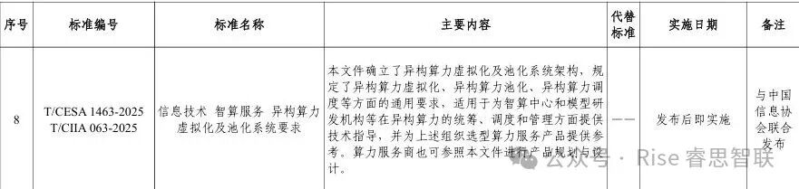
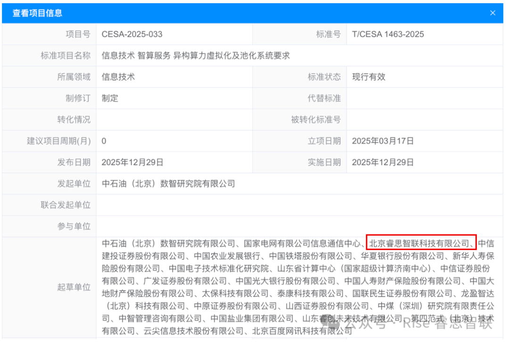

[简体中文](./README.md) · [All articles](../../README.en.md) · [Read on the website](https://www.theriseunion.com/en/blog/riseunion-participates-in-intelligent-computing-service-standard-formulation.html)

# RiseUnion Co-Authors Intelligent Computing Service Standards, Advancing Heterogeneous Compute Orchestration

RiseUnion · December 31, 2025 at 08:00 (UTC+08:00)

RiseUnion, as a key drafting unit, co-authored the 'Heterogeneous Compute Virtualization and Pooling System Requirements' standard. This standard defines core architectures for virtualization, pooling, and intelligent scheduling, providing authoritative guidance for intelligent computing centers and enterprises, and driving industry standardization.

On December 31, 2025, the China Electronics Standardization Institute (CESI) officially approved and published 28 group standards, including "Technical Requirements for AI Supernode Servers." Beijing RiseUnion Technology Co., Ltd. (RiseUnion), as a key drafting unit, collaborated with PetroChina (Beijing) Digital Intelligence Research Institute, State Grid Information & Telecommunication Group, 4Paradigm, and other leading organizations to co-author the **"Information Technology - Intelligent Computing Service - Heterogeneous Compute Virtualization and Pooling System Requirements"** (Standard No. T/CESA1463-2025/T/CIIA063-2025). This standard establishes a unified technical benchmark for heterogeneous compute management in the industry.

As a core player in the intelligent computing sector, RiseUnion deeply participated in the technical architecture design and core requirement discussions during the standard's formulation. Leveraging profound technical expertise in heterogeneous compute virtualization, pooling, and scheduling, RiseUnion helped shape a comprehensive and scientific technical specification system.

The standard defines the core architecture for heterogeneous compute virtualization and pooling technologies. It establishes general technical requirements across critical dimensions such as virtualization implementation, pooled resource integration, and intelligent scheduling mechanisms. The scope covers various compute consumers, including intelligent computing centers, large model R&D institutions, and AI application operators. It not only provides professional technical guidance for the unified management and efficient scheduling of heterogeneous compute resources but also serves as an authoritative reference for selecting compute service products. Simultaneously, compute service providers can reference these requirements for product planning and design, further standardizing industry service quality.

Crucially, the drafting process attracted deep participation from multiple customer units. This demonstrates high market recognition of the standard's technical direction and lays a solid foundation for its widespread adoption. Moving forward, enterprises can utilize the technical requirements specified in the standard as a basis for procurement, effectively reducing selection risks and improving cooperation efficiency.

The release of this standard marks a significant step towards standardization and regulation in the heterogeneous compute service domain. RiseUnion will continue to play a leading technical role, driving the implementation of the standard and working with industry partners to build an efficient and reliable intelligent computing ecosystem, injecting strong momentum into the high-quality development of the AI industry.

-> Related Link: https://www.cesa.cn/tb/detail?id=547

---

[Read this article on the RiseUnion website](https://www.theriseunion.com/en/blog/riseunion-participates-in-intelligent-computing-service-standard-formulation.html) · [Explore more articles](https://www.theriseunion.com/en/blog.html)
