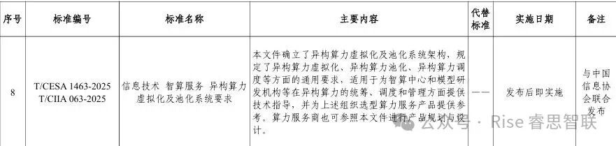
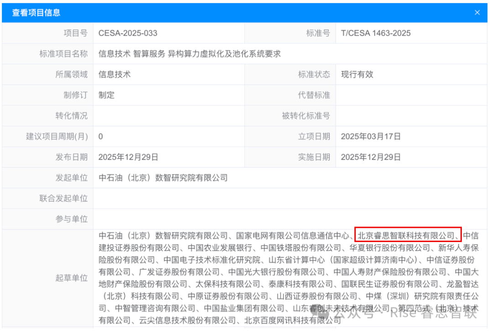

[English](./README.en.md) · [文章目录](../../README.md) · [官网阅读](https://www.theriseunion.com/zh/blog/riseunion-participates-in-intelligent-computing-service-standard-formulation.html)

# 睿思智联深度参与智算服务标准制定 推动异构算力协同管理与广泛应用

睿思智联 · 2025/12/31 08:00（北京时间）

睿思智联作为主要起草单位，联合多家头部企业共同制定《信息技术 智算服务异构算力虚拟化及池化系统要求》团体标准。该标准确立了异构算力虚拟化、池化及智能调度的核心架构与通用技术要求，为智算中心及AI企业提供权威技术指导，推动行业规范化发展。

2025 年 12 月 31 日，中国电子工业标准化技术协会正式批准并公布《人工智能超节点服务器技术要求》等 28 项团体标准，其中由北京睿思智联科技有限公司（以下简称 “睿思智联”）作为主要起草单位，与中石油（北京）数智研究院有限公司、国家电网有限公司信息通信中心、第四范式（北京）技术有限公司等多家头部单位共同起草、制定的《信息技术 智算服务异构算力虚拟化及池化系统要求》（标准编号 T/CESA1463-2025/T/CIIA063-2025），为行业异构算力管理树立了统一技术标杆。

作为智算领域的核心参与者，睿思智联在该标准制定过程中深度参与技术架构设计与核心要求研讨，凭借在异构算力虚拟化、池化及调度领域的深厚技术积累，推动标准形成了全面、科学的技术规范体系。

该标准明确了异构算力虚拟化及池化技术的核心架构， from 异构算力虚拟化实现、池化资源整合、智能调度机制等关键维度，制定了通用技术要求。其适用范围覆盖智算中心、大模型研发机构、人工智能应用运营方等各类算力使用主体，既能为异构算力的统筹管理、高效调度提供专业技术指导，也能为相关组织的算力服务产品选型提供权威参考依据。同时，算力服务商可参照标准要求开展产品规划与设计，进一步规范行业服务质量。

值得关注的是，标准起草过程中吸引了多家客户单位深度参与，这不仅体现了市场对标准技术方向的高度认可，更为后续标准的广泛推广与落地应用奠定了坚实基础。未来，客户可将标准规定的技术要求作为采购依据，有效降低选型风险，提升合作效率。

此次标准的发布，标志着智算服务异构算力领域逐步走向规范化、标准化发展阶段。睿思智联将持续发挥技术引领作用，推动标准落地实施，与行业伙伴共同构建高效、可靠的智算生态体系，为人工智能产业高质量发展注入强劲动力！

-> 相关链接：https://www.cesa.cn/tb/detail?id=547

---

[在睿思智联官网阅读本文](https://www.theriseunion.com/zh/blog/riseunion-participates-in-intelligent-computing-service-standard-formulation.html) · [浏览更多文章](https://www.theriseunion.com/zh/blog.html)
