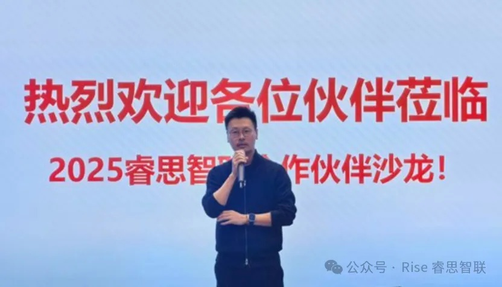

[简体中文](./README.md) · [All articles](../../README.en.md) · [Read on the website](https://www.theriseunion.com/en/blog/riseunion-partner-salon-2025.html)

# From Compute Build to Operations: Channel Portfolio Launch

RiseUnion · December 19, 2025 at 08:00 (UTC+08:00)

RiseUnion 2025 Partner Salon launches channel product portfolio with Basic, Advanced, and Enterprise editions. Shares compute pooling, heterogeneous adaptation, and unified orchestration practices to improve compute utilization and achieve commercial scale across finance, government, and research sectors.

On December 18, 2025, **RiseUnion** hosted its **2025 Partner Salon** at Modu World in Beijing's Economic-Technological Development Area. The event brought together representatives from more than **30 companies across the industry chain**, including Kunlunxin (Beijing) Technology Co., Ltd. and Beijing Shenzhou Guangda Technology Co., Ltd., for discussions on compute resource management, intelligent computing infrastructure, and channel collaboration.

The salon centered on a critical question facing the industry:

> As demand for intelligent computing surges and compute architectures continue to diversify, how can organizations achieve **real-world deployment** and **commercial scale** through more effective **compute resource management**?

## From Building Compute to Operating It: A New Industry Phase

Compute has evolved beyond hardware deployment—it's now a strategic asset that requires ongoing operations. With domestic GPUs and NPUs gaining traction and AI applications penetrating deeper into industries, the bar for compute management has been raised. Organizations need more than just **access**; they need **efficiency, control, and clear accountability**.

Kicking off the event, RiseUnion's CEO noted:

> As large models and enterprise AI applications scale, compute resource management has become the critical link between chip capabilities and business outcomes. The competitive landscape is shifting—it's no longer about who has the most compute, but who can deliver **better utilization, smarter scheduling, and faster time-to-value**.

RiseUnion then shared its latest work in compute pooling, heterogeneous chip support, and unified orchestration, drawing on real deployments across financial services, government, enterprise, and research institutions.

## Proven in Production: Replicable and Scalable

During the case study session, RiseUnion's solutions team walked through several production deployments that demonstrate the business impact of effective compute management:

* **Large state-owned enterprises**: Unified orchestration and granular resource management drove significant GPU utilization gains, improving ROI for IT leadership;
* **Mid-market companies**: Multi-chip, heterogeneous environments where resource fragmentation and operational silos were eliminated, solving the "not enough compute" paradox;
* **Small and medium businesses**: Lowering the barrier to entry enabled on-demand allocation and rapid model deployment.

These examples showcase **replicable, scalable delivery**—demonstrating RiseUnion's engineering maturity, measurable results, and business value.

## The Big Announcement: RiseUnion Channel Product Portfolio

The centerpiece of the salon was the launch of RiseUnion's **Channel Product Portfolio**. Designed for different partner and customer segments, the portfolio includes:

* **Basic Edition**: Core compute resource management and orchestration for SMEs and entry-level intelligent computing use cases;
* **Advanced Edition**: Enhanced scheduling strategies and data operations for mid-to-large enterprises expanding their compute footprint;
* **Enterprise Edition**: End-to-end intelligent compute control and customization for large organizations with complex requirements.

This isn't a one-off project partnership model—it's a sustainable, repeatable productized approach to collaboration.

Attendees noted the portfolio's clear functional boundaries, version differentiation, and use case alignment, providing a solid foundation for market collaboration.

## Trends, Collaboration, and Real-World Impact

The discussion session explored several key themes:

* Where the intelligent computing industry is heading over the next 2–3 years and what will drive change;
* How chip vendors, platform providers, and channel partners can best work together;
* How compute management capabilities can be deployed across different industry verticals.

A clear consensus emerged:

> **Compute resource management is becoming a neutral foundational capability in the intelligent computing ecosystem—one whose value multiplies through multi-party collaboration.**

## Connecting Through Channels to Unlock Value

Looking ahead, RiseUnion will continue evolving the channel product portfolio, strengthening delivery support and ecosystem partnerships. Together with partners, we'll bring compute management capabilities to more industries and unlock the long-term value of intelligent computing infrastructure.

> Compute isn't just about building—it's about operating.

RiseUnion looks forward to partnering with more organizations to build a sustainable, scalable approach to compute resource management in the intelligent computing era.

---

[Read this article on the RiseUnion website](https://www.theriseunion.com/en/blog/riseunion-partner-salon-2025.html) · [Explore more articles](https://www.theriseunion.com/en/blog.html)
