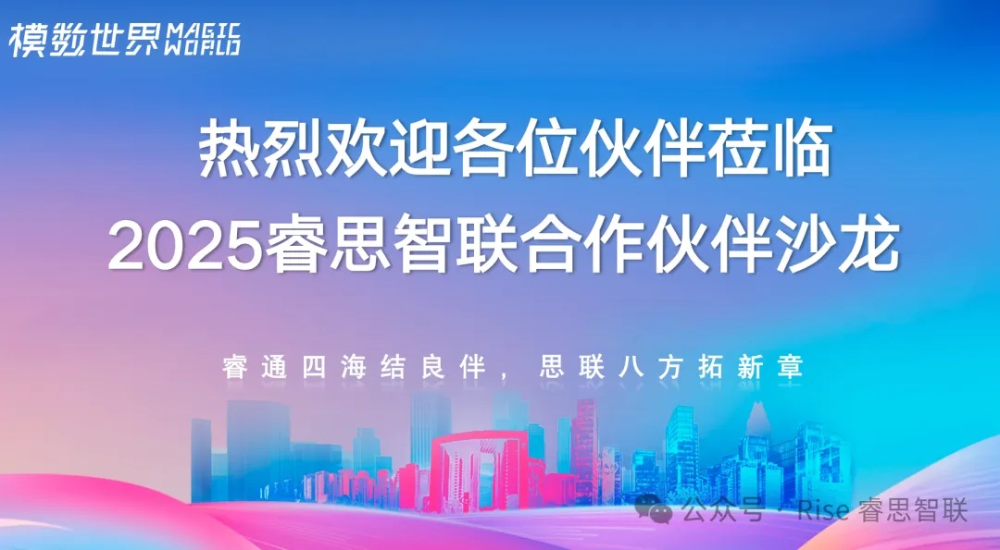
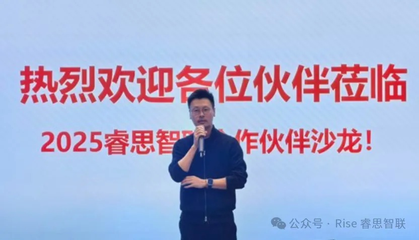

[English](./README.en.md) · [文章目录](../../README.md) · [官网阅读](https://www.theriseunion.com/zh/blog/riseunion-partner-salon-2025.html)

# 从算力建设到运营：睿思智联发布渠道产品体系

睿思智联 · 2025/12/19 08:00（北京时间）

睿思智联2025合作伙伴沙龙发布渠道产品体系，涵盖基础版、进阶版、旗舰版三大版本。分享算力池化、异构适配、统一调度等实践，助力企业实现算力利用率提升与商业规模化。适用于金融、政企、科研等场景。

2025 年 12 月 18 日，北京亦庄经济开发区模数世界内，北京睿思智联科技有限公司（以下简称“**睿思智联**”）举办 **2025 合作伙伴沙龙**。来自昆仑芯（北京）科技有限公司、北京神州光大科技有限公司等 **30 余家产业链企业代表** 齐聚现场，围绕算力管理、智算基础设施与渠道协同展开深入交流。

本次沙龙聚焦一个核心问题：

> 在智算需求快速增长、算力形态持续分化的背景下，如何通过更高效的 **算力管理** 体系，实现 **技术落地** 与 **商业规模化**？

从“算力建设”走向“算力运营”，行业进入新阶段
当前，算力已从单纯的硬件建设，演进为可持续运营的关键生产要素。国产 GPU / NPU 加速普及、行业应用不断下沉，也对算力管理能力提出了更高要求：不仅要 **“用得上”**，更要 **“用得好、管得住、算得清”**。

沙龙开场，睿思智联 CEO 致辞：

> 随着大模型与行业智能应用进入规模化阶段，算力管理正成为连接芯片能力与业务价值之间的关键一环。未来的竞争，不再只是算力规模的竞争，而是 **算力利用率、调度效率与交付能力** 的综合竞争。

围绕这一判断，睿思智联继续分享了其在算力池化、异构适配与统一调度方面的最新实践进展，以及在金融、政企、科研等场景中的落地经验。

## 真实场景验证能力：“可复制、可规模化”

在案例分享环节，睿思智联解决方案负责人通过多个已实践的行业经验，展示了算力管理能力在实际业务中的价值体现：

* 在某大型央企环境中，如何通过统一调度与资源精细化管理，显著提升 GPU 利用率，帮助 CIO 提升投入产出比；
* 在某中型企业多芯片、异构算力的复杂环境中，如何解决资源碎片化与管理割裂问题，解决算力不足的悖论；
* 在某中小企业日常工作中，如何通过降低算力使用门槛，实现按需分配与快速部署各类模型。

这些案例围绕 **“可复制、可规模化交付”** 深度展开，全面介绍了睿思智联在工程化落地层面的进展、成果及商业价值。

## 核心发布：睿思智联渠道产品体系正式亮相

本次沙龙的重点环节，是睿思智联 **渠道产品体系** 的正式发布。围绕不同类型合作伙伴与客户需求，睿思智联推出了多种渠道产品：

* **基础版**：聚焦算力资源管理与基础调度能力，适合中小企业与初级智算场景；
* **进阶版**：在基础能力之上强化调度策略与数据运营，满足中大型客户的算力扩展需求；
* **旗舰版**：面向大型客户的复杂场景，提供全链路智能算力管控与定制化能力支持。

这一产品体系，不是“单点项目型合作”，而是可持续、可复制的产品化合作模式。

多位参会伙伴表示，该渠道体系在功能边界、版本划分与适配场景上具备较高清晰度，为后续市场协同提供了明确的支撑。

## 聚焦趋势与合作，推动协同落地

在随后的交流讨论中，与会嘉宾围绕以下议题展开深入探讨：

* 智算行业未来 2–3 年的发展节奏与关键变量；
* 芯片厂商、平台厂商与渠道伙伴之间的协作边界；
* 算力管理能力在不同行业场景中的落地路径。

讨论重点逐渐形成共识：

> **算力管理正在成为智算生态中的“中立基础能力”，其价值将在多方协作中被进一步放大。**

## 以渠道连接，共同释放算力价值

未来，睿思智联将围绕渠道产品体系持续迭代能力，强化交付支持与生态协同，与合作伙伴共同推动算力管理能力在更多行业场景中落地，释放智算基础设施的长期价值。

> 算力不止于建设，价值来自运营。

睿思智联期待与更多伙伴携手，在智算时代构建可持续、可规模化的算力管理新范式。

---

[在睿思智联官网阅读本文](https://www.theriseunion.com/zh/blog/riseunion-partner-salon-2025.html) · [浏览更多文章](https://www.theriseunion.com/zh/blog.html)
