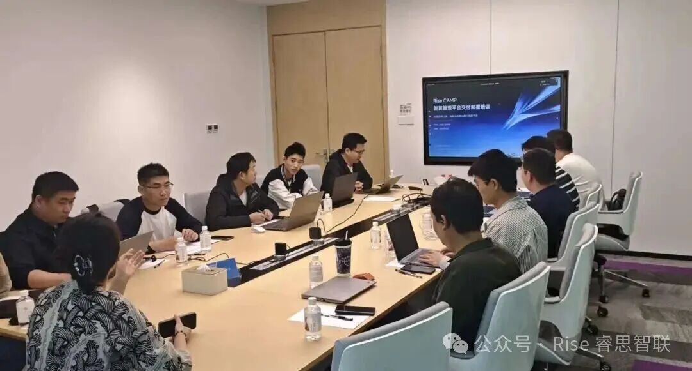

[简体中文](./README.md) · [All articles](../../README.en.md) · [Read on the website](https://www.theriseunion.com/en/blog/riseunion-partner-training-2026q1.html)

# RiseUnion Hosts 2026 Q1 Partner Delivery Engineer Training for AI Compute Management Platform

RiseUnion · April 27, 2026 at 08:00 (UTC+08:00)

As AI moves into large-scale enterprise deployment, the core challenge has shifted from 'having compute' to 'using compute well'. RiseUnion recently hosted a partner delivery engineer enablement program for the AI compute management platform, transferring its standardized delivery framework, troubleshooting methodology, and heterogeneous compute management practices to channel partners — building an elite force ready to serve enterprises across industries.

As AI enters its large-scale deployment phase, the core challenge for enterprises has shifted from "having compute" to "using compute efficiently, reliably, and simply". To address industry pain points and grow alongside our partners, RiseUnion recently hosted the **AI Compute Management Platform Channel Partner Delivery Engineer Enablement Training**.

## Building an Elite Force for AI Compute Infrastructure

This training was designed to transfer the standardized delivery system, systematic troubleshooting playbook, and forward-looking heterogeneous compute management methodology that RiseUnion has accumulated through complex enterprise engagements — directly to our core channel partners. Through deep technical exchange and hands-on exercises, RiseUnion and its partners forged an elite team capable of serving AI compute infrastructure across industries.

The AI compute management platform RiseUnion has built is the key to unlocking today's industry pain points: compute silos, operational complexity, and high cost. Delivering that key precisely and reliably to customers depends on the engineering execution capability of our channel partners.

## A Three-in-One Curriculum: From Theory to Practice

The training was structured around three pillars — methodology, hands-on practice, and systemic understanding — designed to lift partner engineers' overall capability:

### 1. Elevating Delivery: From "Art" to "Engineering"

We released a standardized delivery framework covering the full lifecycle of "planning → preparation → deployment → handover". This framework turns large-platform deployment from an art that depends on individual experience into engineering that is repeatable and manageable, raising project success rate and customer satisfaction at the source.

### 2. Hands-On Capability: Stability and Maintainability First

Anchored on what enterprise customers care about most — system stability and maintainability — the course emphasized systematic troubleshooting techniques rooted in the platform's core dependency chain. Instructors walked through a full live demonstration from environment setup through application deployment, sharpening partners' problem-solving and service-assurance skills under realistic conditions.

### 3. Broader Ecosystem View: Frontline Practice and Value

The training also unpacked the platform's value and frontline practice in domestic-compute compatibility and unified scheduling across heterogeneous accelerators. This equips partners to handle increasingly complex multi-vendor compute scenarios, evolving from technical executors into trusted solution advisors for their customers.

## Building the Future of AI Compute, Together

This training is one concrete step in RiseUnion's long-term strategy of "technology empowering the ecosystem".

Going forward, we will keep iterating our enablement program and sharing the fruits of technical innovation. We will continue to walk side by side with every ecosystem partner — committed to delivering smarter, more stable, and more open compute services to every customer, and to deepening intelligent computing across industries.

A single tree does not make a forest; rivers join to form an ocean. As the intelligent compute market expands, RiseUnion welcomes more like-minded partners to join our ecosystem.

As a partner, you'll get:

- **Full-spectrum technical enablement** — recurring training, 1-on-1 expert support, and a maintained delivery knowledge base.
- **A competitive product** — an industry-leading AI compute management platform that fits diverse customer needs.
- **Strong commercial returns** — attractive channel policies, deal-registration protection, and joint marketing support.
- **Co-built industry solutions** — combine your industry expertise with our platform to build flagship references.

Get in touch:

- Email: contact@riseunion.io
- Hotline: 400-605-2336

---

[Read this article on the RiseUnion website](https://www.theriseunion.com/en/blog/riseunion-partner-training-2026q1.html) · [Explore more articles](https://www.theriseunion.com/en/blog.html)
