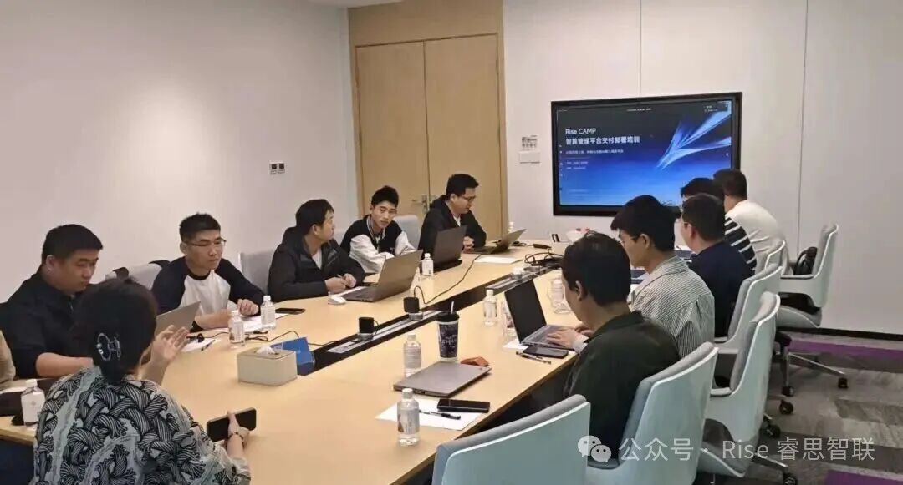

[English](./README.en.md) · [文章目录](../../README.md) · [官网阅读](https://www.theriseunion.com/zh/blog/riseunion-partner-training-2026q1.html)

# 睿思智联 2026 年第一期 AI 智算管理平台交付工程师培训圆满举行

睿思智联 · 2026/04/27 08:00（北京时间）

随着人工智能迈入规模化应用阶段，企业核心挑战已从'拥有算力'转向'用好算力'。睿思智联近期举办 AI 智算管理平台渠道交付工程师赋能培训，面向核心渠道伙伴系统输出标准化交付框架、故障排查方法论与异构算力管理理念，共同锻造服务千行百业的'精锐部队'。

随着人工智能迈入规模化应用的新阶段，企业面临的核心挑战已从单纯的"拥有算力"向"高效、稳定、简单地用好算力"转变。为破解行业痛点，携手伙伴共赢，睿思智联于近日成功举办了 **AI 智算管理平台渠道交付工程师赋能培训**。

## 打造 AI 算力基础设施的"精锐部队"

本次培训旨在将睿思智联在复杂企业环境中沉淀的标准化交付体系、系统化故障排查心法及前瞻性的异构算力管理理念，全面赋能给核心渠道伙伴。通过深度的技术交流与实战演练，睿思智联与伙伴们共同锻造了一支服务于千行百业 AI 算力基础设施的"精锐部队"。

睿思智联倾力打造的 AI 智算管理平台，正是破解当前"算力孤岛、管理复杂、成本高昂"等核心行业痛点的关键钥匙。而将这把钥匙精准、可靠地交付到客户手中，离不开渠道伙伴卓越的工程落地能力。

## 三位一体课程：从理论到实战的全面跃升

为此，本次培训精心设计了"方法论构建、实战化演练、体系化认知"三位一体的专属课程，全方位提升交付工程师的综合能力：

### 1. 交付方法论的升华：从"艺术"到"工程"

我们系统输出了覆盖"规划-准备-部署-交付"全周期的标准化交付框架。这一框架将大型平台的部署从依赖个人经验的"艺术"，转化为可复制、可管理的"工程"，旨在从源头大幅提升项目成功率与客户满意度。

### 2. 实战能力的灌注：聚焦稳定与可维护性

围绕企业客户最为关注的系统稳定性与可维护性，课程重点分享了基于平台核心依赖链的系统性排查心法。同时，讲师现场演示了从环境配置到应用部署的完整操作流程，切实强化了伙伴工程师在实战中的问题解决与服务保障能力。

### 3. 生态格局的拓宽：前沿实践与价值解读

培训深入解读了 AI 智算管理平台在信创适配与异构算力统一调度上的核心价值与前沿实践。这不仅帮助伙伴更好地应对客户日益复杂的多元化算力场景，更助力他们从单纯的技术执行者，蜕变成长为客户值得信赖的解决方案顾问。

## 携手并进，共创智算新纪元

此次培训是睿思智联践行"技术赋能生态"长期战略的关键一步。

未来，睿思智联将持续迭代赋能体系，共享技术创新成果。我们将与所有生态伙伴坚定地并肩前行、共同成长，致力于将更智能、更稳定、更开放的算力服务交付给每一位客户，共同推动智能计算在千行百业的普惠与深化。

独木不成林，百川聚江海。面对广阔的智算市场，睿思智联诚邀更多志同道合的伙伴加入我们的生态圈。

成为我们的合作伙伴，您将获得：

- **全方位技术赋能**：定期专属培训、技术专家 1 对 1 支持、完善的交付知识库
- **具竞争力的产品**：行业领先的 AI 智算管理平台，满足多元化客户需求
- **丰厚的商业回报**：极具吸引力的渠道政策、项目报备保护机制、联合营销支持
- **共创行业解决方案**：基于您的行业积淀与我们的平台能力，联合打造标杆案例

加入方式：

- 发送邮件：contact@riseunion.io
- 咨询热线：400-605-2336

---

[在睿思智联官网阅读本文](https://www.theriseunion.com/zh/blog/riseunion-partner-training-2026q1.html) · [浏览更多文章](https://www.theriseunion.com/zh/blog.html)
