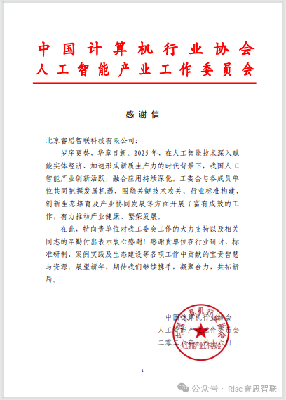

[简体中文](./README.md) · [All articles](../../README.en.md) · [Read on the website](https://www.theriseunion.com/en/blog/riseunion-received-thank-you-letter-from-ai-committee.html)

# RiseUnion Receives Appreciation Letter from China Computer Industry Association AI Committee

RiseUnion · January 24, 2026 at 08:00 (UTC+08:00)

RiseUnion received a letter of appreciation from the AI Committee of the China Computer Industry Association, recognizing its contributions to AI standards, ecosystem building, and industrial development in 2025. RiseUnion remains committed to advancing the AI industry.

As we usher in a new year, we embrace new beginnings.

Recently, Beijing RiseUnion Technology Co., Ltd. received a letter of appreciation from the AI Industry Committee of the China Computer Industry Association. This recognition validates our dedication to the AI field and our contributions to industrial development throughout 2025, while expressing high expectations for our continued partnership.

2025 marks a pivotal year for AI technology to deeply empower the real economy and accelerate the formation of new quality productive forces. Amid this wave, China's AI industry has shown explosive innovation vitality and deepening integrated applications. As a key industry participant and driver, RiseUnion has consistently championed innovation, actively responding to the Committee's initiatives by deeply engaging in critical technology breakthroughs, industry standard formulation, ecosystem cultivation, and collaborative industrial development.

From thought leadership in industry seminars to rigorous validation in standard development, and from practical exploration in use cases to resource sharing in ecosystem building, RiseUnion has dedicated its technical expertise to industry needs. We have contributed our wisdom and strength to the healthy prosperity of the AI industry with enthusiasm and pragmatism. This honor belongs to the dedicated efforts of our entire team and is made possible by the Committee's guidance and the support of all member units.

This letter of appreciation represents both an honor and a responsibility.

Looking ahead, RiseUnion remains committed to exceeding expectations. We will continue to deepen R&D in core AI technologies and industry application innovations. Together with the AI Industry Committee and all member units, we will forge ahead to empower diverse industries with AI, jointly writing a new chapter of high-quality industrial development.

Encouraged by this recognition, let us explore new horizons and achieve greater success in the vast blue ocean of artificial intelligence!

---

[Read this article on the RiseUnion website](https://www.theriseunion.com/en/blog/riseunion-received-thank-you-letter-from-ai-committee.html) · [Explore more articles](https://www.theriseunion.com/en/blog.html)
