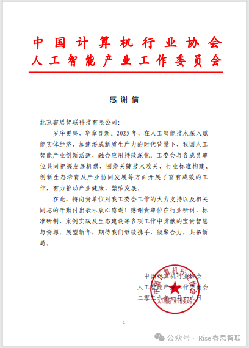

[English](./README.en.md) · [文章目录](../../README.md) · [官网阅读](https://www.theriseunion.com/zh/blog/riseunion-received-thank-you-letter-from-ai-committee.html)

# 荣誉加冕，携手同行！睿思智联获中国计算机行业协会 人工智能产业工作委员会感谢信

睿思智联 · 2026/01/24 08:00（北京时间）

睿思智联收到中国计算机行业协会人工智能产业委员会感谢信。认可公司在2025年深耕AI领域、参与标准制定及生态建设的贡献。睿思智联将继续携手行业伙伴，推动AI产业高质量发展。

岁序更替，华章日新。

近日，北京睿思智联科技有限公司收到了来自中国计算机行业协会人工智能产业工作委员会的感谢信。字里行间的肯定与期许，既是对我们 2025 年深耕人工智能领域、助力产业发展的认可，更是对未来继续携手前行的殷切期盼。

2025 年，是人工智能技术深度赋能实体经济、加速形成新质生产力的关键一年。在这一时代浪潮下，我国人工智能产业创新活力迸发，融合应用持续深化。作为行业发展的参与者、推动者，睿思智联始终秉持创新精神，积极响应工委会号召，深度参与到关键技术攻关、行业标准构建、创新生态培育及产业协同发展等多项重要工作中。

从行业研讨会上的思想碰撞，到标准研制中的严谨求证；从案例实践里的躬身探索，到生态建设中的资源共享，睿思智联始终以饱满的热情和务实的行动，将自身技术积累与行业发展需求紧密结合，为人工智能产业的健康繁荣贡献着自己的智慧与力量。这份认可，不仅属于公司全体同仁的辛勤付出，更离不开工委会的悉心指导与各成员单位的鼎力支持。

感谢信既是一份荣誉，更是一份责任。

展望未来，睿思智联将不负期许，继续深耕人工智能核心技术研发与行业应用创新，与中国计算机行业协会人工智能产业工作委员会及所有成员单位一道，凝聚合力、携手共进，在人工智能赋能千行百业的道路上勇毅前行，共同书写产业高质量发展的新篇章！

让我们以信为勉，共拓新局，在人工智能的广阔蓝海中再创佳绩！

---

[在睿思智联官网阅读本文](https://www.theriseunion.com/zh/blog/riseunion-received-thank-you-letter-from-ai-committee.html) · [浏览更多文章](https://www.theriseunion.com/zh/blog.html)
