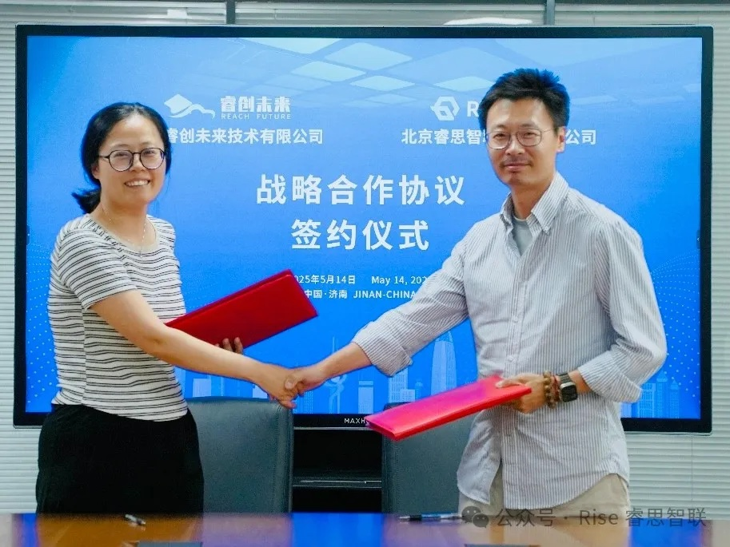

[简体中文](./README.md) · [All articles](../../README.en.md) · [Read on the website](https://www.theriseunion.com/en/blog/riseunion-ruichuang.html)

# RiseUnion Partners with RuiChuang: AI Compute Powers EdTech

RiseUnion · May 14, 2025 at 08:00 (UTC+08:00)

RiseUnion and RuiChuang Future sign strategic partnership at National Supercomputing Center Jinan, combining AI compute orchestration with smart education platforms to accelerate digital transformation in education sector.

On May 14, 2025, Beijing RiseUnion Technology Co., Ltd. and Shandong RuiChuang Future Technology Co., Ltd. officially signed a strategic partnership agreement at the National Supercomputing Center in Jinan. This collaboration marks a significant milestone in their joint efforts to **accelerate digital transformation and intelligent upgrades in the education sector**. The signing ceremony was attended by Wang Jibin, Chief Engineer of the National Supercomputing Center in Jinan, Jin Meng, CEO of RiseUnion, Zhang Qiuping, Chairman of RuiChuang Future, and Jia Shipeng, General Manager of RuiChuang Future.

This strategic alliance aims to integrate both companies' core competencies, leveraging **RiseUnion's advanced AI compute orchestration and scheduling capabilities** alongside **RuiChuang Future's proven expertise in smart education platform development and solution delivery**. Together, they will establish **an innovative application ecosystem for intelligent education**.

RuiChuang Future is a high-tech enterprise incubated from the R&D achievements of **Shandong Computer Center (National Supercomputing Center in Jinan)** and strategically funded by Shandong Science & Technology Innovation Group Co., Ltd. (state-owned). The company specializes in smart education solutions, utilizing Jinan Supercomputing Center's robust computational resources to deliver comprehensive offerings including **R&D training platforms, programming education systems, virtual simulation teaching environments, university data asset management platforms, and smart campus product suites**—all designed to accelerate educational digital transformation.

RiseUnion stands as an industry leader in AI compute scheduling and resource management. Through its proprietary Rise CAMP platform, the company has built a powerful **heterogeneous compute resource pool** that enables **unified orchestration and dynamic allocation of diverse computational resources**. The platform excels in GPU virtualization and compute pooling technologies, providing efficient computational support for smart education use cases such as big data analytics, intelligent learning systems, and virtual laboratories.

Guided by the principle **"Technology Empowers Education, Innovation Drives the Future,"** both companies will collaborate through multiple engagement models including joint projects, industry-specific solutions, and establishment of shared research laboratories. This partnership will deliver mutual benefits through resource sharing, technical complementarity, and market synergy.

This strategic collaboration represents more than a simple resource integration initiative—it introduces transformative innovation capabilities to the education industry. Moving forward, RiseUnion and RuiChuang Future will deepen their partnership, actively explore emerging opportunities in intelligent education, and jointly drive high-quality educational development while advancing China's educational sector digital transformation.

---

[Read this article on the RiseUnion website](https://www.theriseunion.com/en/blog/riseunion-ruichuang.html) · [Explore more articles](https://www.theriseunion.com/en/blog.html)
