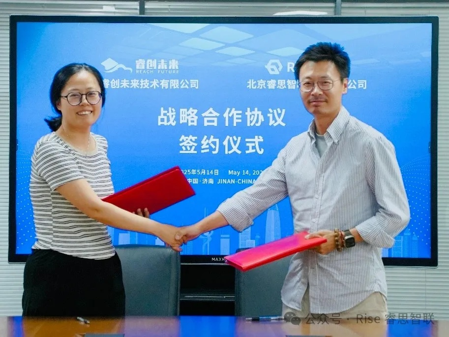

[English](./README.en.md) · [文章目录](../../README.md) · [官网阅读](https://www.theriseunion.com/zh/blog/riseunion-ruichuang.html)

# 睿思智联携手睿创未来：AI算力调度赋能智慧教育数字化转型

睿思智联 · 2025/05/14 08:00（北京时间）

睿思智联与睿创未来在国家超算济南中心签署战略合作协议，整合AI算力管理调度技术与智慧教育平台，共建面向智慧教育的创新应用体系，加速教育行业数字化智能化升级。

2025年5月14日，北京睿思智联科技有限公司与山东睿创未来技术有限公司在国家超级计算济南中心正式签署战略合作协议。这一合作标志着双方在智慧教育领域的深度携手，将**合力推动教育行业的数字化、智能化升级**。国家超级计算济南中心总工程师王继彬，睿思智联CEO金萌，睿创未来董事长张秋萍、总经理贾士朋等出席签约仪式。

此次强强联合，旨在整合双方优势资源，充分发挥**睿思智联在AI算力管理与调度领域的技术优势**，以及**睿创未来在智慧教育平台研发与解决方案领域的深厚积淀**，共同打造**面向智慧教育的创新应用体系**。

图片
睿创未来是由**山东省计算中心（国家超级计算济南中心）**科技成果孵化，并由山东省科创集团有限公司（国有全资）战略投资成立的高科技企业。公司深耕智慧教育领域，依托济南超算雄厚的算力资源优势，推出涵盖**研发教学实训平台、编程学习平台、虚拟仿真教学平台、高校数据资产管理平台、智慧校园系列产品**等多个创新教育解决方案，助力教育行业数字化转型。

睿思智联则作为AI算力调度与管理领域的行业先锋，通过其自主研发的Rise CAMP平台，构建了强大的**异构算力资源池**，实现了**多样化计算资源的统一调度与灵活分配**。该平台在GPU虚拟化与算力池化调度技术方面具备显著优势，为智慧教育中的大数据分析、智能学习系统、虚拟实验室等场景提供了高效算力支持。

基于**“科技赋能教育，创新引领未来”**的合作理念，双方将基于项目、行业解决方案以及成立联合实验室等多种模式展开合作，通过资源共享、技术互补、市场协同，实现互利共赢。

此次战略合作不仅是一次优势互补、资源整合的全新尝试，也将为教育行业注入更多创新动能。未来，睿思智联与睿创未来将继续深化合作，积极探索智慧教育领域的新机遇，共同助力教育高质量发展，推动中国教育行业的数字化转型升级。

---

[在睿思智联官网阅读本文](https://www.theriseunion.com/zh/blog/riseunion-ruichuang.html) · [浏览更多文章](https://www.theriseunion.com/zh/blog.html)
