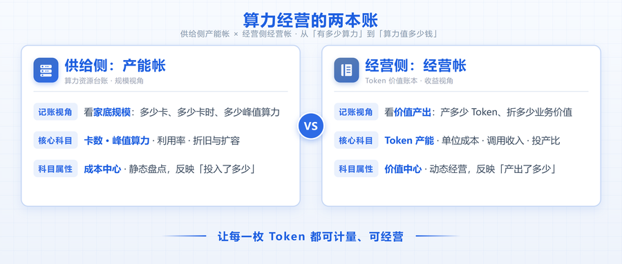

[English](./README.en.md) · [文章目录](../../README.md) · [官网阅读](https://www.theriseunion.com/zh/blog/riseunion-securities-token-capacity-operations.html)

# 睿思智联助力券商，从"买卡堆卡"转向"经营Token产能"

睿思智联 · 2026 年 11 月 5 日 10:00（北京时间） · [微信公众号原文](https://mp.weixin.qq.com/s/gBKVxZxsGvzQG0IxdFCVZQ)

买卡堆卡，回答的是"我有多少算力"；经营Token产能，回答的是"我的算力值多少钱"。

> 过去两年，券商智算建设的关键词是"买"：买卡、堆卡、扩机房，算力规模一年一个台阶。但卡堆起来之后，真正的考题才刚刚开始——**分散的卡不等于产能，跑起来的Token才是**。算力规划正在从"买卡堆卡"的一次性投入，转向"经营Token产能"的长期运营：既要把异构算力盘成一条统一的产能线，又要让每一个Token都被计量、被核算、被花在刀刃上。某券商依托睿思智联的多集群统一纳管架构与平台运营体系，把这门"产能经营课"落了地，算清了供给侧与经营侧的"两本帐"。

## 供给侧的"产能帐"—把分散的卡，变成一条Token产线

【痛点】**买回来的卡，为什么产不出足够的Token？**

在实际生产中，该券商面临管控域与计算域跨中心分离、多款异构加速芯片并存、模型调用入口不统一等难题。传统模式下各租户独占资源池，闲置算力无法互通——卡是按峰值买的，产能却按谷值在跑；基础存储与镜像设施还在重复建设。**买卡堆卡逻辑下，这些损耗都被掩盖在"资产已到位"的报表里；换成产能视角，它们全是流失的Token。**

【方案】**落地方案：跨中心统一纳管，让每一张卡都进入产能池**

- 存量利旧与异构协同：采用"管控域+计算域"分离部署架构并通过专线互联，直接复用现有的容器集群、镜像仓库、存储设备与身份认证体系，集中纳管底层通用算力与异构加速集群。不同代际、不同品牌的卡被抽象为统一的算力单元，上层业务不再与具体型号绑定——这是产能化的第一步：先把零散的机器变成一条统一的产线。

- 统一网关与运维闭环：通过智能网关暴露单一访问入口与统一密钥，按模型标识将业务流量精准路由至对应算力集群，并结合监控指标、告警与故障迁移机制形成端到端运维闭环——产能要稳定出Token，产线就不能停。

- 池化共享与开箱即用：将重度管理模式简化为"项目即租户"的一级隔离，所有项目在配额内共享公共资源池以拉升利用率；同时结合企业统一登录、实名认证门控及注册自动配额，实现安全准入与环境一键就绪——产能池的核心指标是利用率，池子越共享，单位Token的成本越低。

## 经营侧的"经营帐"—让每个Token都有主、有价、有账

【痛点】**产能有了，为什么账还是算不清？**

随着投研、风控、量化等多个业务团队高频调用大模型与算力，粗放式管理暴露出诸多经营盲区：业务侧"用完才知花多少"，Token消耗与预算完全脱钩；免费且无感知的存储空间造成冗余模型与数据大量堆积，资源频繁扩缩容缺乏精准的退补费机制；科技部门推广创新应用缺乏灵活的补贴抓手，月底跨集群的算力与模型调用难以快速拉齐对账与合规结算。**没有经营帐，产能再足也只是一笔糊涂的固定资产。**

【方案】**落地方案：全周期成本精算，把算力当产能来定价、计量、结算**

围绕券商内部真实的算力消费全生命周期，平台构建了从预算准入、过程计量到激励结算的完整经营闭环：

- 事前透明预览与双模预算管控：团队在新建资源或调整规格前，系统实时预览每小时或每月的预估费用及差价，确认无误后方才生效，彻底告别盲目下单。日常稳态团队默认采用"预付费（先充后用）"严控预算红线，突发行情分析或临时攻关则切换"后付费（先用后结）"，业务弹性不受余额限制——经营的第一原则：先算清楚，再开产线。

- 事中分段精算与存储透明计费：算力实例按小时精确计费，扩容升配仅补后续差价、不往前追溯；降配、停止或删除资源时，未使用时间的费用自动退回账户并生成可查退款单。存储空间纳入"容量单价×实际使用时间"的透明计费，删除即刻停计——用清晰的成本感知，倒逼各业务组及时清理冗余数据。

- 自动预警停机与充值无感自愈：费用中心实时展示可用余额，低于阈值自动预警。余额耗尽触发自动停机后，业务方在线扫码充值（支持渠道异常自动回补与误充原路退回），资金到账资源即刻恢复，全程无需人工介入运维。

- 内部创新扶持与跨集群自动让利：注册、实名认证通过或充值后自动发放代金券，结算时按"先到期先用"自动抵扣算力与模型消费；管理员可按工作空间或项目配置统一计费折扣（项目级优先、不叠加）并跨成员集群自动同步，价格条、账单与调用记录均直观呈现折后明细——让利也是经营：用价格杠杆引导业务侧多产Token、多出场景。

- 事后三维账单穿透与合规业财闭环：费用中心与管理后台支持按"资源、Token、钱包"三个维度逐笔穿透筛查消费明细并自动汇总月账单，"谁花了多少、花在何处"一目了然。同时打通合同模版发起、复核盖章与台账管理，以及发票在线申请、资质审核、电子交付与纸质物流追踪全链路——产能经营最终要落进财务合规的账本里。

## 写在最后

**买卡堆卡，回答的是"我有多少算力"；经营Token产能，回答的是"我的算力值多少钱"。** 通过"供给侧产能化"与"经营侧精算化"这两套组合拳，存量老用户无需重新注册即可无缝切换至新工作台，在原有资源与业务数据丝毫无损的前提下，真正建立起更安全、更透明、更省心的金融级算力运营体系。

### 关于睿思智联

北京睿思智联科技有限公司（RiseUnion）专注于AI 算力管理与调度，已完成 10+ 国产芯片兼容认证，是 CNCF Sandbox 开源项目 HAMi 的核心贡献者之一。公司是国家高新技术企业、北京市专精特新中小企业、AIIC 算力池化工作组组长单位，在金融、政企军工、交通、医疗等行业实现大规模生产级落地。

睿思智联致力于让算力像水电一样随取随用，为企业 AI 转型构建智能、可控、高效的算力底座。

了解更多详细信息，欢迎访问官网：**riseunion.ai** 或联系：**400-605-2336。**

---

[在睿思智联官网阅读本文](https://www.theriseunion.com/zh/blog/riseunion-securities-token-capacity-operations.html) · [浏览更多文章](https://www.theriseunion.com/zh/blog.html)
