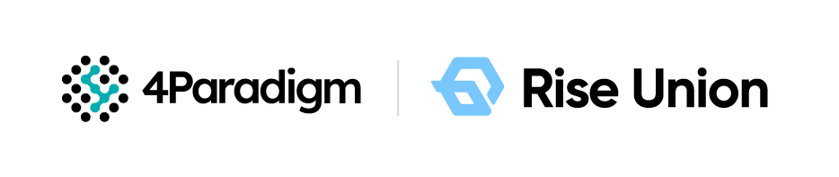

[简体中文](./README.md) · [All articles](../../README.en.md) · [Read on the website](https://www.theriseunion.com/en/blog/riseunion-seed-round-financing-news.html)

# RiseUnion Secures Seed Funding from Fourth Paradigm

RiseUnion · January 01, 2025 at 08:00 (UTC+08:00)

Leading AI infrastructure management platform RiseUnion announces seed round funding from Fourth Paradigm, focusing on enterprise-grade AI infrastructure optimization and software-defined compute solutions for accelerating AI deployment across industries.

**RiseUnion**, a leading AI infrastructure management platform and solution provider, has recently announced the completion of its seed round financing, exclusively invested by **[4Paradigm](https://www.4paradigm.com/)**. This successful funding not only represents the capital market's strong recognition of RiseUnion's growth potential but also provides powerful momentum for the company's future development, enabling it to further expand its industry leadership.

Since its inception, RiseUnion has been committed to innovating AI infrastructure. Through its unique technological advantages, superior product quality, and professional service team, the company has quickly distinguished itself in the market, earning trust and support from numerous clients. Their independently developed AI compute management and orchestration platform enhances AI workload performance and efficiency through software-defined heterogeneous compute orchestration and optimization capabilities. By addressing compatibility issues with domestic infrastructure, RiseUnion provides an efficient, user-friendly, and high-quality **data center-grade** AI compute management platform and solutions, achieving remarkable market success with continuously growing market share.

As AI foundation models like DeepSeek and Manus gradually deploy in enterprise scenarios, traditional applications are accelerating their AI transformation, driving the emergence of AI Native applications. With the expansion of inference scale and explosive growth in traffic, AI infrastructure platforms are experiencing significant load increases. Users need to build unified compute resource pools and rely on resource management solutions that are more powerful, cost-effective, and cover the **full lifecycle of training and inference** to achieve efficient resource utilization and cost optimization.

Against this backdrop of technological innovation, RiseUnion is dedicated to building a world-class next-generation AI compute management platform and solutions, continuously increasing investments in technology R&D, market expansion, and team building. This successful financing will provide sufficient funding support for the company's development. The company plans to allocate the funds primarily to technology R&D and innovation, market expansion and brand building, and team development and talent cultivation.

The investment director of Fourth Paradigm (Beijing) Technology Co., Ltd. stated: "RiseUnion has demonstrated strong innovation capabilities and market competitiveness in AI infrastructure optimization and management, with a team possessing rich industry experience and keen market insights. We are confident in the company's future development. Through this investment, we will leverage our resources to collaborate with RiseUnion in driving industry development and progress."

Jin Meng, Founder and CEO of RiseUnion, expressed: "We deeply appreciate the trust and support from all investors in this round of financing. This successful funding not only validates our past efforts but also motivates our future development. We will take this financing as a new starting point, continuing to uphold our development philosophy of innovation, focus, and mutual benefit. We remain committed to enhancing our core competitiveness, creating greater value for customers, delivering substantial returns for shareholders, and making larger contributions to industry development."

As AI applications increasingly penetrate core industry scenarios, software-defined compute has emerged as a crucial topic for 2025, though this sector remains in its early stages. RiseUnion's core competitiveness lies in its ability to achieve production-grade reliability in **enterprise environments**. By optimizing GPU resource management, it helps industries heavily dependent on AI - such as energy, transportation, finance, and healthcare - to accelerate their **AI model development and production deployment**. RiseUnion offers comprehensive solutions, particularly for enterprises seeking broad hardware support, vendor lock-in avoidance, and domestic technology adoption. This capability becomes increasingly crucial as AI infrastructure grows more complex.

---

[Read this article on the RiseUnion website](https://www.theriseunion.com/en/blog/riseunion-seed-round-financing-news.html) · [Explore more articles](https://www.theriseunion.com/en/blog.html)
