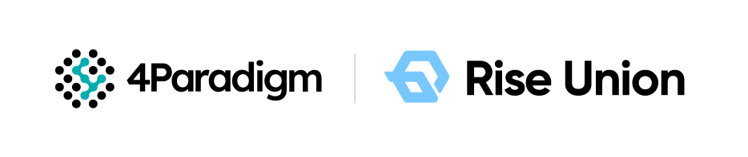

[English](./README.en.md) · [文章目录](../../README.md) · [官网阅读](https://www.theriseunion.com/zh/blog/riseunion-seed-round-financing-news.html)

# 睿思智联完成种子轮融资，开启行业发展新篇章

睿思智联 · 2025/01/01 08:00（北京时间）

AI算力管理平台领导者睿思智联完成种子轮融资，由第四范式独家投资。公司将深耕企业级AI基础设施管理，通过软件定义算力技术优化GPU资源调度，助力各行业加速AI应用落地。

近日，业界领先的AI算力管理平台与解决方案提供商 睿思智联 宣布成功完成种子轮融资，由 <a href="http://4paradigm.com/" target="_blank">第四范式</a> 独家投资。此次融资的成功，不仅是资本市场对睿思智联发展潜力的高度认可，也为公司未来的发展注入了强大动力，将助力其在行业中进一步扩大领先优势，实现跨越式发展。

睿思智联自成立以来，始终致力于人工智能基础设施的创新与发展，凭借独特的技术优势、卓越的产品品质以及专业的服务团队，在市场中迅速脱颖而出，赢得了众多客户的信赖与支持。公司自主研发的AI算力管理与调度平台，通过软件定义的异构算力调度与优化能力，提升AI工作负载的性能和效率，解决国产基础设施的适配问题，为客户提供更加高效、便捷、优质的 数据中心级 AI算力管理平台与解决方案，在市场上取得了显著成绩，市场份额持续攀升。

随着 DeepSeek、Manus 等 AI 大模型产品在企业级应用场景的逐步落地，传统应用正在加速“AI 化”，并推动AI Native 应用不断涌现。随着推理规模的扩大与流量的爆发式增长，AI算力平台的负载显著上升，用户需要构建统一的算力资源池，并依赖功能更强、成本更低且覆盖训练和推理 全生命周期的资源管理方案，以实现资源的高效利用和成本优化。

睿思智联正是在这样的技术革新背景下，致力于构建世界级的新一代AI算力管理平台与解决方案，并持续加大在技术研发、市场拓展、团队建设等方面的投入。此次融资的成功，将为公司的发展提供充足的资金支持。公司计划将资金主要用于技术研发与创新、市场拓展与品牌建设、团队建设与人才培养。

第四范式（北京）技术有限公司的投资负责人表示：“睿思智联在人工智能基础设施优化管理方面展现出了强大的创新能力和市场竞争力，其团队具备丰富的行业经验和敏锐的市场洞察力。我们对公司的未来发展充满信心。此次投资，我们将充分发挥自身的资源优势，与睿思智联携手共进，共同推动行业的发展和进步。”

睿思智联的创始人兼 CEO 金萌表示：“非常感谢本轮融资的所有投资方对我们的信任和支持。此次融资的成功，既是对我们过去努力的肯定，也是对我们未来发展的鞭策。我们将以此次融资为新的起点，继续秉承创新、专注、共赢的发展理念，不断提升公司的核心竞争力，为客户创造更大的价值，为股东带来丰厚的回报，并为行业的发展做出更大的贡献。

随着AI应用逐步进入行业核心应用场景，软件定义算力已成为 2025 年不可忽视的话题，但这一赛道依然处于早期阶段。睿思智联的核心竞争力在于其能够在企业级生产环境 中实现可用性，通过优化 GPU 资源管理，帮助能源、交通、金融、医疗等对 AI 依赖较大的行业更快速地实现 AI 模型的研发与生产化落地。尤其对于那些寻求广泛硬件支持、避免供应商锁定以及需要进行国产化替代的企业来说，睿思智联提供了更全面的解决方案。在AI基础设施日益复杂化的今天，睿思智联的这种能力显得尤为重要。

---

[在睿思智联官网阅读本文](https://www.theriseunion.com/zh/blog/riseunion-seed-round-financing-news.html) · [浏览更多文章](https://www.theriseunion.com/zh/blog.html)
