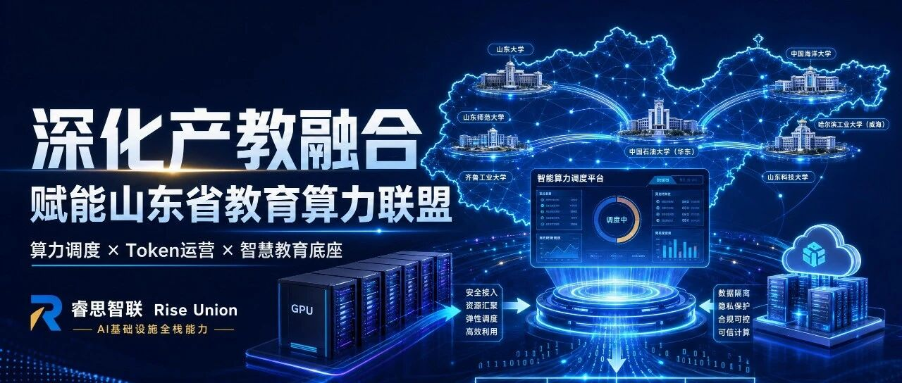

[简体中文](./README.md) · [All articles](../../README.en.md) · [Read on the website](https://www.theriseunion.com/en/blog/riseunion-shandong-education-computing-alliance.html)

# RiseUnion Deepens Industry-Education Integration and Empowers the Shandong Education Computing Alliance: Reshaping Computing Utilization and Token Operations

RiseUnion · June 08, 2026 at 10:20 (UTC+08:00) · [Original WeChat article (Chinese)](https://mp.weixin.qq.com/s/4OSpgUqOcp7H28LiD8EG7Q)

The Shandong Education Computing Alliance was officially established in Jinan on March 27 under the guidance of the Shandong Provincial Department of Education, led by Qilu University of Technology (Shandong Academy of Sciences) and Shandong University, and jointly initiated by universities, enterprises, and municipal education authorities across the province.

**Background: The Shandong Education Computing Alliance was officially established in Jinan on March 27.** Under the guidance of the Shandong Provincial Department of Education, the alliance was led by Qilu University of Technology (Shandong Academy of Sciences) and Shandong University and jointly initiated by universities, enterprises, and municipal education authorities across the province. By building an infrastructure architecture of **“1 education private network + 1 computing scheduling platform + N computing nodes,”** the alliance aims to effectively address challenges such as scattered education computing resources and high construction costs, providing solid support for “AI + education” applications across the province.

Beijing RiseUnion Technology Co., Ltd. (RiseUnion) recently joined the Shandong Education Computing Alliance and is greatly encouraged to become a formal member. We have already participated deeply in the development of multiple AI business scenarios for the alliance and have profoundly felt the strong pulse of Shandong’s digital transformation in education. In the future, we will rely on our full-stack strengths in AI infrastructure, work side by side with alliance partners, and jointly break through the pain points of education computing.

### Directly Addressing the Pain Point: The “Engineering Gap” Between Expensive Hardware and Surging Demand

As “AI + education” scenarios roll out comprehensively, demand for large models among faculty and students at universities across the province is rising exponentially. Yet in our in-depth exchanges with many experts in the alliance, a practical pain point stands before us: **expensive GPU servers make the scaled rollout of computing services extremely difficult.**

On the one hand, hardware procurement costs that easily run into millions impose enormous financial pressure on universities; on the other, the rapidly growing volume of Token calls from teaching, research, and daily administration constantly strains the existing computing foundation. How can unlimited demand for educational AI exploration be met within a limited budget? This is precisely the engineering gap that must be crossed on the way to the Software 3.0 era.

### RiseUnion’s Breakthrough: Unlock Value from Existing Assets and Counter Expensive Hardware with Scheduling Pushed to the Limit

In the face of this challenge, RiseUnion’s core solution is: **reject blind capacity expansion and use dynamic scheduling pushed to the limit to improve utilization of existing resources.**

Relying on RiseUnion’s independently developed “HAMi Enterprise Edition-based computing management platform, the inefficient traditional model of “exclusive” computing allocation has been broken. The platform can perform extremely fine-grained dynamic partitioning and pooled management of underlying heterogeneous GPU resources according to real fluctuations in faculty and student model-inference workloads.

This means that the existing intelligent computing platforms of alliance universities will be revitalized. Through intelligent bin packing and tidal reuse scheduling, we can maximize the computing value of every accelerator card, enable existing computing resources to “do the work of ten,” and fundamentally ease the financial pressure on educational institutions to procure new computing servers.

### Leap in Efficiency: Building a Hybrid Token Governance System that Connects Internal and External Resources

Computing power is only the foundation; Tokens are the core medium through which faculty and students access AI. In response to the growing volume of concurrent requests, RiseUnion has tailored an **enterprise-grade hybrid Token production and operations service platform** for the alliance.

Through a unified AI intelligent gateway, we seamlessly join Tokens generated through inference on the alliance’s internally built computing pools with high-quality external large-model Token services. Whether for a research team’s intensive long-context inference or a student’s everyday coding assistant, the platform can intelligently route Tokens. We provide not only end-to-end Token metering, cost accounting, and concurrency throttling, but also absolute isolation and security for education data at the underlying layer. The unified management hub substantially improves Token operating efficiency, making every large-model call measurable, manageable, and effective.

### Looking Ahead: Building an Innovation Foundation for Smart Education Together

Promoting efficient collaboration between general-purpose Xinchuang computing and heterogeneous artificial intelligence computing is key to building a new model of computing services for the province’s education system.

RiseUnion will always uphold the principles of “integration, innovation, and mutual benefit,” use the alliance platform as its base, and deepen industry-education integration. We will continue to provide leading heterogeneous computing scheduling and Token production and operating capabilities, strive to help the Shandong Education Computing Alliance become the province’s computing hub and innovation foundation for smart education, and inject strong digital and intelligent momentum into high-quality education development across the province!

If you would like to join the **Shandong Education Computing** Alliance, please contact us:

- Email: contact@riseunion.io

- Consultation hotline: 400-605-2336

### About RiseUnion

Beijing RiseUnion Technology Co., Ltd. (RiseUnion) focuses on AI computing management and scheduling. It has completed compatibility certification with more than 10 domestic chips and is one of the core contributors to the CNCF Sandbox open-source project HAMi. The company is a National High-Tech Enterprise, a Beijing Specialized, Refined, Distinctive, and Innovative SME, and chair organization of the AIIC Compute Pooling Working Group, with large-scale production deployments in finance, government and military enterprises, transportation, healthcare, and other industries.

RiseUnion is committed to making computing power as readily available as water and electricity, building an intelligent, controllable, and efficient computing foundation for enterprise AI transformation.

---

[Read this article on the RiseUnion website](https://www.theriseunion.com/en/blog/riseunion-shandong-education-computing-alliance.html) · [Explore more articles](https://www.theriseunion.com/en/blog.html)
