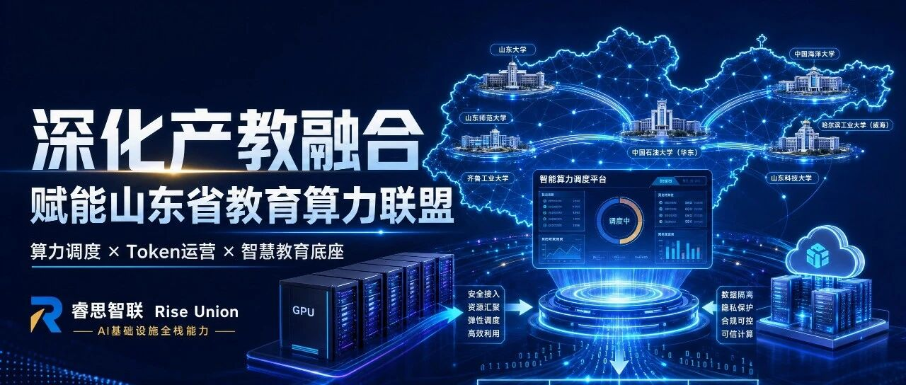

[English](./README.en.md) · [文章目录](../../README.md) · [官网阅读](https://www.theriseunion.com/zh/blog/riseunion-shandong-education-computing-alliance.html)

# 睿思智联深化产教融合，赋能山东省教育算力联盟：重塑算力利用率与Token运营新效能

睿思智联 · 2026/06/08 10:20（北京时间） · [微信公众号原文](https://mp.weixin.qq.com/s/4OSpgUqOcp7H28LiD8EG7Q)

山东省教育算力联盟于3月27日在济南正式成立。该联盟是在山东省教育厅指导下，由齐鲁工业大学（山东省科学院）与山东大学牵头，联合省内高校、企业和市级教育主管部门共同发起。

**背景：山东省教育算力联盟于3月27日**在济南正式成立。该联盟是在山东省教育厅指导下，由齐鲁工业大学（山东省科学院）与山东大学牵头，联合省内高校、企业和市级教育主管部门共同发起。联盟旨在通过打造**“1张教育专网 + 1个算力调度平台 + N个算力节点”**的基础设施架构，有效破解教育算力资源分散、建设成本高昂等挑战，为全省“人工智能+教育”应用提供坚实支撑。

北京睿思智联科技有限公司（睿思智联）近期加入了山东省教育算力联盟，作为联盟的正式成员单位，深受鼓舞。前期，我们已深入参与到联盟多项AI业务场景的建设中，并深刻感知到山东教育数字化转型的强劲脉搏。未来，我们将依托自身在AI基础设施领域的全栈优势，与联盟伙伴并肩作战，共同破局教育算力痛点。

### 痛点直击：昂贵硬件与激增需求间的“工程鸿沟”

随着“人工智能+教育”场景的全面铺开，全省高校师生对大模型的需求呈指数级上升。但在我们与联盟内诸多专家的深入交流中，一个现实的痛点横亘在眼前：**昂贵的GPU服务器让算力服务的规模化推广举步维艰。**

一方面，动辄数百万的硬件采购成本给高校带来了巨大的财政压力；另一方面，师生在教学、科研、日常管理中快速激增的Token调用量，又在无时无刻地拉扯着现有的算力底座。如何在有限的预算内，满足无限的教育AI探索需求？这正是迈向 Software 3.0 时代必须跨越的一道工程鸿沟。

### 睿思破局：向存量要红利，用极致调度对抗硬件昂贵

面对这一挑战，睿思智联给出的核心解法是：**拒绝盲目扩容，用极致的动态调度提升现有资源利用率。**

依托睿思智联自主研发的“基于HAMi企业版的算力管理平台，打破了传统“独占式”算力分配的低效模式。平台能够根据师生模型推理的真实负载波动，对底层异构GPU资源进行极细粒度的动态切分与池化管理。

这意味着，联盟高校现有的智算平台将焕发新生。通过智能装箱与潮汐复用调度，我们能最大限度地压榨每一张显卡的计算价值，让现有算力资源“以一当十”，从根本上缓解教育机构采购新型算力服务器的资金压力。

### 效能飞跃：构建内外联动的混合Token治理体系

算力只是底座，Token 才是师生触达AI的核心媒介。针对日益庞大的并发请求，睿思智联为联盟量身打造了**企业级混合Token生产和运营服务平台**。

通过统一的AI智能网关，我们将联盟内部基于自建算力池推理生成的Token与外部优质大模型Token服务无缝缝合。无论是科研团队的重度长文本推理，还是学生的日常编码助手，平台都能实现Token的智能路由。我们不仅提供端到端的Token计量、成本核算与并发限流，更在底层保障了教育数据的绝对隔离与安全。统一的管理中枢大幅提升了Token运营效能，让每一次大模型调用都能算得清、管得住、用得好。

### 展望未来：共筑智慧教育创新底座

推动信创通用算力和异构人工智能计算的高效协同，是构建面向全省教育系统算力服务新模式的关键。

睿思智联将始终秉持“融合、创新、共赢”的理念，立足联盟平台，深化产教融合。我们将持续输出领先的异构算力调度与Token生产、运营能力，努力助力山东省教育算力联盟打造成为全省智慧教育的算力中枢与创新底座，为全省教育高质量发展注入强劲的数智动能！

如您希望加入**山东省教育算力**联盟，请与我们联系：

- 发送邮件：contact@riseunion.io

- 咨询热线：400-605-2336

### 关于睿思智联

北京睿思智联科技有限公司（RiseUnion）专注于AI 算力管理与调度，已完成 10+ 国产芯片兼容认证，是 CNCF Sandbox 开源项目 HAMi 的核心贡献者之一。公司是国家高新技术企业、北京市专精特新中小企业、AIIC 算力池化工作组组长单位，在金融、政企军工、交通、医疗等行业实现大规模生产级落地。

睿思智联致力于让算力像水电一样随取随用，为企业 AI 转型构建智能、可控、高效的算力底座。

---

[在睿思智联官网阅读本文](https://www.theriseunion.com/zh/blog/riseunion-shandong-education-computing-alliance.html) · [浏览更多文章](https://www.theriseunion.com/zh/blog.html)
