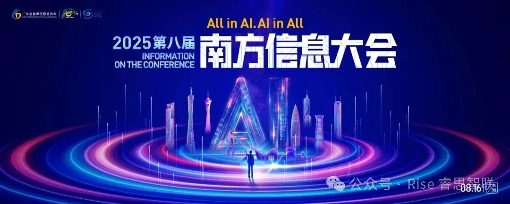
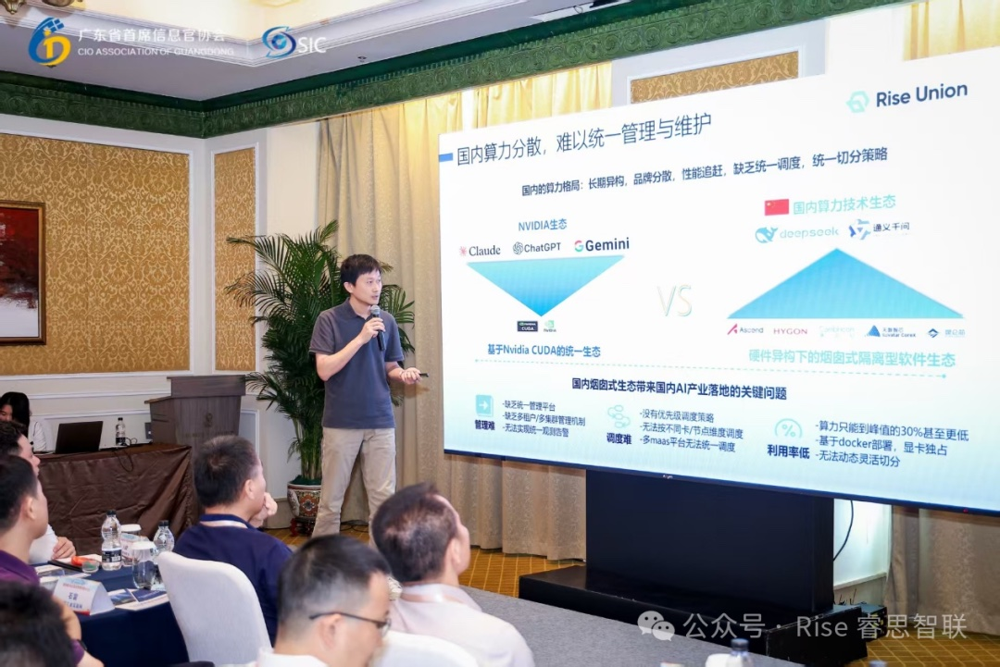
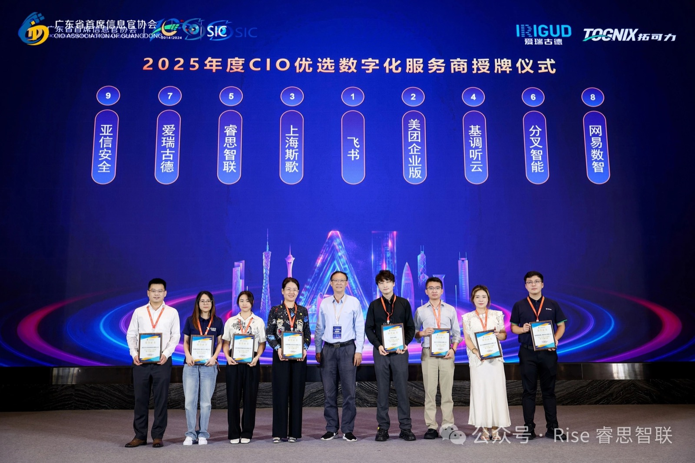

[简体中文](./README.md) · [All articles](../../README.en.md) · [Read on the website](https://www.theriseunion.com/en/blog/riseunion-south-ai-info-conference.html)

# RiseUnion at South Info Conference: AI Era Collaboration

RiseUnion · August 16, 2025 at 08:00 (UTC+08:00)

RiseUnion attends the 8th South Information Conference, sharing insights on AI era industry collaboration and digital infrastructure development, showcasing compute pooling, intelligent orchestration, and heterogeneous resource optimization technologies.

On August 16, 2025, the **8th South Information Conference**, hosted by the Guangdong Chief Information Officer Association, was held at the Ritz-Carlton Guangzhou. The conference, themed **"AI Era: Opportunities and Challenges for CIOs"**, brought together over 500 CIOs, IT directors, CFOs, and digital transformation leaders from various industries across Guangdong Province to explore AI technology's role in enterprise transformation and industrial upgrading.

As an innovative company in AI computing and compute resource management, RiseUnion was invited to attend the conference and share insights on **industry collaboration and digital infrastructure development in the AI era**, showcasing the company's advancements in compute pooling, intelligent orchestration, and heterogeneous resource optimization.

During the afternoon session on **"State-Owned Digital Technology Company Operations Workshop"**, RiseUnion CTO Yang Shiqi engaged in discussions with industry leaders including Guangdian Yuntong Research Institute Director Tian Feng, China Southern Airlines Digital Intelligence Deputy General Manager Bu Liang, and Shenzhen Qianhai Data Deputy General Manager Cai Yujuan. Yang Shiqi shared RiseUnion's practical experience in **operational models and breakthrough strategies for state-owned digital technology companies**, and proposed constructive recommendations for establishing a **"State-Owned Digital Technology Company Operations Alliance"**, fostering closer collaboration and consensus among industry partners.

> In the AI era, competitive advantage lies not only in compute resource provisioning, but in how **standardized, intelligent compute management platforms** enable more efficient collaboration across the entire industry value chain.
> -- RiseUnion CTO Yang Shiqi

RiseUnion has long been dedicated to **AI and digital integration**, delivering core products including **[Rise VAST](https://www.theriseunion.com/en/product/vast.html), [Rise CAMP](https://www.theriseunion.com/en/product/camp.html), and [Rise ModelX](https://www.theriseunion.com/en/product/modelx.html)**. These solutions help financial, energy, and telecommunications industry clients overcome compute fragmentation and heterogeneous resource barriers, achieving efficient resource utilization and agile business innovation. Participation in the South Information Conference represents not only deep insights into industry trends, but also a significant step toward **collaborative AI ecosystem development** with industry chain partners.

Moving forward, RiseUnion will leverage this conference as a catalyst to continue focusing on **AI technology innovation and industrial deployment**, injecting new momentum into enterprise digital transformation while leading the AI revolution and jointly creating a new landscape of high-quality development.

---

[Read this article on the RiseUnion website](https://www.theriseunion.com/en/blog/riseunion-south-ai-info-conference.html) · [Explore more articles](https://www.theriseunion.com/en/blog.html)
