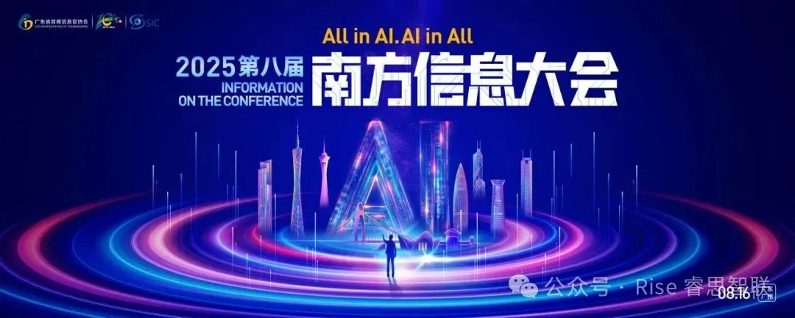
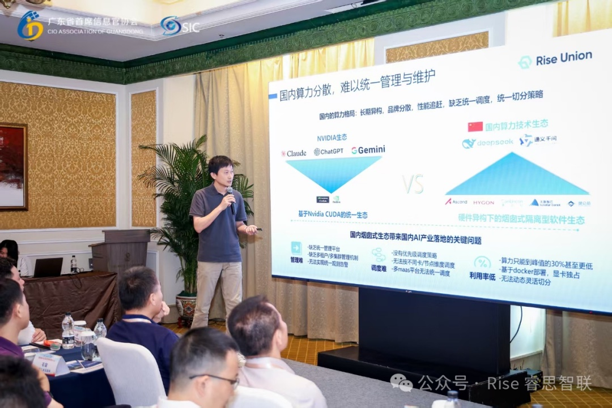
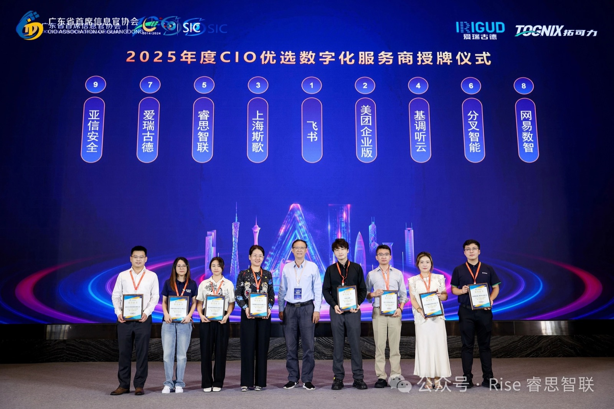

[English](./README.en.md) · [文章目录](../../README.md) · [官网阅读](https://www.theriseunion.com/zh/blog/riseunion-south-ai-info-conference.html)

# 睿思智联出席南方信息大会，分享AI时代产业协同

睿思智联 · 2025/08/16 08:00（北京时间）

睿思智联受邀出席第八届南方信息大会，分享AI时代产业协同与数字化底座建设经验，展示算力池化、智能调度与异构适配等前延技术，推动国有数科公司运营联盟建设。

2025 年 8 月 16 日，由广东省首席信息官协会主办的 **第八届南方信息大会** 在广州富力丽思卡尔顿酒店盛大举行。本届大会以 **“AI 时代・CIO 的机遇和挑战”** 为主题，吸引了来自广东省各行业的 500 余位 CIO、IT 总监、CFO 及数字化负责人齐聚一堂，共同探讨 AI 技术在企业转型与产业升级中的实践与未来。

作为 AI 计算与算力管理领域的创新企业，睿思智联受邀出席本次大会，并分享了对 AI 时代产业协同与数字化底座建设 的最新思考，彰显了公司在算力池化、智能调度与异构适配等前沿方向上的探索成果。

在下午举行的 **“国有数科公司运营研讨会”** 上，睿思智联 CTO 杨世琪与广电运通研究总院院长田丰、南航数智副总经理卜靓、深圳前海数据副总经理蔡玉娟等行业嘉宾同台交流。杨世琪重点围绕 **国有数科公司的运营模式与破局路径** 分享了睿思智联的实践经验，并就 **“国有数科公司运营联盟”** 建设提出了建设性建议，推动与行业伙伴形成更紧密的合作与共识。

> AI 时代的核心竞争力，不仅在于算力资源的供给，更在于如何通过 **标准化、智能化的算力管理平台**，让产业链上下游能够更高效协同。
> -- 睿思智联 CTO 杨世琪

长期以来，睿思智联深耕 **AI 与数字化融合**，通过自研的 **[Rise VAST](https://www.theriseunion.com/zh/product/vast.html)、[Rise CAMP](https://www.theriseunion.com/zh/product/camp.html)、[Rise ModelX](https://www.theriseunion.com/zh/product/modelx.html)** 等核心产品，帮助金融、能源、通信等行业客户打破算力碎片化与异构壁垒，实现资源高效利用与业务敏捷创新。此次参与南方信息大会，不仅是对行业前沿趋势的深度洞察，更是睿思智联与产业链伙伴 **携手共建 AI 产业生态** 的重要一步。

未来，睿思智联将以本次大会为契机，继续聚焦 **AI 技术创新与产业落地**，为企业数字化转型注入新动能，在 AI 浪潮中勇立潮头，共同开创高质量发展的新局面。

---

[在睿思智联官网阅读本文](https://www.theriseunion.com/zh/blog/riseunion-south-ai-info-conference.html) · [浏览更多文章](https://www.theriseunion.com/zh/blog.html)
