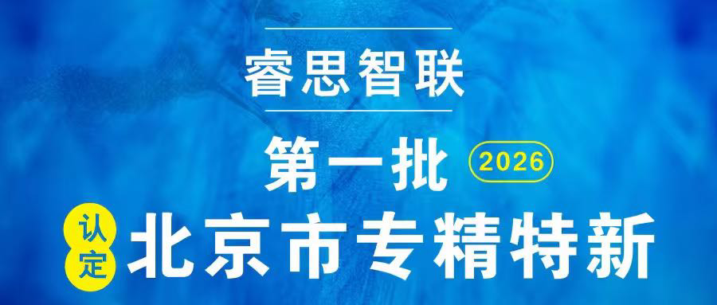

[简体中文](./README.md) · [All articles](../../README.en.md) · [Read on the website](https://www.theriseunion.com/en/blog/riseunion-specialized-sme-2026.html)

# RiseUnion Named Among First Batch of 2026 Beijing Specialized & Innovative SMEs

RiseUnion · March 25, 2026 at 08:00 (UTC+08:00)

RiseUnion has been selected for Beijing's first batch of 2026 Specialized, Refined, Distinctive & Innovative SMEs, recognizing the company's expertise and innovation in AI compute management.

RiseUnion has been selected for **Beijing's first batch of 2026 Specialized, Refined, Distinctive & Innovative (SRDI) SMEs**. This recognition reflects the company's professional depth, technical innovation, and differentiated competitive advantage in AI compute management.

RiseUnion is an innovative technology company focused on **AI compute management and scheduling**. Since its founding, the company has been deeply committed to the AI infrastructure segment, driving technical innovation to build leading AI compute management platforms. By tackling core challenges in heterogeneous GPU resource management and promoting deep integration of domestic chips with AI applications, RiseUnion has established a distinctive position that aligns with Beijing's SRDI enterprise development criteria.

As a **national high-tech enterprise** and innovative SME, RiseUnion has consistently prioritized R&D investment, holding multiple patents and software copyrights, and actively participating in heterogeneous GPU resource management standardization efforts. With solid technical foundations, a mature product portfolio, and strong market growth, the company successfully passed all levels of review to earn SRDI recognition.

This designation not only validates RiseUnion's innovation capability, technical strength, and growth potential, but also opens new policy opportunities. Going forward, RiseUnion will continue to deepen its focus on AI compute management, intensify core technology R&D, and deliver professional compute management solutions to empower industry development and strengthen supply chain self-reliance.

---

[Read this article on the RiseUnion website](https://www.theriseunion.com/en/blog/riseunion-specialized-sme-2026.html) · [Explore more articles](https://www.theriseunion.com/en/blog.html)
