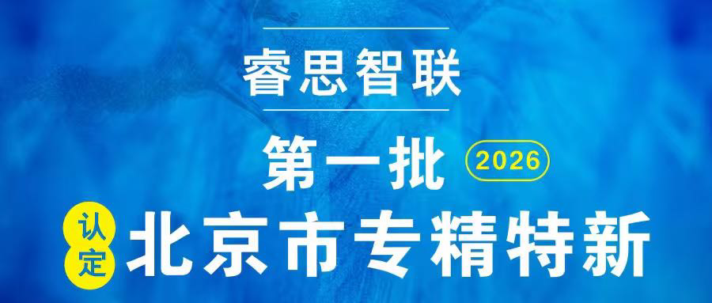

[English](./README.en.md) · [文章目录](../../README.md) · [官网阅读](https://www.theriseunion.com/zh/blog/riseunion-specialized-sme-2026.html)

# 睿思智联荣膺 2026 首批北京市专精特新中小企业

睿思智联 · 2026/03/25 08:00（北京时间）

睿思智联成功入选 2026 年第一批北京市专精特新中小企业名单，这是对公司在 AI 算力管理领域专业化、精细化、特色化与创新能力的高度认可。

睿思智联成功入选 **2026 年第一批北京市专精特新中小企业**名单。这是对公司在专业化、精细化、特色化与创新能力上的高度认可，更是公司发展历程中的重要里程碑。

睿思智联是一家聚焦 **AI 算力管理与调度**的创新科技企业，自成立以来，深耕 AI 基础设施细分赛道，以技术创新为核心驱动力，致力于打造 AI 算力管理平台。针对行业痛点，重点攻克异构 GPU 资源管理等核心难题，推动国产芯片与 AI 应用的深度融合。这一业务布局高度契合北京市专精特新中小企业的专业化、特色化发展要求，在 AI 算力管理细分领域形成了差异化竞争优势。

作为**国家级高新技术企业**、创新型中小企业，睿思智联始终将研发创新放在发展首位，持续加大研发投入，拥有多项自主知识产权专利及软件著作权，深度参与异构 GPU 资源管理相关标准制定。凭借扎实的技术积淀、成熟的产品体系和良好的市场成长性，顺利通过各级审核，成功跻身北京市专精特新中小企业行列。

此次获评既是对睿思智联创新能力、技术实力与发展潜力的高度认可，也为企业发展带来新的政策机遇。未来，睿思智联将持续深耕 AI 算力管理与调度赛道，加大核心技术攻关力度，以更专业的算力管理解决方案赋能行业发展，助力产业链供应链自主可控。

---

[在睿思智联官网阅读本文](https://www.theriseunion.com/zh/blog/riseunion-specialized-sme-2026.html) · [浏览更多文章](https://www.theriseunion.com/zh/blog.html)
