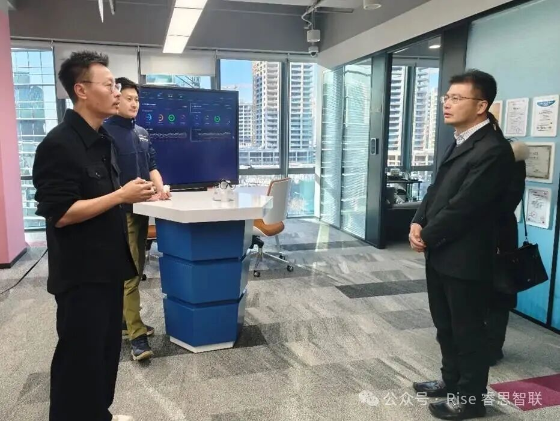

[简体中文](./README.md) · [All articles](../../README.en.md) · [Read on the website](https://www.theriseunion.com/en/blog/riseunion-visited-by-ccid-institute.html)

# Industry-Government Collab: CCID Institute Visits RiseUnion

RiseUnion · January 16, 2026 at 08:00 (UTC+08:00)

Hu Guodong, Deputy Party Secretary of CCID Institute, visited RiseUnion. Both sides discussed AI scenario application, compute infrastructure, and standard formulation. RiseUnion showcased its full-stack AI infrastructure solutions, receiving high recognition.

On January 16, 2026, Hu Guodong, Deputy Party Secretary of the CCID Institute (China Center for Information Industry Development) under the Ministry of Industry and Information Technology (MIIT) and Director of the MIIT Key Laboratory for AI Scenario Application and Intelligent System Evaluation, visited Beijing RiseUnion Technology Co., Ltd. for inspection and exchange. Accompanied by RiseUnion CEO Jin Meng and CTO Yang Shiqi, the two sides engaged in in-depth discussions on core topics such as AI scenario implementation, computing power infrastructure construction, and industry standard co-construction, aiming to lay out a blueprint for the high-quality development of the AI industry through government-enterprise synergy.

During the visit, Deputy Secretary Hu Guodong and his delegation first visited RiseUnion's technology achievement exhibition area, gaining an immersive understanding of the company's core capabilities in AI compute management, oversubscription, pooling, and heterogeneous computing. CTO Yang Shiqi focused on reporting the company's self-developed full-stack AI infrastructure solutions, systematically elaborating on RiseUnion's core logic of "software-defined compute, technology-empowered industry," covering the unified heterogeneous compute scheduling platform, integrated AI Dev/Ops tools, and customized scenario applications for finance, telecommunications, and intelligent manufacturing industries. In the on-site demonstration, the product's practical effectiveness in improving compute utilization, reducing AI R&D costs, and ensuring system security and stability received high recognition and full affirmation from the inspection team.

At the symposium, Deputy Secretary Hu Guodong interpreted the current policy orientation and industry trends of AI industry development, combining the functional positioning of the MIIT Key Laboratory. He pointed out that AI technology is moving from a breakthrough period to a large-scale application period. As a core productivity element, the standardized, efficient, and secure application of computing power is the key grasp for industrial upgrading. The CCID Institute and Key Laboratory have always based themselves on the industry hub position, committed to building a collaborative innovation platform for industry, academia, research, and application. By promoting the deep integration of AI technology and the real economy through technology evaluation, standard formulation, and scenario empowerment, RiseUnion's core technology and business layout precisely fit the core needs of industrial development.

CEO Jin Meng extended a warm welcome to Deputy Secretary Hu Guodong's visit and detailed RiseUnion's development history, core advantages, and industry practices. He stated that the company has been deeply cultivating the AI compute infrastructure field for many years. With self-developed core algorithms and full-link solutions, it has served multiple industry-leading customers, achieving significant results of increasing compute resource utilization by over 40%. As the leader of the AI Industry Committee (AIIC) Compute Pooling Working Group, RiseUnion has always taken the stance of an industry leader, spearheading the formulation of technical standards, ecosystem cultivation, and scenario promotion for AI heterogeneous compute pooling. focusing on solving industry pain points such as heterogeneous compute compatibility and efficient resource scheduling, and assisting the large-scale application of domestic computing power and the transformation of large model results. This time, we are eager to deepen cooperation with authoritative institutions like the CCID Institute, further integrate resources, complement advantages, and achieve collaborative win-win in technology R&D, standard co-construction, and scenario expansion, promoting standardized industrial development.

With government and enterprise united, success is assured. This inspection and exchange not only solidified the foundation for cooperation between the two sides but also clarified the direction of development for the integration of AI technology and industry. In the future, RiseUnion will work side by side with the CCID Institute, using collaborative innovation as a link, deeply cultivating the fields of AI scenario application and computing power infrastructure, jointly writing a new chapter of collaborative development of industry, academia, research, and application, and helping China's AI industry accelerate on the global track.

---

[Read this article on the RiseUnion website](https://www.theriseunion.com/en/blog/riseunion-visited-by-ccid-institute.html) · [Explore more articles](https://www.theriseunion.com/en/blog.html)
