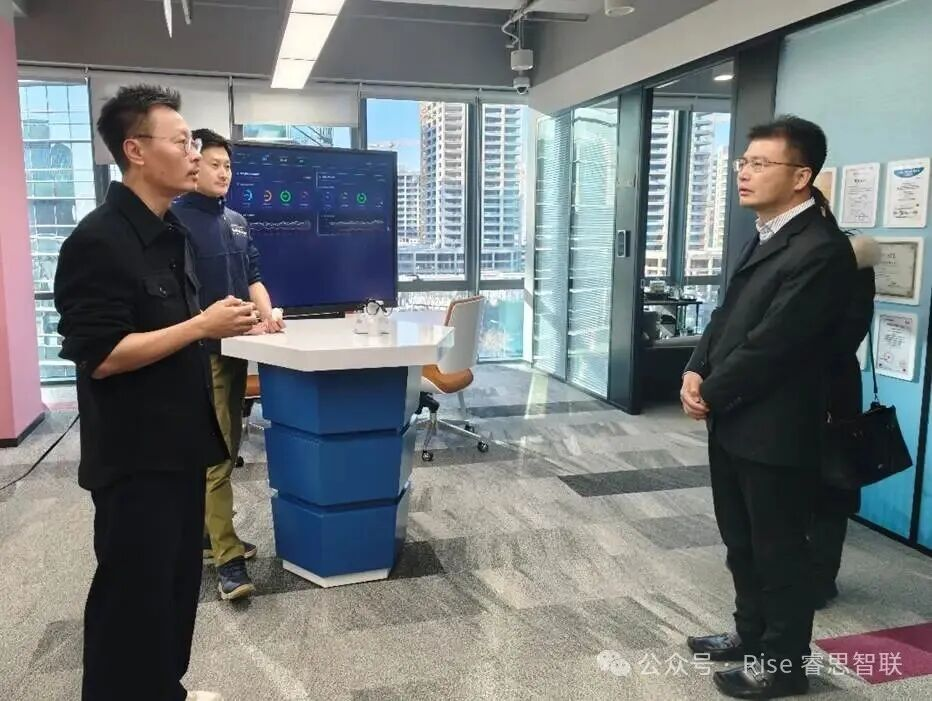

[English](./README.en.md) · [文章目录](../../README.md) · [官网阅读](https://www.theriseunion.com/zh/blog/riseunion-visited-by-ccid-institute.html)

# 政企携手共拓AI新赛道！赛迪研究院胡国栋一行莅临睿思智联考察交流

睿思智联 · 2026/01/16 08:00（北京时间）

工信部赛迪研究院党委副书记胡国栋一行莅临睿思智联考察。双方围绕AI场景化落地、算力基础设施建设及行业标准共建深入交流。睿思智联展示全栈式AI基础设施解决方案，获高度认可。

2026年1月16日，工信部赛迪研究院（中国电子信息产业发展研究院）党委副书记、人工智能场景化应用与智能系统测评工信部重点实验室主任胡国栋一行，莅临北京睿思智联科技有限公司开展考察交流。睿思智联CEO金萌、CTO杨世琪全程陪同，双方围绕人工智能场景化落地、算力基础设施建设、行业标准共建等核心议题深入探讨，以政企协同之力为AI产业高质量发展谋篇布局。

考察期间，胡国栋副书记一行首先走进睿思智联技术成果展示区，沉浸式了解企业在AI算力管理、超分、池化、异构等领域的核心能力。CTO杨世琪重点汇报了公司自主研发的全栈式AI基础设施解决方案，从异构算力统一调度平台、AI开发运维一体化工具，到面向金融、电信、智能制造等行业的定制化场景应用，系统阐述了睿思智联“软件定义算力，技术赋能产业”的核心逻辑。现场演示中，产品在提升算力利用率、降低AI研发成本、保障系统安全稳定等方面的实战成效，得到考察团的高度认可与充分肯定。

座谈会上，胡国栋副书记结合工信部重点实验室的职能定位，解读了当前人工智能产业发展的政策导向与行业趋势。他指出，AI技术正从技术突破期迈向规模化应用期，算力作为核心生产力要素，其标准化、高效化、安全化应用是产业升级的关键抓手。赛迪研究院及重点实验室始终立足行业枢纽地位，致力于搭建产学研用协同创新平台，通过技术测评、标准制定、场景赋能，推动AI技术与实体经济深度融合，而睿思智联的核心技术与业务布局，精准契合了产业发展的核心需求。

CEO金萌对胡国栋副书记一行的到访表示热烈欢迎，并详细介绍了睿思智联的发展历程、核心优势及行业实践。他表示，公司深耕AI算力基础设施领域多年，凭借自主研发的核心算法与全链路解决方案，已为多个行业头部客户提供服务，实现了算力资源利用率提升40%以上的显著成果。作为AI产业工委会（AIIC）算力池化工作组组长单位，睿思智联始终以行业引领者姿态，牵头推动AI异构算力池化技术标准制定、生态培育及场景化推广工作，聚焦解决异构算力兼容、资源高效调度等行业痛点，助力国产算力规模化应用与大模型成果转化。此次渴望与赛迪研究院这样的权威机构深化携手，进一步整合资源、互补优势，在技术研发、标准共建、场景拓展等方面实现协同共赢，推动产业规范化发展。

政企同心，其利断金。此次考察交流不仅夯实了双方合作基础，更明确了AI技术与产业融合的发展方向。未来，睿思智联将与赛迪研究院携手并肩，以协同创新为纽带，深耕人工智能场景化应用与算力基础设施领域，共同书写产学研用协同发展的新篇章，助力我国AI产业在全球赛道上跑出加速度。

---

[在睿思智联官网阅读本文](https://www.theriseunion.com/zh/blog/riseunion-visited-by-ccid-institute.html) · [浏览更多文章](https://www.theriseunion.com/zh/blog.html)
