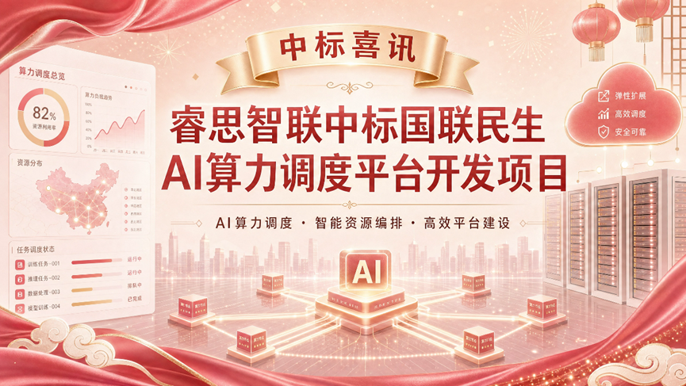

[简体中文](./README.md) · [All articles](../../README.en.md) · [Read on the website](https://www.theriseunion.com/en/blog/riseunion-wins-guolian-minsheng-ai-scheduling-project.html)

# Good News | RiseUnion Wins the Guolian Minsheng AI Computing Scheduling Platform Development Project

RiseUnion · May 19, 2026 at 10:20 (UTC+08:00) · [Original WeChat article (Chinese)](https://mp.weixin.qq.com/s/2OM7Zq4ZiXA_omTrE8yjiA)

The Wuxi Property Rights Exchange recently announced the award result for the “Guolian Minsheng AI Computing Scheduling Platform Development Project Procurement.” Beijing RiseUnion Technology Co., Ltd. won the project on the strength of its technical capabilities, mature project experience, and high-quality service proposal.

The Wuxi Property Rights Exchange recently announced the award result for the “Guolian Minsheng AI Computing Scheduling Platform Development Project Procurement.” **Beijing RiseUnion Technology Co., Ltd.** won the project on the strength of its technical capabilities, mature project experience, and high-quality service proposal.

Guolian Minsheng Securities Co., Ltd. is a leading state-controlled comprehensive listed securities firm in China, with businesses covering the full chain of financial services including brokerage, investment banking, and asset management. This project focuses on building an AI computing scheduling platform and model-inference services, demonstrating the customer’s determination to deeply integrate AI large models into daily work and core businesses, as well as its strong emphasis on computing management, platform-based operations, and technical implementation capabilities. RiseUnion’s ability to stand out amid intense competition not only fully affirms its overall strength in computing scheduling and model services, but also reflects the customer’s deep trust in RiseUnion’s intelligent computing planning and implementation and delivery experience in the financial industry.\

In the future, RiseUnion will uphold its original commitment to professionalism, efficiency, and reliability; advance the project’s follow-up work rigorously and solidly; and repay the customer’s trust through high-quality delivery. At the same time, RiseUnion will take this project win as a new starting point, continue to invest in core technology innovation, comprehensively upgrade its intelligent computing product system, provide more industry customers with advanced, stable, and sustainable AI platform solutions, and empower more industry customers to build core competitiveness in the large-model era.

### About RiseUnion

Beijing RiseUnion Technology Co., Ltd. (RiseUnion) focuses on AI computing management and scheduling. It has completed compatibility certification with more than 10 domestic chips and is one of the core contributors to the CNCF Sandbox open-source project HAMi. The company is a National High-Tech Enterprise, a Beijing Specialized, Refined, Distinctive, and Innovative SME, and chair organization of the AIIC Compute Pooling Working Group, with large-scale production deployments in finance, government and military enterprises, transportation, healthcare, and other industries.

RiseUnion is committed to making computing power as readily available as water and electricity, building an intelligent, controllable, and efficient computing foundation for enterprise AI transformation.

---

[Read this article on the RiseUnion website](https://www.theriseunion.com/en/blog/riseunion-wins-guolian-minsheng-ai-scheduling-project.html) · [Explore more articles](https://www.theriseunion.com/en/blog.html)
