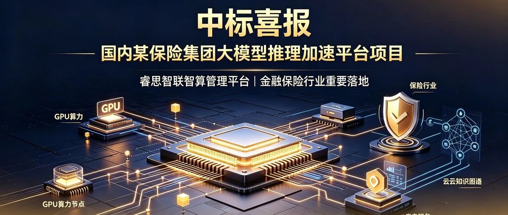

[简体中文](./README.md) · [All articles](../../README.en.md) · [Read on the website](https://www.theriseunion.com/en/blog/riseunion-wins-insurance-llm-inference-platform.html)

# Good News | RiseUnion Wins Bid for a Large-Model Inference Acceleration Platform at a Major Domestic Insurance Group

RiseUnion · August 24, 2026 at 09:57 (UTC+08:00) · [Original WeChat article (Chinese)](https://mp.weixin.qq.com/s/jlpp2uhwQ-eRAkSdRDfZFQ)

Beijing RiseUnion Technology Co., Ltd. (“RiseUnion”) recently won the bid for a large-model inference acceleration platform project at a major domestic insurance group.

> “
>
> Beijing RiseUnion Technology Co., Ltd. (“RiseUnion”) recently won the bid for a large-model inference acceleration platform project at a major domestic insurance group (the “Project”). This win marks an important deployment for RiseUnion in the financial and insurance industry. Large models are evolving from a technology trend into business infrastructure, and the platform layer connecting computing power with model services is precisely where RiseUnion delivers value.

Over the past year, the financial industry’s attitude toward large models has changed significantly. Early discussions centered on “which model to choose”; the focus now is on “how to run models reliably in production.” Buying GPU servers and selecting models are only the beginning. The real challenges come next: Are inference services responsive enough? Is GPU computing power being fully utilized? Who manages models after they go live?

This project addresses those three questions:

## Inference Acceleration: Handling Peak Business Demand

Insurance workloads have a distinctive pattern: requests surge during working hours and fall sharply after hours. If model services are designed around average load, they will inevitably slow down at peak times. If they are provisioned for peak load, resources will sit idle most of the time.

RiseUnion optimizes both the scheduling and engine layers, enabling the platform to adjust resource allocation automatically based on real-time load—handling peaks without wasting resources during troughs. The goal is not impressive benchmark scores, but reliable performance when the business actually depends on it.

## Compute Management: Turning Distributed GPUs into One Resource Pool

Financial institutions often procure GPUs in batches, resulting in different models and fragmented clusters. This frequently creates a situation where “GPUs exist on the books, but the business still lacks capacity.”

RiseUnion brings all types of GPUs under unified management, partitions them on demand, and schedules them elastically. A busy workload can draw on more GPUs, while idle resources are released automatically for others to use. Put simply, the goal is not to make customers buy more GPUs, but to keep the GPUs they already own from sitting idle.

## Model Operations: Going Live Is Another Beginning

Deploying a model is only the first step. Once it is live, teams still need to monitor service status, diagnose problems, update versions, and switch smoothly away from models being retired. Without a unified management tool, many management capabilities are impossible to establish, leaving teams without effective ways to assure model-service quality and efficiency.

RiseUnion provides complete model-service management capabilities, covering monitoring, alerts, service start and stop controls, and version management, so operations teams can complete their work through one interface.

## Conclusion

For this insurance group, rapidly growing computing capacity and the broad rollout of AI applications mean that large models are moving beyond scenario validation to become production-grade infrastructure capable of supporting core business operations. RiseUnion’s role is to make this infrastructure reliable, controllable, and affordable.

What truly creates differentiation is not who chooses the stronger model, but who can keep models serving real business needs over the long term—reliably and efficiently. That is the significance of RiseUnion winning this project.

### About RiseUnion

Beijing RiseUnion Technology Co., Ltd. focuses on AI computing management and scheduling. It has completed compatibility certifications for more than 10 domestic chips and is one of the core contributors to the CNCF Sandbox open-source project HAMi. The company is a National High-Tech Enterprise, a Beijing Specialized, Sophisticated, Distinctive, and Innovative SME, and the leader of the AIIC Computing Pooling Working Group. It has delivered large-scale production deployments in finance, government, defense, transportation, healthcare, and other industries.

RiseUnion is committed to making computing power as readily available as water and electricity, building an intelligent, controllable, and efficient computing foundation for enterprise AI transformation.

For more information, visit **riseunion.ai** or contact us at **400-605-2336**.

---

[Read this article on the RiseUnion website](https://www.theriseunion.com/en/blog/riseunion-wins-insurance-llm-inference-platform.html) · [Explore more articles](https://www.theriseunion.com/en/blog.html)
