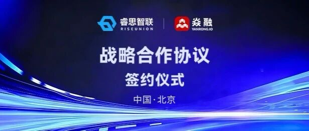
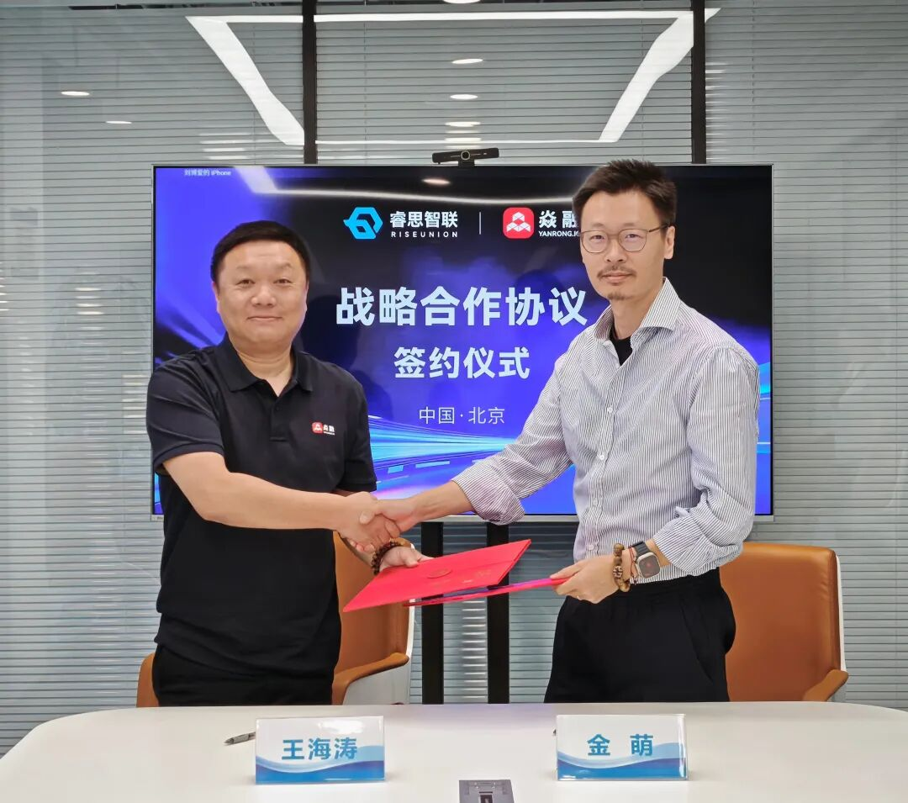

[简体中文](./README.md) · [All articles](../../README.en.md) · [Read on the website](https://www.theriseunion.com/en/blog/riseunion-yanrong-token-factory-partnership.html)

# RiseUnion and YanRong Technology Form a Strategic Partnership to Jointly Build “Token Factory” AI Infrastructure

RiseUnion · June 01, 2026 at 10:00 (UTC+08:00) · [Original WeChat article (Chinese)](https://mp.weixin.qq.com/s/8nNJNMHJY3JBfg8lefOOyg)

RiseUnion and YanRong Technology form a strategic partnership to jointly build “Token Factory” AI infrastructure.

**Beijing, May 29, 2026** — Today, as AI applications move comprehensively toward large-scale inference, “Tokens” are evolving from a technical metric into a core financial and operating metric for enterprises. To address the dual pressures on storage and computing caused by explosive growth in daily Token calls, Beijing RiseUnion Technology Co., Ltd. (RiseUnion), an innovative company focused on AI computing management and scheduling, and Beijing YanRong Technology Co., Ltd. (YanRong Technology), a leading Chinese full-stack AI storage vendor, formally signed a strategic cooperation agreement in Beijing.

This cooperation is a deep handshake between “storage” and “computing” in AI infrastructure. Relying on RiseUnion’s computing scheduling platform and YanRong Technology’s full-stack AI training and inference storage solution, the two parties will jointly create a systematic solution for the “Token Factory.” Through storage-compute collaboration, it breaks through the boundaries of heterogeneous computing and GPU memory capacity, unlocking new computing efficiency and commercial monetization capabilities for enterprises.

**Breaking Through the “Storage-Compute Imbalance”**

**Building Deterministic Token Delivery Capabilities**

As large models enter the stage of Agent-cluster collaboration, enterprise demand for AI has shifted from “renting GPU computing” to “purchasing Token output.” Yet response delays caused by the GPU memory wall and idle heterogeneous computing resources make large-scale implementation of the “Token Factory” extremely difficult.

The strategic alliance between RiseUnion and YanRong Technology addresses this problem through storage-compute collaboration. RiseUnion weaves scattered heterogeneous GPUs into a unified computing network to allocate resources on demand; YanRong Technology builds an efficient data-supply channel through deep storage optimization technologies.

To meet the differing response-speed and cost requirements of various enterprise businesses, the joint solution demonstrates extremely high flexibility:

- Scheduling layer: RiseUnion CAMP computing management software relies on heterogeneous compute pooling and intelligent scheduling strategies to precisely activate idle computing resources, optimize GPU memory resource allocation, and fully unlock the resource potential of high-, mid-, and low-tier computing devices. It enables fragmented computing resources and whole-machine computing resources to operate together efficiently, releasing resource utilization and performance far beyond traditional computing deployment models.

&nbsp;

- Storage layer: The YanRong YRCache inference storage system intelligently offloads critical data, greatly easing GPU memory pressure so that high-, mid-, and low-tier computing resources can all run at full load and deliver inference performance far beyond their native configurations.

The two parties collaborate deeply on the model-service system to build a tiered assurance mechanism for inference services, achieving refined computing-resource utilization pushed to the limit. Whether for latency-critical core businesses such as financial transactions and real-time interactions, or cost-sensitive scenarios such as batch processing and content generation, each can receive a matching response level and resource allocation, truly achieving the optimal balance between resource utilization and business experience.

**Reconstructing the Business Logic of AI Infrastructure to Multiply Value**

This deep storage-compute collaboration completely changes the profitability formula for AI infrastructure. Under the traditional model, enterprises often fall into the dilemma of “insufficient computing resources at peak times and idle resources during valleys.” Without refined operating methods, the cost per Token also remains high.

By combining compute pooling + storage acceleration + unified scheduling, the joint solution integrates previously fragmented resources into a measurable and operable “Token Factory.” Compared with the traditional “bare computing rental” model and a single model-inference solution, the new solution achieves a significant leap in Token output efficiency and commercial value from the same hardware investment. Enterprises no longer leave expensive computing resources idle. By pushing resource utilization to the limit, they substantially amortize the cost per Token and transform AI infrastructure into a profit center capable of continuously creating business value.

**Building the Ecosystem Together and Defining Pricing Power in the AI Era**

The signing of this strategic agreement marks the official beginning of a new chapter of deep collaboration between RiseUnion and YanRong Technology in AI infrastructure. The two parties will cooperate comprehensively on joint solution development and deep cultivation of industry scenarios, jointly helping customers in finance, government and enterprise, healthcare, education, and other industries reduce costs, increase efficiency, and accelerate applications during AI deployment and implementation, driving China’s AI industry toward a more efficient and economical “Token Factory” era.

------------------------------------------------------------------------

**About RiseUnion**

RiseUnion is an innovative technology company focused on AI computing management and scheduling, committed to building an industry-leading data-center-level AI computing management platform and solutions. With “software-defined computing” at its core, the company uses products such as Rise CAMP to deliver unified management of heterogeneous GPU resources, compute pooling, task scheduling, and refined operations, solving industry challenges such as the difficulty of uniformly scheduling heterogeneous computing and the waste of idle resources. RiseUnion is a core maintainer of the CNCF Sandbox open-source project HAMi and has strong underlying technical accumulation and ecosystem influence. Its solutions widely serve customers in finance, government and enterprise, transportation, education, healthcare, and other industries, helping enterprises comprehensively improve the utilization efficiency and intelligence of AI infrastructure.

**About YanRong Technology**

YanRong Technology is a leading Chinese provider of full-stack AI storage solutions, building high-performance, scalable data infrastructure around the entire AI lifecycle. To address core challenges in AI inference scenarios, YanRong Technology launched the YRCache inference storage system, which deeply optimizes critical paths such as KVCache. Its multi-level cache architecture breaks through GPU memory bottlenecks, significantly reduces time to first Token, increases Token throughput, and effectively amortizes inference cost per Token. YanRong Technology covers the entire AI training, inference, and data-governance chain with storage performance pushed to the limit, ensuring every GPU releases its full capability with optimal data supply and providing enterprises with a stable, efficient, and low-cost AI infrastructure foundation.

---

[Read this article on the RiseUnion website](https://www.theriseunion.com/en/blog/riseunion-yanrong-token-factory-partnership.html) · [Explore more articles](https://www.theriseunion.com/en/blog.html)
