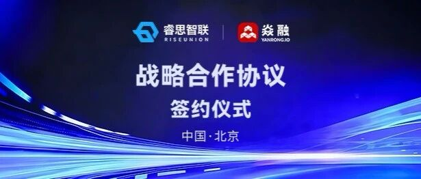
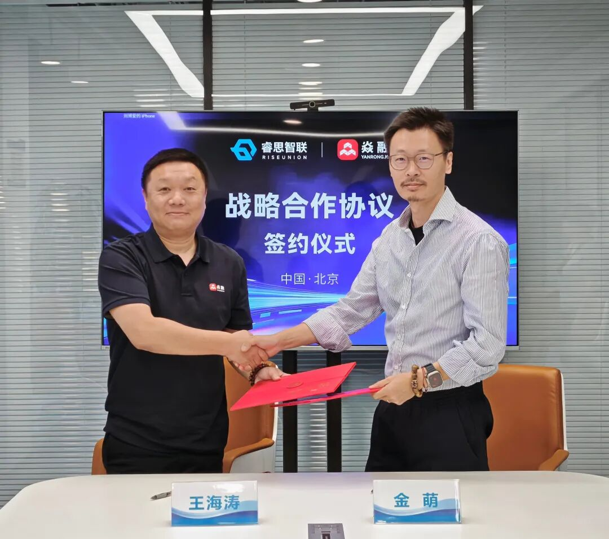

[English](./README.en.md) · [文章目录](../../README.md) · [官网阅读](https://www.theriseunion.com/zh/blog/riseunion-yanrong-token-factory-partnership.html)

# 睿思智联与焱融科技达成战略合作，联合打造“Token工厂”AI基础设施

睿思智联 · 2026/06/01 10:00（北京时间） · [微信公众号原文](https://mp.weixin.qq.com/s/8nNJNMHJY3JBfg8lefOOyg)

睿思智联与焱融科技达成战略合作，联合打造“Token工厂”AI基础设施

**北京，2026年5月29日**—— 在 AI 应用全面迈向规模化推理的今天，“Token”正从技术指标演变为企业的核心财务与运营指标。为了应对日均 Token 调用量爆发式增长带来的存算双重压力，专注于 AI 算力管理与调度的创新企业北京睿思智联科技有限公司（简称：睿思智联）与中国领先的全栈 AI 存储厂商北京焱融科技有限公司（简称：焱融科技）在北京正式签署战略合作协议。

此次合作是 AI 基础设施领域“存”与“算”的深度握手。双方将依托睿思智联的算力调度平台与焱融科技全栈 AI 训推存储解决方案，联合打造面向“Token工厂”的系统性解决方案，通过存算协同打破异构算力与显存容量的边界，为企业解锁全新的算力效率与商业变现能力。

**破局“存算失衡” **

**构建确定性 Token 交付能力**

随着大模型进入 Agent 集群协作阶段，企业对 AI 的需求已从“租用 GPU 算力”转向“购买 Token 产出”。然而，显存墙导致的响应迟滞与异构算力闲置，让“Token工厂”的规模化落地举步维艰。

睿思智联与焱融科技的战略联合，正是通过存算协同破解这一难题。睿思智联将分散的异构GPU编织成统一的算力网络，实现资源的按需分配；焱融科技则通过深度的存储优化技术，构建了高效的数据供给通道。

针对企业不同业务对响应速度和成本的差异化诉求，联合方案展现出了极高的灵活性：

- 调度层：睿思智联 CAMP 算力管理软件依托异构算力池化与智能调度策略，精准盘活闲置算力资源、优化显存资源分配，全面盘活高、中、低各类算力设备的资源潜能，让碎片化算力与整机算力高效协同运转，释放出远超传统算力部署模式的资源利用率与效能。

&nbsp;

- 存储层：焱融 YRCache 推理存储系统通过智能卸载关键数据，极大缓解了 GPU 显存压力，让高、中、低各档位的算力都能满负荷运行，发挥出远超原生配置的推理效能。

双方在模型服务体系上深度协同，打造推理服务分级保障机制，实现算力资源精细化、极致化利用。无论是金融交易、实时交互等对延迟极度敏感的核心业务，还是批量处理、内容生成等成本敏感型场景，都能获得与之匹配的响应级别与资源配比，真正实现资源利用与业务体验的最优平衡。

**重构 AI 基础设施的商业逻辑 实现价值倍增**

这种深度的存算协同，彻底改变了 AI 基础设施的盈利公式。传统模式下，企业往往陷入“高峰期算力不足、低谷期资源闲置”的困境，且由于缺乏精细化的运营手段，单位 Token 成本居高不下。

联合方案通过算力池化+存储加速+统一调度，将原本割裂的资源整合成了一个可度量、可运营的“Token工厂”。相比传统的“裸租算力”模式以及单一的模型推理方案，新方案在相同的硬件投入下，实现了 Token 产出效率和商业价值的显著跃升。企业不再让昂贵算力资源闲置，通过极致的资源利用率大幅摊薄单位 Token 成本，将 AI 基础设施转化为能够持续创造业务价值的利润中心。

**共建生态，定义 AI 时代定价权**

此次战略协议的签署，标志着睿思智联与焱融科技正式开启在AI基础设施领域的深度协同新篇章。双方将在联合解决方案研发、行业场景深耕等方面展开全面合作，共同帮助金融、政企、医疗、教育等行业的客户在 AI 部署落地过程中实现降本增效与应用加速，推动中国 AI 产业向更高效、更经济的“Token工厂”时代迈进。

------------------------------------------------------------------------

**关于睿思智联**

睿思智联是一家专注于 AI 算力管理与调度的创新科技企业，致力于打造业界领先的数据中心级 AI 算力管理平台与解决方案。公司以“软件定义算力”为核心，通过 Rise CAMP 等产品实现异构 GPU 资源的统一纳管、算力池化、任务调度与精细化运营，解决异构算力难以统一调度、资源闲置浪费等行业难题。睿思智联是 CNCF Sandbox 开源项目HAMi 的核心维护者，具备强大的底层技术积累与生态影响力，其方案广泛服务于金融、政企、交通、教育、医疗等行业客户，帮助企业全面提升AI基础设施的利用效率与智能化水平。

**关于焱融科技**

焱融科技是中国领先的全栈 AI 存储解决方案提供商，围绕 AI 全生命周期打造高性能、可扩展的数据基础设施。面对 AI 推理场景的核心挑战，焱融科技推出 YRCache 推理存储系统，针对 KVCache 等关键路径进行深度优化，通过多级缓存架构突破 GPU 显存瓶颈，显著降低首 Token 延迟、提升 Token 吞吐能力，并有效摊薄单位 Token 推理成本。焱融科技以极致存储性能覆盖 AI 训练、推理、数据治理全链路，确保每一块 GPU 在最优数据供给下释放全部效能，为企业构建稳定、高效、低成本的 AI 基础设施底座。

---

[在睿思智联官网阅读本文](https://www.theriseunion.com/zh/blog/riseunion-yanrong-token-factory-partnership.html) · [浏览更多文章](https://www.theriseunion.com/zh/blog.html)
