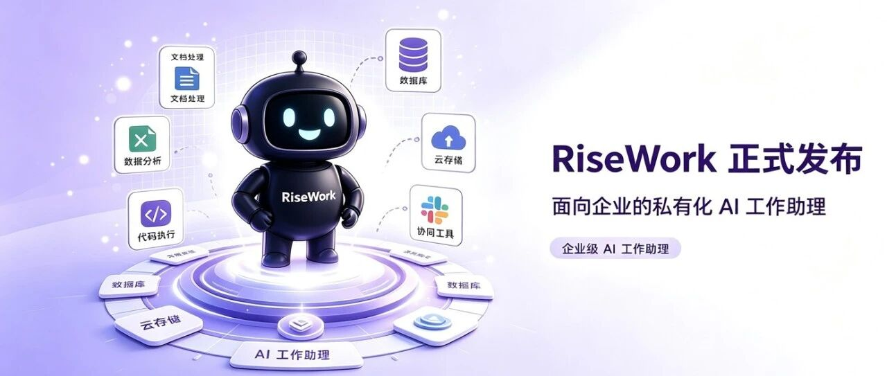
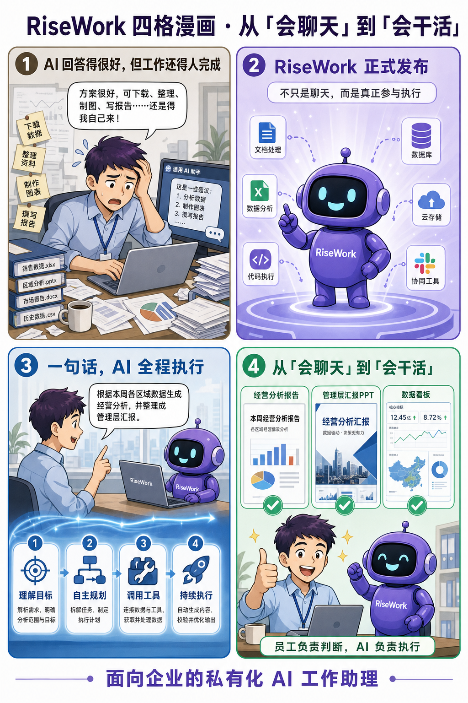
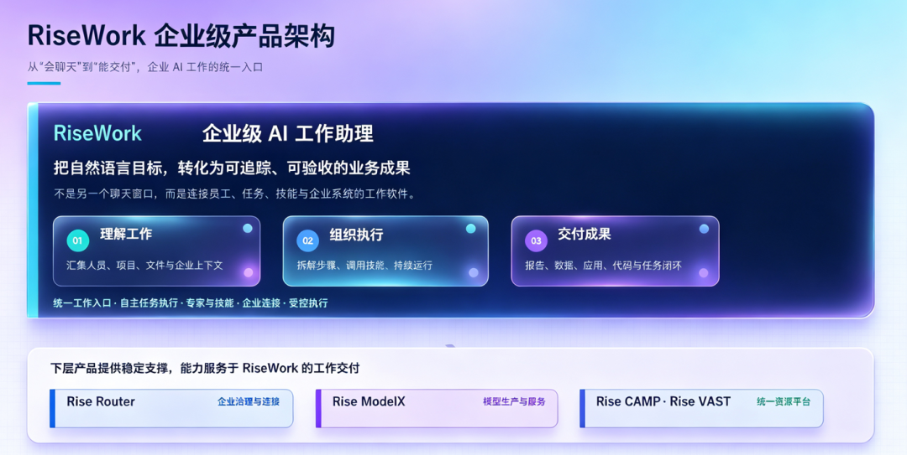

[简体中文](./README.md) · [All articles](../../README.en.md) · [Read on the website](https://www.theriseunion.com/en/blog/risework-enterprise-ai-work-assistant.html)

# AI Should Do More Than Answer: RiseWork Launches to Turn Every Goal into an Outcome

RiseUnion · August 17, 2026 at 10:02 (UTC+08:00) · [Original WeChat article (Chinese)](https://mp.weixin.qq.com/s/N15QKiRwHWw_v00LBenDZw)

As more and more people become accustomed to using AI to write copy, look up information, and organize materials, a new question has emerged: AI gives excellent answers, but people still have to complete the actual work in the end.

As more and more people become accustomed to using AI to write copy, look up information, and organize materials, a new question has emerged:

**AI gives excellent answers, but people still have to complete the actual work in the end.**

Employees still need to download files, organize data, switch between systems, create charts, and write reports. Enterprises still need to address a series of issues involving data security, model selection, permission management, and cost control.

Can AI do more than tell us “how to do it”? Can it actually participate in execution and get the work done?

Now, an AI work assistant built for private enterprise environments—**RiseWork—is officially launched**.

RiseWork was launched by Beijing RiseUnion Technology Co., Ltd. (RiseUnion). It is not another chat window, but an intelligent work platform that connects employees, tasks, skills, and enterprise systems.

An employee only needs to describe a goal in one sentence. RiseWork can then understand the task around that goal, make a plan, invoke tools, continue executing, and ultimately deliver documents, data reports, presentations, code, or runnable applications. From “able to chat” to “able to work,” enterprise AI is entering a new stage.

## What Enterprises Really Need Is Not More Answers, but Faster Delivery

Most large-model applications in the past revolved around “one question, one answer.” A user asked a question and AI generated content. Employees still had to organize materials, call data, modify files, run tests, and prepare presentations themselves. But real work in an enterprise rarely consists of only one question and answer.

A business analysis may require collecting data from multiple channels, cleaning spreadsheets, creating charts, summarizing conclusions, and generating presentation materials. Advancing a project may involve understanding requirements, modifying files, executing commands, running tests, and reporting results. A recurring job may also need to start on schedule, keep running, and recover from exceptions.

RiseWork organizes these previously scattered steps into the same work chain:

**Understand the goal, plan autonomously, invoke tools, continue executing, and deliver results.**

For example, an employee can simply ask: “Generate a business analysis based on this week’s regional data and organize it into a management presentation.”

RiseWork can break down the task around this goal, process the relevant files and data, produce charts and conclusions, and ultimately deliver presentation materials that can continue to be edited and used.

Employees do not need to master complex prompts or repeatedly move information between multiple systems. Work begins with a natural-language instruction and ends with a result that can be accepted.

## Turn Frequent Work into Enterprise AI Capabilities That Can Be Invoked

When an enterprise introduces AI, the difficulty is not only choosing a model. More importantly, it is about enabling the model to enter real business scenarios.

Through its “experts and skills” mechanism, RiseWork combines capabilities such as search, file processing, data analysis, code execution, and enterprise tool invocation to create work experts for specific roles and tasks.

Whether the work involves decision-making insights, business growth, legal affairs and risk control, data and finance, or R&D and quality management, employees can select the appropriate expert for the actual task and begin working directly.

Enterprises can also build, review, and publish their own experts and skills based on their business processes, turning proven internal methods, processes, and experience into reusable AI capabilities.

Through MCP and plugin mechanisms, RiseWork can also connect to internal enterprise business systems, allowing AI to move beyond a standalone chat window and gradually enter the real work environment.

## Documents, Data, and Automation in One Workspace

RiseWork brings everyday office work and code development into the same enterprise workspace, covering many frequent work scenarios.

For documents and presentations, it can help produce meeting minutes, material summaries, analysis reports, and presentations, delivering files that can be used directly.

For data and research, it can process information from multiple sources and produce charts, conclusions, and management reports, helping enterprises turn scattered data into business insights more quickly.

For automation, it can execute recurring tasks such as scheduled briefings and batch file processing, keeping repetitive work running continuously and reliably.

For R&D, it can also understand projects, process code, run tests, and report results, bringing development tasks and office collaboration into the same work system.

Through desktop, CLI, enterprise IM, and mobile interfaces, employees can initiate tasks, view progress, and receive results, so AI work is no longer restricted to a single device or fixed scenario.

## Employees Make Judgments; AI Executes

Enterprises need AI that can get work done, and they also need it to work within clear boundaries.

RiseWork preserves human decision-making authority while tasks are executed. Employees review key checkpoints involving plan confirmation, file modification, and permission requests. AI continues only after high-risk operations have been confirmed.

For complex, long-running tasks, the platform supports continuous operation and task recovery. Task progress and results can be tracked, while execution processes and resource usage can be audited.

This form of collaboration does not ask AI to replace employees. It redistributes work between people and AI:

**People set goals, judge direction, and confirm key decisions, while AI takes on large amounts of repetitive, continuous, and execution-oriented work.**

Employees can therefore devote more time to customer communication, business judgment, innovative design, and management decisions.

## Private Deployment Keeps Core Control in the Enterprise’s Hands

Enterprises cannot avoid questions of data, models, cost, and security when adopting AI.

RiseWork is designed for private enterprise environments. It keeps enterprise knowledge, business data, and work files within a controlled environment and provides a unified interface for managing models, accounts, permissions, quotas, usage, and audits.

Enterprises can therefore retain four key forms of control:

**Model choice**: Connect international, domestic, and local models through a unified interface and choose flexibly for different business scenarios.

**Data control**: Keep enterprise knowledge and work files in a controlled environment through private deployment.

**Capability expansion**: Continuously expand enterprise AI capabilities through Skills, Agents, MCP, plugins, and the expert marketplace.

**Cost governance**: Centrally manage accounts, plans, quotas, usage, and audits to make resource investment more transparent and controllable.

Employees do not need to manage model keys separately, and enterprises do not need to be locked into a single model or hardware system.

## Build a Sustainable AI Work System from Models to Compute

Real enterprise AI is more than a front-end application. Beneath RiseWork, Rise Router provides enterprise governance and connectivity, Rise ModelX handles model production and services, and Rise CAMP and Rise VAST provide unified resource-platform support.

Through this product system, enterprises can pool, schedule, and monitor heterogeneous international and domestic compute resources such as GPUs, NPUs, XPUs, and MLUs, choosing flexibly according to their infrastructure and procurement strategies.

From underlying compute, model services, and enterprise governance to task understanding, organizational execution, and outcome delivery at the upper layer, RiseWork creates a complete enterprise AI work chain.

This means an enterprise gains not just a temporary AI tool, but an intelligent work system that can continue evolving alongside its models, business, and organizational needs.

## Starting Today, Give the Work to RiseWork

The value of AI should not be measured only by how many questions it answers, but by how much real work it completes.

RiseWork turns natural-language goals into trackable, executable, and verifiable business outcomes. It moves AI from the chat box into enterprise workflows and lets every employee invoke complex capabilities in a simpler way.

When employees only need to state their goals clearly and AI can continue advancing the work and deliver results, enterprise intelligence truly moves from “trying a model” to “establishing a new way of working.”

**From “able to chat” to “able to work”: RiseWork, a privately deployed AI work assistant for enterprises.**

### About RiseUnion

Beijing RiseUnion Technology Co., Ltd. (RiseUnion) specializes in AI compute management and scheduling. It has completed compatibility certifications for more than 10 domestic chips and is one of the core contributors to HAMi, a CNCF Sandbox open-source project. The company is a National High-Tech Enterprise, a Beijing Specialized and Innovative SME, and the leader of the AIIC Compute Pooling Working Group. It has achieved large-scale production deployments in finance, government and defense enterprises, transportation, healthcare, and other industries.

RiseUnion is committed to making compute as readily available as water and electricity and to building an intelligent, controllable, and efficient compute foundation for enterprise AI transformation.

For more information, visit the official website: **riseunion.ai**, or contact: **400-605-2336**.

---

[Read this article on the RiseUnion website](https://www.theriseunion.com/en/blog/risework-enterprise-ai-work-assistant.html) · [Explore more articles](https://www.theriseunion.com/en/blog.html)
