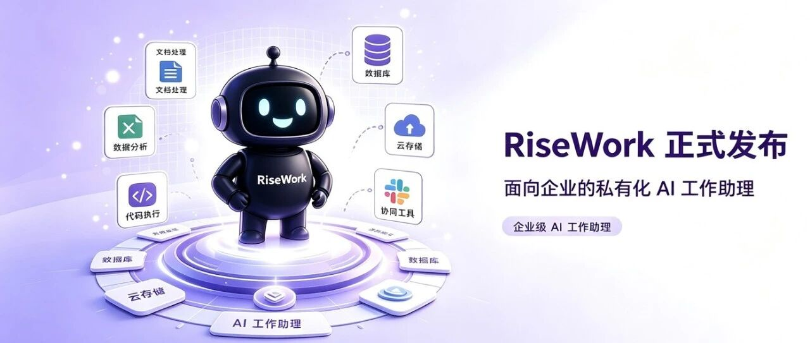
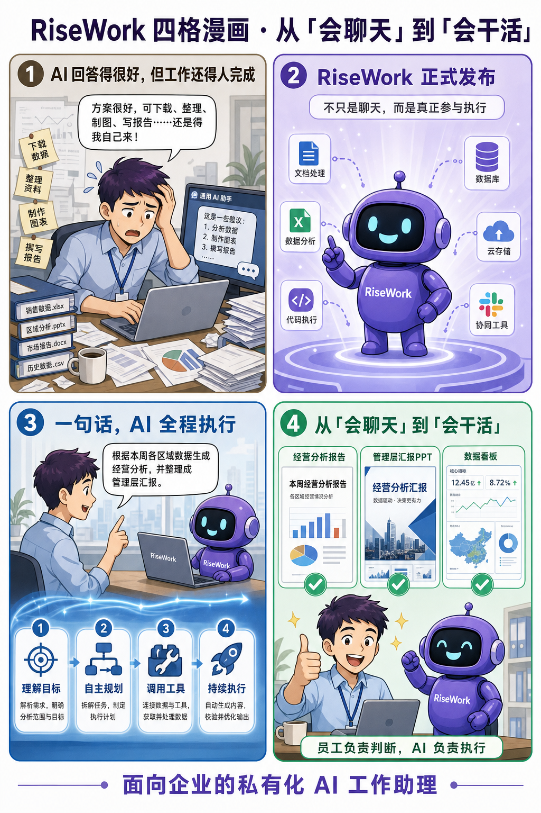
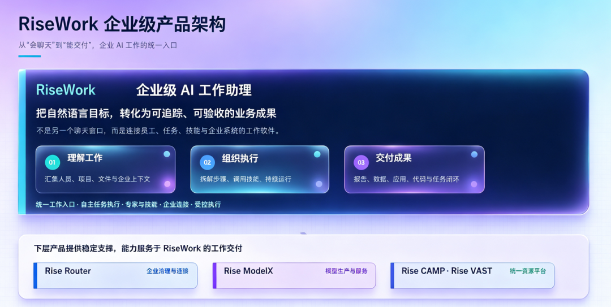

[English](./README.en.md) · [文章目录](../../README.md) · [官网阅读](https://www.theriseunion.com/zh/blog/risework-enterprise-ai-work-assistant.html)

# AI 不应止步于回答：睿思RiseWork 重磅发布，让每一个目标都走向成果

睿思智联 · 2026/08/17 10:02（北京时间） · [微信公众号原文](https://mp.weixin.qq.com/s/N15QKiRwHWw_v00LBenDZw)

当越来越多的人习惯用 AI 写文案、查资料、整理信息时，一个新的问题也随之出现：AI 回答得很好，但真正的工作，最后还是要人来完成。

当越来越多的人习惯用 AI 写文案、查资料、整理信息时，一个新的问题也随之出现：

**AI 回答得很好，但真正的工作，最后还是要人来完成。**

员工仍然需要下载文件、整理数据、切换系统、制作图表、编写报告；企业仍然需要面对数据安全、模型选择、权限管理、成本控制等一系列问题。

AI 能不能不只告诉我们“怎么做”，而是真正参与执行，把事情做完？

现在，面向企业私有化场景打造的 AI 工作助理——**RiseWork 正式发布**。

RiseWork 由北京睿思智联科技有限公司（睿思智联）推出。它不是另一个聊天窗口，而是一套连接员工、任务、技能与企业系统的智能工作平台。

员工只需用一句话说明目标，RiseWork便可围绕目标理解任务、制定计划、调用工具、持续执行，并最终交付文档、数据报告、PPT、代码或可运行的应用。从“会聊天”到“会干活”，企业 AI 正在进入新的阶段。

## 企业真正需要的，不是更多答案，而是更快交付

过去的大模型应用大多围绕“一问一答”展开。用户提出问题，AI生成内容；至于如何整理材料、调用数据、修改文件、执行测试、制作汇报，仍然需要员工自己完成。但企业中的真实工作，很少只包含一次问答。

一份经营分析可能需要收集多个渠道的数据、清洗表格、制作图表、总结结论并生成汇报材料；一次项目推进可能涉及理解需求、修改文件、执行命令、运行测试并反馈结果；一项周期性工作还可能需要定时启动、持续执行和异常恢复。

RiseWork将这些原本分散的步骤组织到同一条工作链路中：

**理解目标、自主规划、调用工具、持续执行、交付成果。**

例如，员工可以直接提出：“根据本周各区域数据生成经营分析，并整理成管理层汇报。”

RiseWork能够围绕这一目标拆解任务，处理相关文件和数据，形成图表与结论，并最终交付一份可继续编辑和使用的汇报材料。

员工不必掌握复杂的提示词，也不用在多个系统之间反复搬运信息。工作开始于一句自然语言指令，结束于一份可以验收的成果。

## 把高频工作，变成可以调用的企业 AI 能力

企业引入 AI，难点不仅是选择一个模型，更重要的是如何让模型真正进入业务场景。

RiseWork通过“专家与技能”机制，将搜索、文件处理、数据分析、代码执行和企业工具调用等能力进行组合，形成面向具体岗位和任务的工作专家。

无论是洞察决策、业务增长、法务风控、数据财务，还是研发与质量管理，员工都可以根据实际任务选择相应专家，直接开始工作。

企业也可以结合自己的业务流程，自建、审核和发布专属专家与技能，把组织内部成熟的方法、流程与经验沉淀为可重复调用的 AI 能力。

通过 MCP 与插件机制，RiseWork还可以连接企业内部业务系统，让 AI 不再停留在独立的聊天窗口，而是逐步进入真实的工作环境。

## 文档、数据、自动化，一套工作台完成

RiseWork将日常办公与代码开发统一到同一个企业工作台中，覆盖多类高频工作场景。

在文档与汇报场景中，它可以协助完成会议纪要、材料汇总、分析报告和 PPT 制作，交付可直接使用的文件。

在数据与研究场景中，它可以处理多源信息，形成图表、结论和管理报告，帮助企业把分散的数据更快转化为经营洞察。

在自动化场景中，它可以执行定时简报、批量文件处理等周期性任务，让重复工作持续、稳定地运行。

在研发场景中，它还可以理解项目、处理代码、执行测试并反馈结果，让开发任务与办公协同进入同一套工作体系。

通过桌面端、CLI、企业 IM 和移动端等入口，员工能够发起任务、查看进度并接收结果，使 AI 工作不再受限于单一设备和固定场景。

## 员工负责判断，AI 负责执行

企业需要 AI 能做事，也需要它在明确的边界内做事。

RiseWork在任务执行过程中保留人的决策权。涉及计划确认、文件修改、权限申请等关键节点时，由员工进行审核；高风险操作得到确认后，AI再继续执行。

对于复杂的长时间任务，平台支持持续运行和任务恢复；任务进度与结果可以追踪，执行过程和资源用量可以审计。

这种协作方式并不是让 AI 取代员工，而是重新分配人与 AI 的工作：

**人负责提出目标、判断方向和确认关键决策，AI承担大量重复、连续和执行性的工作。**

员工因此可以把更多时间投入到客户沟通、业务判断、创新设计和管理决策中。

## 私有化部署，让企业始终掌握核心控制权

企业应用 AI，绕不开数据、模型、成本和安全问题。

RiseWork面向企业私有化场景设计，让企业知识、业务数据与工作文件留在受控环境中，并通过统一入口管理模型、账号、权限、配额、用量和审计。

企业因此能够掌握四项关键控制权：

**模型选择权**：统一接入国际、国产及本地模型，根据不同业务场景灵活选择。

**数据控制权**：通过私有化部署，让企业知识和工作文件保留在受控环境。

**能力扩展权**：通过 Skills、Agents、MCP、插件和专家市场持续扩展企业 AI 能力。

**成本治理权**：集中管理账号、套餐、配额、用量与审计，让资源投入更加透明可控。

员工不需要分别管理模型密钥，企业也不必被绑定在某一个模型或硬件体系中。

## 从模型到算力，建立可持续运营的 AI 工作体系

真正的企业 AI，不只是一个前端应用。在 RiseWork 之下，Rise Router提供企业治理与连接能力，Rise ModelX承担模型生产与服务，Rise CAMP 和 Rise VAST 提供统一资源平台支撑。

通过这一产品体系，企业可以对国际与国产 GPU、NPU、XPU、MLU等异构算力进行统一池化、调度和监控，根据自身基础设施与采购策略灵活选型。

从底层算力、模型服务和企业治理，到上层的任务理解、组织执行与成果交付，RiseWork构建了一条完整的企业 AI 工作链路。

这意味着，企业获得的不只是一个阶段性的 AI 工具，而是一套能够随着模型、业务和组织需求持续演进的智能工作体系。

## 从今天开始，把工作交给 RiseWork

AI 的价值，不应只体现在回答了多少问题，而应体现在完成了多少真实工作。

RiseWork把自然语言目标转化为可追踪、可执行、可验收的业务成果，让 AI 从对话框走进企业工作流，让每一位员工都可以用更简单的方式调用复杂能力。

当员工只需说清目标，AI便可以持续推进并交付结果，企业智能化也就从“试用一个模型”，真正走向“建立一种新的工作方式”。

**从“会聊天”到“会干活”，RiseWork，面向企业的私有化 AI 工作助理。**

### 关于睿思智联

北京睿思智联科技有限公司（RiseUnion）专注于AI 算力管理与调度，已完成 10+ 国产芯片兼容认证，是 CNCF Sandbox 开源项目 HAMi 的核心贡献者之一。公司是国家高新技术企业、北京市专精特新中小企业、AIIC 算力池化工作组组长单位，在金融、政企军工、交通、医疗等行业实现大规模生产级落地。

睿思智联致力于让算力像水电一样随取随用，为企业 AI 转型构建智能、可控、高效的算力底座。

了解更多详细信息，欢迎访问官网：**riseunion.ai** 或联系：**400-605-2336**。

---

[在睿思智联官网阅读本文](https://www.theriseunion.com/zh/blog/risework-enterprise-ai-work-assistant.html) · [浏览更多文章](https://www.theriseunion.com/zh/blog.html)
