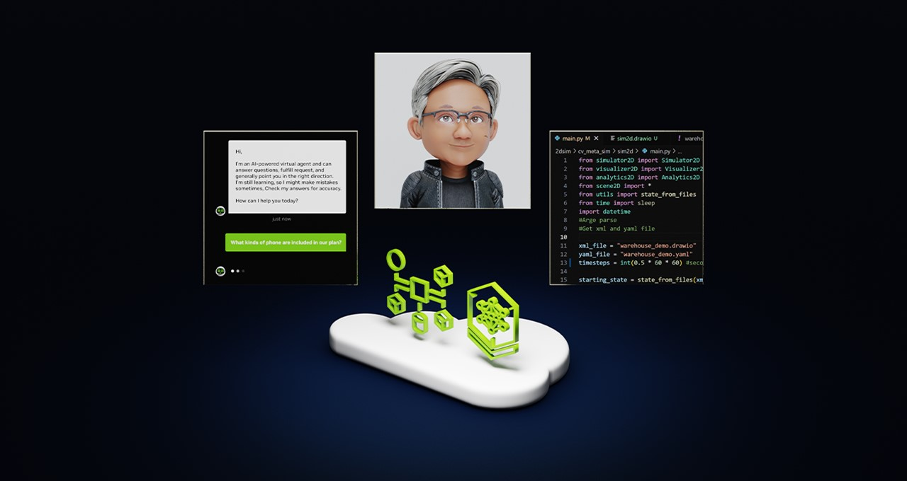
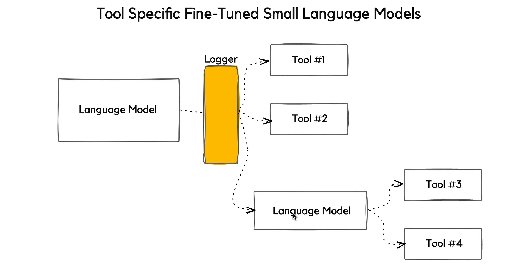
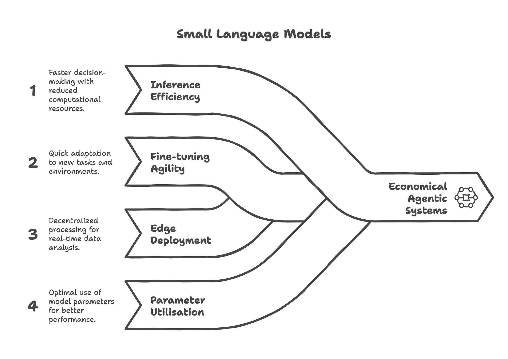
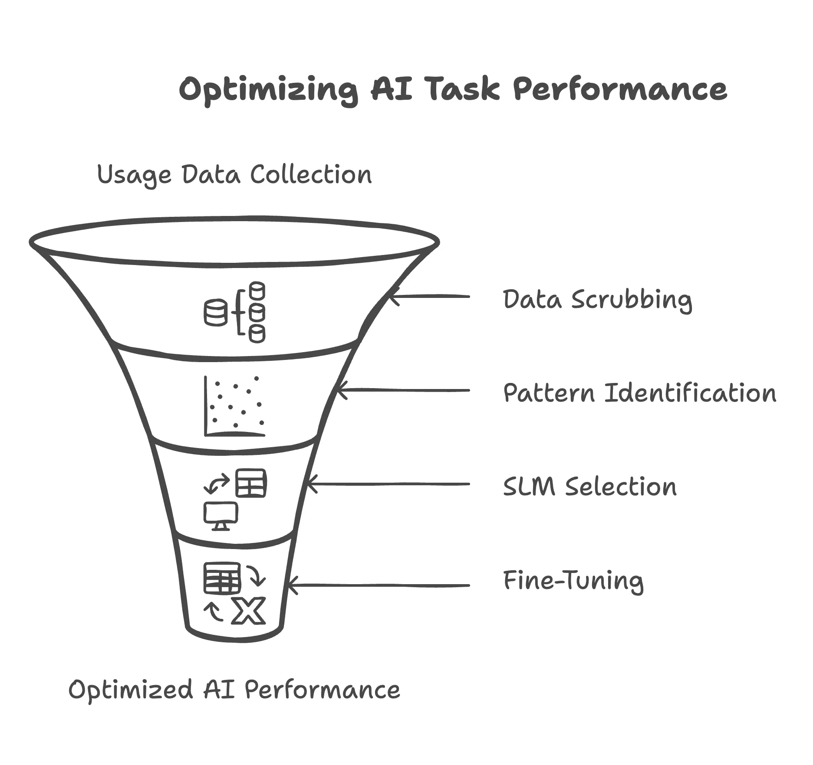

[简体中文](./README.md) · [All articles](../../README.en.md) · [Read on the website](https://www.theriseunion.com/en/blog/small-llms-are-future-of-agenticai.html)

# NVIDIA: Small, rather than large, language models are the future of agentic AI

RiseUnion · January 01, 2025 at 08:00 (UTC+08:00)

NVIDIA advocates transitioning from large to small language models for agentic AI systems. Through GPU fractional allocation, memory oversubscription, and dynamic resource pooling, NVIDIA provides a comprehensive 6-phase framework for enterprise AI infrastructure optimization and cost reduction.

## Executive Summary

NVIDIA advocates for a paradigm shift from monolithic Large Language Models to specialized Small Language Models in agentic AI systems.

The strategic rationale encompasses cost optimization, latency reduction, operational overhead minimization, and infrastructure efficiency improvements including hosting requirements and commercial scalability.

The proposed approach leverages a data-driven methodology: analyzing usage patterns, clustering workloads by tool requirements, and deploying task-specific SLMs optimized for available resources.

> (SLMs) are sufficiently powerful, inherently more suitable & necessarily more economical for many invocations in agentic systems, and are therefore the future of agentic AI. -  NVIDIA

This approach involves fine-tuning specialized SLMs for specific tool sets, moving beyond the current paradigm where agentic applications are constrained by LLM architectural requirements.

NVIDIA proposes model selection based on sub-task analysis and continuous optimization, utilizing actual usage patterns to train purpose-built Small Language Models.

> Small, rather than large, language models are the future of agentic AI - NVIDIA

## Research Analysis

This research presents a compelling case for rethinking AI infrastructure economics and operational efficiency in production environments.

NVIDIA quantifies the significant operational and economic impact of transitioning from LLMs to SLMs in AI agent deployments, addressing critical infrastructure optimization challenges.

Contemporary AI agents predominantly rely on Large Language Models as their core reasoning engines.

These models enable strategic decision-making regarding tool utilization, operational flow control, complex task decomposition into manageable sub-tasks, and reasoning for action planning and problem-solving.

Current AI agent architectures typically interface with LLM API endpoints through centralized cloud infrastructure hosting these models.

> Agentic interactions provide natural pathways for gathering data to drive continuous improvement. - NVIDIA

LLM API endpoints are architected to handle high-volume, diverse request patterns using generalist models—an operational paradigm deeply embedded in current industry practices.

NVIDIA asserts that LLM dominance in AI agent design is both resource-inefficient and misaligned with the functional requirements of most agentic use cases.

## Small Language Models: Infrastructure Optimization

### GPU Resource Optimization for Small Models

**Fractional GPU Allocation**: Small models enable efficient GPU sharing through fractional allocation, allowing multiple SLM workloads to coexist on single GPU instances. This approach maximizes hardware utilization while maintaining performance isolation.

**GPU Memory Oversubscription**: SLMs' smaller memory footprint enables intelligent memory oversubscription strategies, allowing virtual GPU memory allocation beyond physical limits while supporting more concurrent workloads.

**Dynamic Resource Pooling**: GPU resource pools can be dynamically segmented and allocated based on SLM requirements, enabling elastic scaling and optimal resource distribution across heterogeneous workloads.

### Task-Specific Model Deployment

AI agent systems naturally decompose complex objectives into modular sub-tasks, each optimally handled by specialized or fine-tuned SLMs rather than monolithic LLMs.

> Agentic interactions are natural pathways for gathering data for future improvement. -  NVIDIA

**GPU Scheduling Optimization**: Advanced scheduling policies can prioritize SLM workloads for rapid response while maintaining resource reservations for occasional LLM invocations, optimizing overall throughput and cost efficiency.

Modern training methodologies, prompting techniques, and agentic augmentation approaches demonstrate that capability—not parameter count—represents the primary performance constraint.

### Economic Advantages in GPU Infrastructure

SLMs deliver superior economics in agentic systems through:
- **Inference Efficiency**: Higher throughput per GPU with reduced computational overhead
- **Fine-tuning Agility**: Rapid model adaptation with minimal resource requirements
- **Edge Deployment**: Distributed inference reducing centralized GPU dependencies  
- **Parameter Utilization**: Optimized compute efficiency through purpose-built architectures

**Multi-Tenant GPU Sharing**: SLMs enable efficient multi-tenant GPU environments where multiple teams or applications share compute resources with QoS guarantees and performance isolation.

NVIDIA advocates for incorporating multiple language models of varying sizes and capabilities, matched to query complexity levels, providing natural integration paths for SLM adoption.

### Implementation Challenges

Small Language Models present significant potential for efficient, task-specific AI solutions, but adoption faces infrastructure and operational challenges.

High capital expenditure for centralized LLM infrastructure, reliance on generic benchmarks in SLM evaluation, and limited market visibility—SLMs often lack the marketing presence of heavily promoted LLM solutions—create adoption barriers.

**GPU Infrastructure Transition**: Organizations require strategies for transitioning from LLM-optimized GPU infrastructure to SLM-friendly architectures that support fractional allocation and multi-tenancy.

### Strategic Implementation Framework

A systematic 6-phase approach for transforming monolithic LLM deployments into optimized SLM agent architectures:

1. **Usage Data Collection**: Comprehensive gathering of operational metrics from existing LLM infrastructure
2. **Data Sanitization**: Removal of sensitive information while preserving usage patterns
3. **Workload Clustering**: Pattern recognition to identify recurring task categories and resource requirements
4. **Model Selection & GPU Allocation**: SLM selection matched to task requirements with optimal GPU resource allocation
5. **Fine-tuning & Optimization**: Custom dataset training with GPU-efficient fine-tuning workflows
6. **Continuous Optimization**: Iterative improvement cycles maintaining SLM performance and resource efficiency

**GPU Pool Management**: Implementing intelligent GPU pool segmentation allows organizations to allocate dedicated resources for SLM fine-tuning while maintaining production inference capacity, ensuring optimal resource utilization across development and deployment workflows.

This framework enables organizations to realize the full potential of Small Language Models while maximizing GPU infrastructure efficiency and reducing operational costs.

## Rise CAMP: Empowering Customer Success

Addressing these critical technical requirements, RiseUnion's **Rise CAMP** provides comprehensive infrastructure capabilities in the following key areas:

1. **Multi-Tenant Resource Sharing with Policy Isolation**: Rise CAMP natively supports tenant-level resource pool segmentation, QoS priority control, and policy quota management, ensuring performance isolation across teams sharing GPU resources while meeting enterprise-grade SLM multi-tenant deployment requirements.

2. **Fine-Grained Task and Model Matching Scheduler**: Supporting the "specialized SLM deployment" scenario for agentic sub-tasks, Rise CAMP employs joint scheduling logic combining "model identification + request characteristics" to automatically route requests to optimal resource nodes, balancing response latency with cluster load distribution.

3. **Complete Development-Inference-Operations Lifecycle Management**: Rise CAMP provides comprehensive lifecycle management tools including model management, inference logging, runtime profiling, task failure recovery, and resource fragment recycling, complementing SLM rapid fine-tuning deployment needs to achieve efficient delivery from experimentation to production.

4. **Unified Heterogeneous Computing Scheduling Support**: Addressing current deployment scenarios involving mixed NVIDIA, Ascend, Kunlun, Cambricon, Enflame, Metax, and Hygon chip environments, Rise CAMP constructs a unified abstraction layer supporting heterogeneous resource registration, adaptation, and dynamic scheduling, facilitating cross-chip, multi-model hybrid agentic inference systems.

5. **Center-Edge Integrated Model Deployment**: Leveraging SLMs' "edge deployment advantages," Rise CAMP has implemented center scheduling + edge inference collaborative architecture, supporting model image distribution, remote loading, and edge node runtime monitoring, addressing edge intelligence deployment requirements in industrial, transportation, and financial scenarios.

## Conclusion

> **"Small, rather than large, language models are the future of agentic AI."** — NVIDIA

The transition from large to small models represents more than just model selection—it signifies the evolutionary direction of entire AI system architectures and GPU infrastructure.

In the future landscape of agentic AI, Small Language Models will no longer be supporting actors, but rather the **core driving force** behind efficient inference, cost-effective deployment, and agile iteration.

Simultaneously, this model architecture transformation presents unprecedented infrastructure challenges: requiring more precise resource management, more intelligent task scheduling, and more efficient model deployment systems. RiseUnion's Rise CAMP product emerges precisely in this context, providing AI Infrastructure capabilities for the model era: through GPU resource pooling, compute partitioning and scheduling optimization, multi-model collaborative scheduling, and edge inference support, Rise CAMP empowers developers and enterprises to build more elastic and efficient Agentic AI systems, rapidly adapting to the new paradigm of agentic AI.

As models become specialized and deployment becomes diversified, truly intelligent systems will be driven by the synergy between models and computing infrastructure.

**References:**
- [NVIDIA Says Small Language Models Are The Future of Agentic AI](https://cobusgreyling.medium.com/nvidia-says-small-language-models-are-the-future-of-agentic-ai-f1f7289d9565)
- [Small Language Models are the Future of Agentic AI](https://arxiv.org/abs/2506.02153?source=post_page-----f1f7289d9565---------------------------------------)

---

[Read this article on the RiseUnion website](https://www.theriseunion.com/en/blog/small-llms-are-future-of-agenticai.html) · [Explore more articles](https://www.theriseunion.com/en/blog.html)
