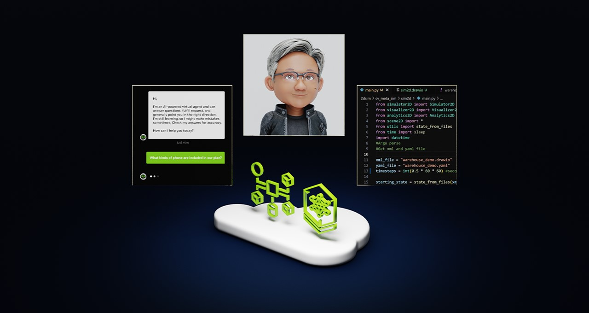
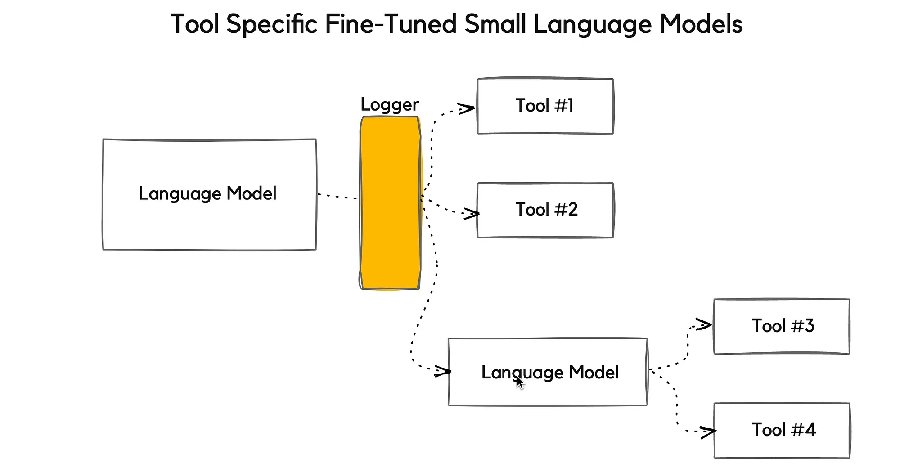
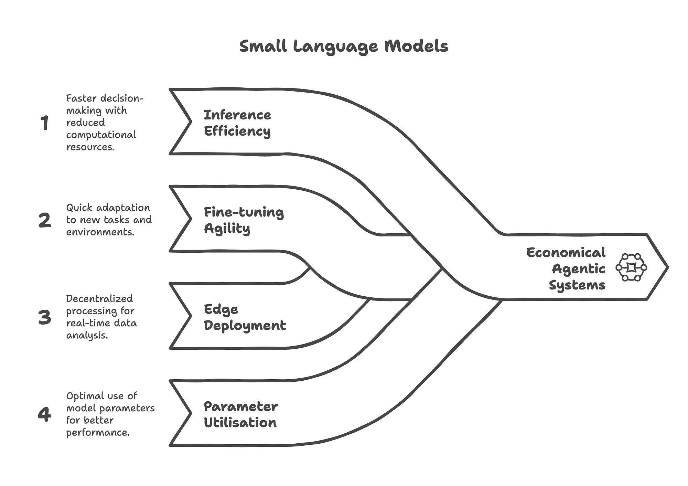
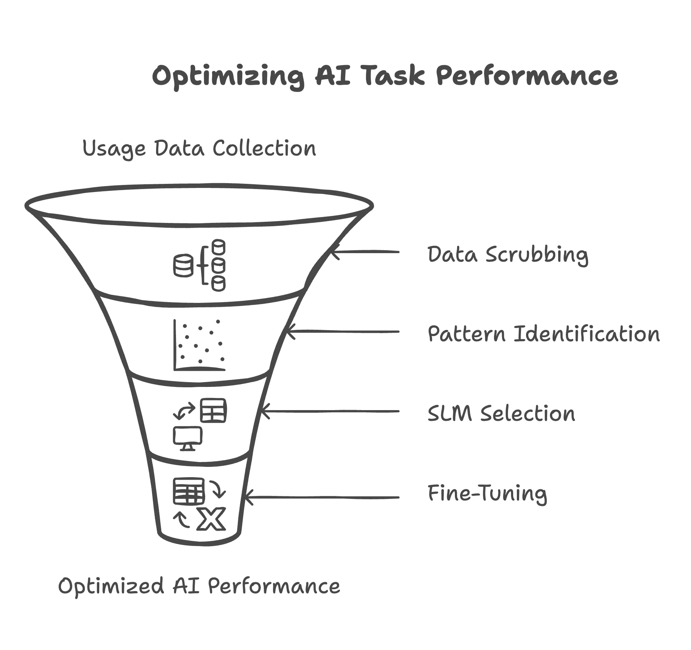

[English](./README.en.md) · [文章目录](../../README.md) · [官网阅读](https://www.theriseunion.com/zh/blog/small-llms-are-future-of-agenticai.html)

# NVIDIA：小语言模型是智能体AI 的未来

睿思智联 · 2025/07/04 08:00（北京时间）

NVIDIA提出从大模型向小语言模型转型的战略框架。通过GPU分片分配、显存超分配和动态资源池化技术，实现智能体AI系统的成本优化与性能提升。详解6阶段实施方案，助力企业构建高效GPU基础设施。

## 摘要

NVIDIA 正在倡导一种新的智能体 AI 系统发展方向：从单一大语言模型（LLM），向 **专业化的小语言模型（SLM）** 演进。

这一战略背后的核心动因包括：**优化成本、降低延迟、减少运维开销，并提升底层基础设施的效率**，例如托管负载能力和商业可扩展性。

该方法以数据为驱动，分析用户使用模式、根据任务和工具需求对工作负载进行聚类，进而部署适配资源的小语言模型。

> 小语言模型在智能体系统中的许多场景下，已足够强大，且更契合需求、更具成本优势。因此，它们代表了智能体 AI 的未来。 -- NVIDIA

这一新范式，打破了当前智能体 AI 架构受制于单一大模型的限制，转而提倡面向特定工具集的专业化小模型微调和部署。

## 研究分析

本研究为 AI 基础设施的**成本结构和运行效率优化**提供了有力论据。

NVIDIA 通过量化分析，揭示了从 LLM 向 SLM 转型在智能体部署中的经济价值和基础设施优势，尤其是在 GPU 使用效率、任务响应速度和多租户支持等方面。

目前多数 AI 智能体依赖大语言模型进行工具调用、任务拆解、流程控制及推理规划。这类模型通常托管于云端，接收来自客户端的远程调用请求。

> 智能体的交互过程本身就是持续收集优化数据的天然路径。 —— NVIDIA

然而，这种以“大模型 + API”为中心的架构，在真实生产环境中逐渐暴露出资源浪费和任务匹配度不高的问题。

## 小语言模型：基础设施的最优路径

### GPU 资源使用优化

* **GPU 分片分配**：小语言模型体积更小，适合通过 GPU 分片进行资源共享。多个 SLM 工作负载可在同一 GPU 上并行运行，在确保性能隔离的同时，极大提升了硬件利用率。
* **GPU 显存超分配**：SLM 对显存占用需求低，使其可采用显存超分配机制，在虚拟资源层面实现超越物理显存限制的调度能力，提升并发处理能力。
* **动态资源池化**：GPU 资源可根据小模型运行时需求灵活划分，实现异构负载之间的弹性调度和资源优化。

### 任务专用模型部署

智能体系统往往会将复杂目标自动分解为子任务。NVIDIA 提出，每个子任务由一个经过专业微调的 SLM 负责执行，比交由大模型统一处理更高效也更经济。

### GPU 调度优化
通过优先调度 SLM 的低延迟请求，同时预留部分资源应对偶发的大模型调用，可实现更优的整体吞吐与成本控制。

这一架构转变反映了一个新的共识：**模型性能的关键，不再是参数规模，而是能力匹配和任务适配度。**

### 小语言模型的经济价值

* **推理效率更高**：SLM 计算资源占用低，单位 GPU 吞吐量显著提升。
* **快速适配微调**：可在较小数据量和资源条件下完成高效微调，迭代更快。
* **便于边缘部署**：SLM 模型体积小、算力需求低，适合部署在本地或边缘端，减少对中心化基础设施的依赖。
* **计算效率优化**：更合理的模型结构和定制设计，带来更高的参数利用率。
* **支持多租户共享**：SLM 可在保证服务质量（QoS）和性能隔离的前提下，为多个团队或任务共享同一 GPU 资源。

> 在系统中混合部署**大小不同、能力各异**的模型，基于请求复杂度动态匹配调用，构建自然高效的模型调用路径。

### 落地挑战

尽管 SLM 模型具备极大的运行优势，其广泛落地仍面临一些现实阻力：

* **基础设施适配**：当前大部分 GPU 架构是为大模型优化设计，尚不完全适配多模型并发的微服务架构。
* **市场认知度低**：SLM 缺乏像 LLM 那样的品牌和话题热度，推广和教育成本较高。
* **评估标准缺失**：通用基准测试往往无法全面衡量 SLM 在任务中的实际表现。

> **GPU 基础设施的转型，需要在底层支持分片调度、多租户隔离等新能力。**

## 战略实施框架

NVIDIA 提出一套系统性的六阶段转换流程，帮助组织从 LLM 架构平滑过渡至面向 SLM 的智能体体系：

1. **使用数据采集**：记录当前 LLM 运行的数据、资源和请求特征
2. **数据脱敏处理**：清洗数据，保留使用模式
3. **工作负载聚类**：根据请求类型和任务结构进行聚类，识别常见子任务
4. **模型与资源匹配**：选择合适的小语言模型，并匹配 GPU 分配策略
5. **模型微调与部署**：在定制数据上完成模型训练，并上线服务
6. **持续迭代优化**：构建反馈闭环机制，不断提升模型质量与资源利用率

> **建议同步实施 GPU 资源池管理策略**，为 SLM 微调与推理提供弹性资源保障，实现开发与生产的分离调度。

## Rise CAMP 助力客户

针对以上关键技术点，睿思智联的 **RiseCAMP** 已在以下方面提供系统性能力支撑：

1. **多租户资源共享与策略隔离**：Rise CAMP 原生支持租户级别的资源池划分、QoS 优先级控制、策略配额限制，确保多个团队在共用 GPU 的同时保持性能隔离，满足企业级 SLM 多租并发部署需求。
2. **任务与模型精细匹配调度**：对应智能体子任务“专用 SLM 部署”场景，Rise CAMP 通过“模型标识+请求特征”的联合调度逻辑，将请求自动路由至最匹配资源节点，兼顾响应时延与集群负载。
3. **开发-推理-运营全周期管理闭环**：Rise CAMP 提供模型管理、推理日志、运行画像、任务失败恢复、资源碎片回收等完整生命周期运维工具，配合 SLM 快速微调部署需求，实现从实验到生产的高效交付路径。
4. **异构算力统一调度支持**：针对当前部署中存在的 NVIDIA、昇腾、昆仑芯、寒武纪、燧原、沐曦、海光等多芯片混用情况，Rise CAMP 构建统一抽象层，支持异构资源注册、适配与动态调度，便于构建跨芯片、多模型混布的智能体推理系统。
5. **中心-边缘一体化模型部署**：结合小模型“便于边缘部署”优势， Rise CAMP 已实现中心调度+边缘推理协同架构，支持模型镜像分发、远程加载与边缘节点运行态监控，适配工业、交通、金融等场景下的边缘智能体落地需求。

## 结语

> **“小语言模型，而非大语言模型，是智能体 AI 的未来。”** —— NVIDIA

从大模型向小模型转型，不只是模型本身的选择问题，更是整个 AI 系统架构与 GPU 基础设施的演进方向。

在智能体 AI 的未来版图中，小语言模型将不再是配角，而是支撑高效推理、低成本部署与敏捷迭代的**核心力量**。

与此同时，这种模型结构的转变也对基础设施提出了前所未有的挑战：需要更精细的资源管理、更智能的任务调度、更高效的模型部署体系。睿思智联 Rise CAMP 产品正是在这一背景下，提供了面向模型时代的 AI Infra 能力底座：通过 GPU 资源池化、算力分片与调度优化、多模型协同调度、边缘推理支持等核心技术，助力开发者和企业构建更具弹性和效率的 Agentic AI 系统，快速适应智能体 AI 的新范式。

当模型走向专精、部署趋向多元，真正的智能系统将由模型与算力基础设施共同驱动。

参考：
- [NVIDIA Says Small Language Models Are The Future of Agentic AI](https://cobusgreyling.medium.com/nvidia-says-small-language-models-are-the-future-of-agentic-ai-f1f7289d9565)
- [Small Language Models are the Future of Agentic AI](https://arxiv.org/abs/2506.02153?source=post_page-----f1f7289d9565---------------------------------------)

---

[在睿思智联官网阅读本文](https://www.theriseunion.com/zh/blog/small-llms-are-future-of-agenticai.html) · [浏览更多文章](https://www.theriseunion.com/zh/blog.html)
