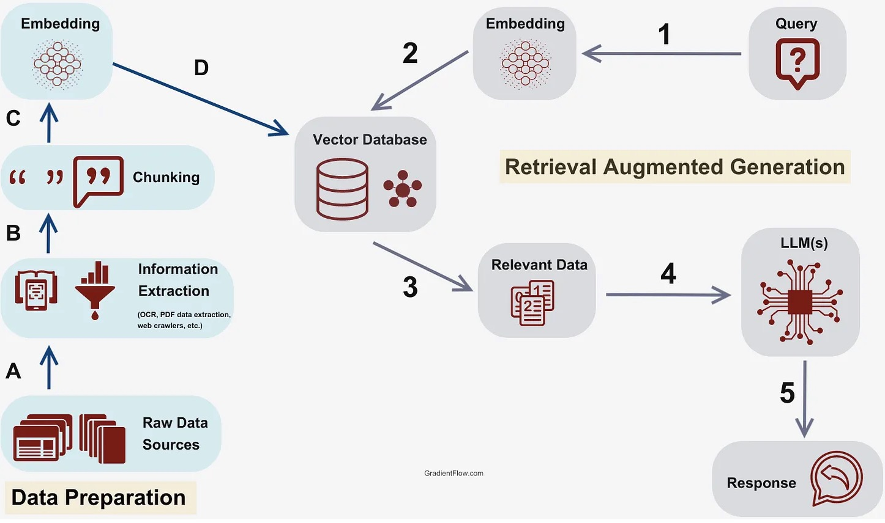
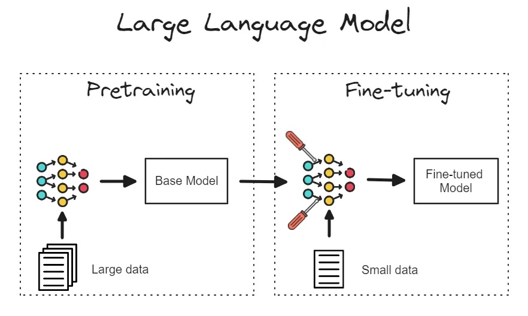
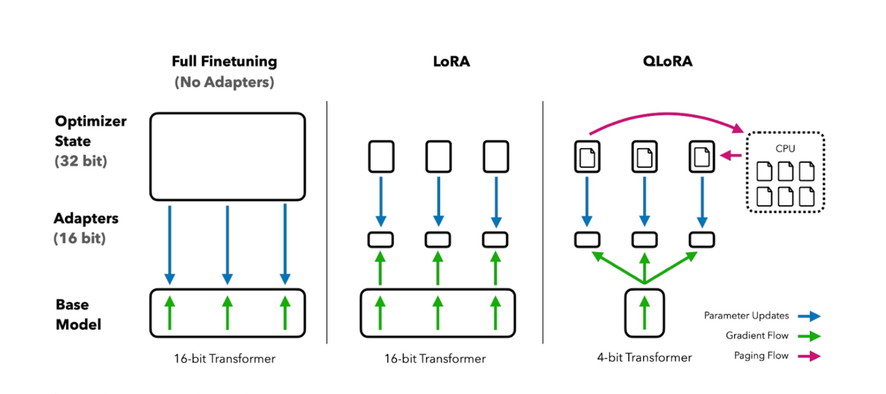

[简体中文](./README.md) · [All articles](../../README.en.md) · [Read on the website](https://www.theriseunion.com/en/blog/understanding-the-essential-role-of-rag-fine-tuning-and-lora-in-genai.html)

# Understanding the Role of RAG, Fine-Tuning, and LoRA in GenAI

RiseUnion · January 01, 2025 at 08:00 (UTC+08:00)

Explore how RAG, Fine-tuning, and LoRA enhance open-source GenAI models. Learn when to use each technique, their benefits and trade-offs, and how they improve model performance while optimizing costs in enterprise AI applications.

Summary: As the adoption of Generative AI (GenAI) accelerates across industries, organizations are increasingly turning to open-source GenAI models. These models offer flexibility, customization, and cost-effectiveness, but fully harnessing their power requires understanding key techniques like Retrieval-Augmented Generation (RAG), fine-tuning, and Low-Rank Adaptation (LoRA) adapters. These methods can significantly improve model performance and relevance for specific business use cases. This blog will introduce these concepts, their roles in GenAI, and how to evaluate which method is best for your organization.

## What is Retrieval-Augmented Generation (RAG)?

RAG is a technique that enhances generative models by augmenting them with external information sources, such as knowledge bases, documents, or databases. Instead of relying solely on the pre-trained model’s internal knowledge, RAG retrieves relevant information during the generation process and uses it to improve the accuracy and relevance of the response.

### How RAG Works
RAG retrieves documents or data using vector embeddings, which represent the model’s understanding of the input text. By matching the embeddings to external sources, the model augments its output in real time with relevant information, enriching responses without requiring additional model training.

### Why RAG Matters for GenAI Inference
For organizations using open-source GenAI models, especially those with limited fine-tuning capabilities, RAG offers a practical way to enrich model outputs with current, context-specific information. By integrating RAG, organizations can generate more accurate and contextually appropriate responses, even when working with generalized models that might lack up-to-date domain knowledge.

### When to use
RAG is particularly valuable when you need real-time access to dynamic data sources (e.g., product catalogs, legal documents). It’s ideal for situations where the model's pre-existing knowledge is insufficient or out-of-date, and you need to inject current information into the response.

## Fine-Tuning GenAI Models

Fine-tuning refers to the process of adapting a pre-trained model to a specific domain or task by training it on additional data. This allows the model to learn task-specific patterns while preserving the general knowledge it acquired during its initial training. Fine-tuning is a popular approach to enhance model performance for specialized applications.

### How Fine-Tuning Works
Fine-tuning involves adding new layers or adjusting parameters in the model based on domain-specific data. This process allows the model to specialize in a particular task or industry while still retaining the broad knowledge it acquired during its initial pre-training.

### Why Fine-Tuning is Crucial for Open-Source GenAI Models
While open-source models like LLaMA and Cohere provide strong foundational capabilities, they are typically trained on large, generalized datasets. Fine-tuning enables businesses to tailor these models to their unique needs, ensuring more accurate and relevant results for specific tasks such as legal document processing or industry-specific customer interactions.

### When to use
Fine-tuning is essential when you need precise control over model behavior and have access to domain-specific data. It’s particularly useful when you’re dealing with niche industry use cases, such as legal, medical, or finance, where generalized models may not perform as effectively.

## Low-Rank Adaptation (LoRA) Adapters

LoRA adapters are a technique designed to fine-tune large language models efficiently. Instead of updating the entire model during fine-tuning, LoRA focuses on adjusting a smaller number of parameters, which reduces computational cost and allows faster model adaptation. This method is particularly beneficial when resources are constrained or when frequent updates are needed.

### How LoRA Adapters Work
LoRA achieves efficient fine-tuning by freezing most of the model’s parameters and only updating a low-rank subset of them. This reduces the computational load and enables faster training cycles, making it ideal for frequent updates or environments where compute resources are limited.

### Why LoRA Adapters Matter
For enterprises leveraging open-source GenAI models, the ability to fine-tune efficiently without needing extensive compute resources can be a game changer. LoRA enables businesses to continuously refine models with smaller datasets and quicker iteration cycles, which is essential for maintaining relevance in fast-moving industries.

### When to use
LoRA adapters are perfect for scenarios where compute resources are limited or the model needs to be frequently updated to account for new data or changes in business requirements. It’s also a great option for organizations working with multiple models that each need lightweight adaptation.

## Real-World Challenges and Considerations
Although these methods offer immense benefits, they come with specific challenges:

- ** RAG **: Implementing RAG can introduce latency as the model retrieves external information during inference. Organizations should optimize retrieval systems to minimize delays, especially when dealing with large data sets.
- ** Fine-Tuning **: Fine-tuning requires a sizable amount of domain-specific data, which may not always be readily available. Additionally, it demands significant compute resources, making it more costly and time-consuming than other methods.
- ** LoRA **: While LoRA reduces compute requirements, it may not provide the same level of model precision as full-scale fine-tuning. Organizations should consider LoRA for frequent, minor updates but reserve full fine-tuning for mission-critical tasks.

## Model Performance Metrics
When choosing between RAG, fine-tuning, or LoRA, performance benchmarks are essential for understanding the trade-offs:

- ** RAG **: Increases response relevance but may add slight delays due to retrieval time.
- ** Fine-Tuning **: Provides highly accurate results but demands greater computational resources and time.
- ** LoRA **: Offers fast adaptation with reduced computational overhead but may sacrifice some precision.
Running benchmarking tests in your specific environment will help you quantify these trade-offs and choose the best method for your use case.

## Integration with Rise CAMP AI Workload Orchestration Platform
Organizations leveraging the Run:ai platform can benefit from these methods through our AI infrastructure management capabilities. 

With Rise CAMP AI Workload Orchestration Platform, you can:

- Optimize resource allocation for RAG processes to minimize latency.
- Efficiently fine-tune models using our intelligent workload orchestration.
- Quickly update models using LoRA adapters, taking advantage of Run:ai’s ability to handle multi-cloud or hybrid environments, ensuring scalability and flexibility across infrastructures.
- Security and Compliance Implications

When deploying these techniques, it’s crucial to address security and compliance risks:

- ** RAG **: Real-time retrieval can expose sensitive data if the knowledge base is not properly secured. Organizations should ensure robust access controls and encryption.
- ** Fine-Tuning **: Fine-tuning on sensitive data (e.g., medical records or financial data) requires compliance with industry regulations such as HIPAA or GDPR.
- ** LoRA **: Since LoRA involves fine-tuning subsets of models, organizations need to ensure that any updates do not inadvertently expose vulnerabilities.

In all cases secure model storage and auditing tools are critical.

## Considerations for Multi-Cloud and Hybrid Architectures

RAG, fine-tuning, and LoRA are each fully supported in cloud, on-premises, and hybrid environments, providing organizations with flexibility in designing AI architectures that meet specific operational needs. Below is an example of an enterprise architecture where these methods may run in different environments for highly specific reasons:

- RAG may run on cloud resources to access dynamic external data.
- Fine-tuning could be performed on-prem for sensitive, domain-specific data.
- LoRA updates could be distributed across different environments for rapid, cost-effective fine-tuning.

Rise CAMP AI Workload Orchestration Platform enables seamless integration across these architectures, allowing enterprises to select the optimal environment for each method while maintaining centralized management and operational efficiency.

## Cost Efficiency and ROI

Each method has different cost implications:

- ** RAG **: Lower upfront costs since no additional training is needed, but potential ongoing costs for retrieval systems.
- ** Fine-Tuning **: Higher upfront costs for training, but long-term value for domain-specific tasks.
- ** LoRA **: Lower costs than full fine-tuning, making it an attractive option for frequently updated models.

Organizations should assess their long-term goals to determine which method offers the best return on investment (ROI) for their specific use cases.

## Future Trends
As AI evolves, innovations in retrieval, fine-tuning, and LoRA are expected to shape the future of enterprise AI applications:

- ** RAG **: Advances in retrieval techniques are anticipated to improve both speed and accuracy, enabling larger-scale, real-time data augmentations. This will allow enterprises to incorporate even more dynamic external information into their models with minimal latency.
- ** Fine-Tuning **: Emerging techniques aim to significantly  reduce the data and compute requirements for fine-tuning, making this process more efficient and accessible. Methods such as synthetic data generation, selective data sampling, and zero-shot learning will allow fine-tuning on smaller, high-impact datasets, cutting costs while retaining model effectiveness.
- ** LoRA **: Enhancements will likely combine LoRA with complementary methods, such as prompt-tuning and adapter-based approaches. These combinations will provide both speed and precision, allowing organizations to update models more flexibly while keeping computational requirements low.

By proactively adopting these advancements, organizations can maintain a competitive edge in the AI landscape, optimizing both cost and performance across diverse deployment environments.

As AI continues to evolve, we expect to see innovations in these areas:

- ** RAG **: Improvements in retrieval techniques speed and accuracy, allowing even larger-scale, real-time data augmentations.
- ** Fine-Tuning **: Techniques to and compute requirements, making it more accessible.
- ** LoRA **: Further enhancements that combine LoRA with other, providing both speed and precision.

By staying ahead of these trends, organizations can maintain a competitive edge in the AI landscape.

## Practical Steps for Implementation
Here are some guidelines for choosing the right method:

- ** Assess data availability **: Do you have domain-specific data for fine-tuning, or do you need to supplement with real-time retrieval (RAG)?
- ** Evaluate compute resources **: Can your infrastructure support full fine-tuning, or would LoRA’s lightweight approach be more suitable?
- ** Define business goals **: Is speed and responsiveness (RAG) more important, or is task-specific accuracy (fine-tuning) critical?
By answering these questions, you can select the method that best fits your organization’s needs.

## Conclusion: Maximizing the Value of Open-Source GenAI Models

In the rapidly evolving landscape of AI, leveraging techniques like RAG, fine-tuning, and LoRA adapters can help organizations unlock the full potential of open-source GenAI models. By understanding when and how to apply these methods, business and technical leaders can ensure that their AI investments drive tangible results, whether through more accurate predictions, faster response times, or improved operational efficiency.

For organizations exploring the deployment of GenAI models on private infrastructure, understanding these techniques is key to tailoring models for enterprise use cases, from dynamic customer interactions to specialized industry tasks.

By leveraging the Rise CAMP AI computing power scheduling platform, numerous enterprises have achieved significant benefits in their generative AI applications:

- **Efficiency Enhancement**：A major telecommunications operator saw a 40% increase in AI workload processing speed and a 35% reduction in model training time;
- **Cost Optimization**：An energy conglomerate saved an average of 45% on computing resource costs through intelligent resource allocation and multi-cloud collaboration;
- **Scalable Expansion**：A state-owned technology company supported seamless scaling from small-scale testing to enterprise-level deployment, completing AI application scaling within 2-3 months;
- **Simplified Operations**：A large state-owned bank reduced AI infrastructure management workload by 60%, allowing the technical team to focus more on model optimization.

> From: Run:ai ["Understanding the Essential Role of RAG, Fine-Tuning, and LoRA in GenAI"](https://www.run.ai/blog/understanding-the-essential-role-of-rag-fine-tuning-and-lora-in-genai) , with some modifications.

---

[Read this article on the RiseUnion website](https://www.theriseunion.com/en/blog/understanding-the-essential-role-of-rag-fine-tuning-and-lora-in-genai.html) · [Explore more articles](https://www.theriseunion.com/en/blog.html)
