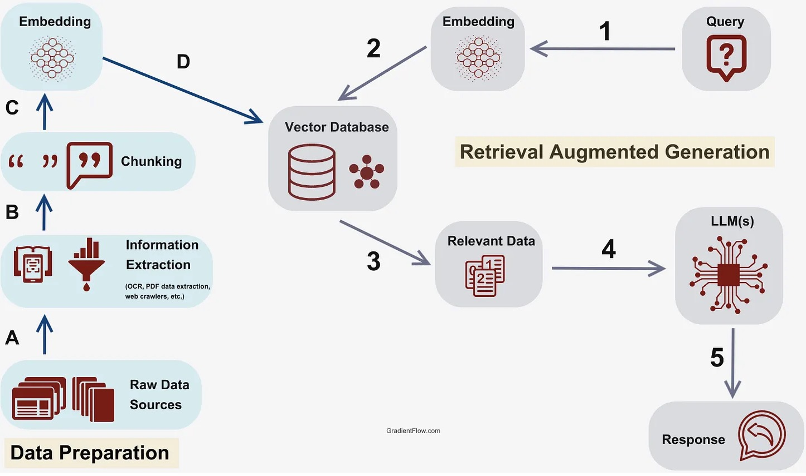
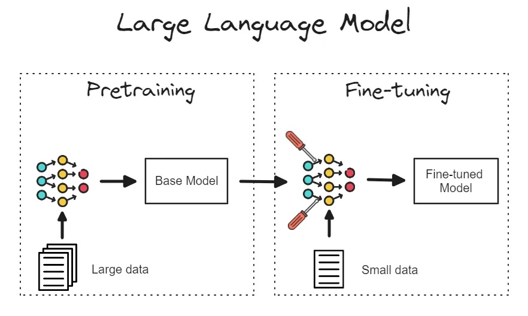
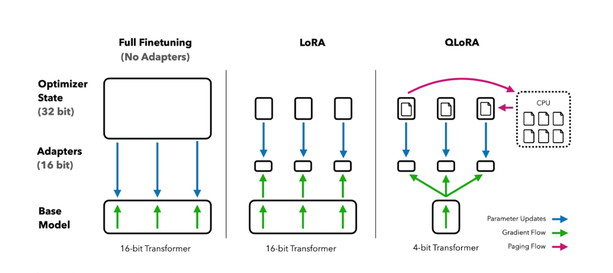

[English](./README.en.md) · [文章目录](../../README.md) · [官网阅读](https://www.theriseunion.com/zh/blog/understanding-the-essential-role-of-rag-fine-tuning-and-lora-in-genai.html)

# 让 AI 更懂你：RAG、微调与 LoRA 的个性化定制之路

睿思智联 · 2024/12/17 08:00（北京时间）

探索RAG、微调和LoRA如何增强开源生成式AI模型的能力。了解这些技术的适用场景、优势和权衡，以及它们如何在企业AI应用中提升模型性能并优化成本。

摘要：随着生成式AI（GenAI）在各行业的应用不断加速，越来越多的组织开始采用开源生成式AI模型。这些模型提供了灵活性、定制化和成本效益，但要充分发挥其潜力，理解一些关键技术至关重要，例如检索增强生成（RAG）、微调和低秩适配（LoRA）。这些方法能够显著提升模型在特定业务场景中的表现和相关性。本文将介绍这些概念、它们在生成式AI中的作用，以及如何评估哪种方法最适合你的组织。

## 什么是检索增强生成（RAG）？

检索增强生成（RAG）是一种通过外部信息源（如知识库、文档或数据库）来增强生成模型的方法。RAG 不依赖于预训练模型的内部知识，而是在生成过程中动态检索相关信息，并将其用于改进响应的准确性和相关性。

### RAG 如何工作？

RAG 通过向量嵌入来检索文档或数据。嵌入向量表示模型对输入文本的理解。通过将嵌入与外部源匹配，RAG 在生成过程中实时增强输出，使其更为精准和相关，而无需额外的模型训练。

### 为什么 RAG 对于生成式 AI 推理至关重要？

对于使用开源生成式 AI 模型的组织，尤其是那些微调能力有限的组织，RAG 提供了一种将当前、特定领域的信息注入模型输出的实用方式。通过集成 RAG，组织可以生成更准确、更具上下文相关性的响应，即使是在使用基础模型时，模型的预训练知识可能已经过时或不完整。

### 适用场景

当需要实时访问动态数据源（如产品目录、法律文件等）时，RAG 尤其有价值。它特别适合于模型原有知识不足或过时，需要注入当前信息的场景。

## 微调生成式 AI 模型

微调是指通过在额外的数据上训练预训练模型，使其适应特定领域或任务，从而提升模型在该任务上的表现，同时保留预训练时获得的广泛知识。微调是提高特定应用场景模型性能的常用方法。

### 微调如何工作？

微调涉及在模型中增加新的层，或根据特定领域的数据调整模型参数。这个过程使模型在特定任务或行业上变得更加专业化，同时保留了其在预训练过程中获得的广泛知识。

### 为什么微调对于开源生成式 AI 模型至关重要？

尽管像 LLaMA、Cohere 等开源模型提供了强大的基础能力，但它们通常是在大型通用数据集上进行训练的。微调使得企业可以将这些模型定制化，以适应其独特需求，确保在特定任务（如法律文档处理或行业特定的客户互动）中获得更准确和相关的结果。

### 适用场景

当需要精确控制模型行为并且有领域特定数据时，微调是必不可少的。它特别适用于涉及特定行业的细分应用场景，例如法律、医疗或金融等领域，在这些领域中，通用模型的表现可能不尽如人意。

## 低秩适配（LoRA）适配器

低秩适配（LoRA）适配器是一种高效的微调技术。在微调过程中，LoRA 并非更新整个模型，而是仅调整一小部分参数，从而减少计算成本，并加快模型适应的速度。当资源受限或需要频繁更新时，LoRA 是一种非常有价值的方法。

### LoRA 适配器如何工作？

LoRA 通过冻结模型的大部分参数，仅更新低秩子集来实现高效的微调。这种方法大大减少了计算负担，使得训练周期更短，特别适合在资源有限或需要频繁更新的环境中使用。

### 为什么 LoRA 适配器很重要？

对于依赖开源生成式 AI 模型的企业而言，LoRA 使得在不需要大量计算资源的情况下进行高效微调成为可能。LoRA 使得企业可以用较小的数据集和更快的迭代周期来持续优化模型，这对于在快速发展的行业中保持模型的相关性至关重要。

### 适用场景

当计算资源受限或模型需要频繁更新以适应新数据或业务需求时，LoRA 适配器是理想选择。它也非常适合需要轻量级适配的场景，尤其是当多个模型需要快速调整时。

## 现实挑战与考虑因素

尽管这些方法具有巨大优势，但它们也面临特定的挑战：

-   **RAG**：实现 RAG 可能会带来推理延迟，因为模型在推理过程中需要检索外部信息。组织需要优化检索系统，尤其是在处理大数据集时，以减少延迟。
-   **微调**：微调需要大量领域特定的数据，这些数据可能并不容易获取。此外，微调通常需要较高的计算资源，使其比其他方法更加昂贵和耗时。
-   **LoRA**：虽然 LoRA 减少了计算需求，但可能无法提供与完全微调相同的模型精度。组织应考虑将 LoRA 用于频繁的小幅更新，而将完整微调用于关键任务。

## 模型性能评估指标

在选择 RAG、微调或 LoRA 时，性能基准测试至关重要，它可以帮助你理解各方法之间的权衡：

-   **RAG**：提高了响应的相关性，但可能由于检索时间而带来些许延迟。
-   **微调**：提供高精度的结果，但需要较高的计算资源和时间。
-   **LoRA**：提供快速适配，减少计算开销，但可能牺牲一定的精度。

在你的特定环境中进行基准测试，可以帮助你量化这些权衡，并选择最适合的方案。

## 与 Rise CAMP AI 算力调度平台的集成

通过 Rise CAMP AI 算力调度平台，企业可以借助以下功能充分发挥这些方法：

-   **优化资源分配**：为 RAG 过程优化资源分配，减少延迟。
-   **高效微调**：使用智能工作负载编排高效微调模型。
-   **快速更新**：利用 LoRA 适配器进行频繁模型更新，充分利用 Rise CAMP 在多云或混合环境下的处理能力，确保可扩展性和灵活性。

## 安全与合规性考量

在部署这些技术时，必须考虑到安全和合规风险：

-   **RAG**：实时检索可能暴露敏感数据，因此需要确保知识库访问控制和加密措施到位。
-   **微调**：在敏感数据（如医疗记录或金融数据）上进行微调时，必须符合行业法规，如 HIPAA 或 GDPR。
-   **LoRA**：由于 LoRA 只调整部分模型参数，安全风险相对较低，但仍需确保模型权重的安全存储和审计。

## 多云与混合架构的考虑

RAG、微调和 LoRA 均可以在云、私有数据中心和混合环境中运行，为组织提供灵活性，以满足特定的操作需求。以下是一个典型企业架构示例，展示这些方法如何在不同环境中运行：

-   **RAG**：可以在云资源上运行，以便访问动态的外部数据。
-   **微调**：可在本地部署，用于敏感的、领域特定的数据。
-   **LoRA**：可分布在不同环境中进行快速、低成本的微调。

Rise CAMP AI 算力调度平台实现了这些架构的无缝集成，帮助企业根据每种方法的特点选择最佳环境，同时保持集中管理和操作效率。

## 成本效益与 ROI

每种方法的成本影响不同：

-   **RAG**：前期成本较低，因为无需额外训练，但可能涉及检索系统的持续费用。
-   **微调**：前期成本较高，需要进行大量数据训练，但对于专业化任务的长期价值较高。
-   **LoRA**：比全量微调成本低，是经常更新模型的理想选择。

组织应根据长期目标评估哪种方法能为特定用例提供最佳的投资回报率（ROI）。

## 未来趋势

随着 AI 的不断发展，RAG、微调和 LoRA 预计将推动企业 AI 应用的未来：

-   **RAG**：检索技术的进步预计将提升速度和准确性，使企业能够以更低延迟大规模实时增强数据。
-   **微调**：新兴技术将大大减少微调的数据和计算需求，使这一过程更加高效和易于访问。方法如合成数据生成、选择性数据采样和零样本学习将使得在较小且高影响力的数据集上进行微调成为可能，降低成本的同时保持模型效果。
-   **LoRA**：未来可能将 LoRA 与其他方法（如提示微调和适配器方法）结合，提供更快的适配速度和更高的精度，使企业能够更加灵活地更新模型，同时保持计算要求低。

通过积极采用这些创新，组织不仅能够提高 AI 模型的精准度和效能，还能获得技术优势，在竞争日益激烈的市场中脱颖而出。

随着AI的继续发展，我们预计在这些领域会看到创新：

-   **RAG**：检索技术速度和准确性的改进，允许更大规模的实时数据增强。
-   **微调**：降低数据和计算需求的技术，使其更加易于访问。
-   **LoRA**：进一步的增强，结合LoRA与其他方法，提供速度和精度。

通过保持这些趋势的领先地位，组织可以在AI景观中保持竞争优势。

## 结论

对于企业而言，了解并利用 RAG、微调和 LoRA 可以在不同的生成式 AI 任务中提供强大的优势。通过合适的技术组合，企业可以克服挑战，提升模型的准确性、灵活性和成本效益，从而更好地应对快速发展的 AI 领域。

通过采用 [Rise CAMP AI 算力调度平台](https://www.theriseunion.com/zh/product/camp.html)，众多企业已经在生成式 AI 应用中取得了显著成效：

- **效率提升**：某大型运营商，其 AI 工作负载处理速度提高了 40%，模型训练时间缩短了 35%；
- **成本优化**：某能源集团，通过智能资源调度和多云协同，平均节省了 45% 的计算资源成本；
- **灵活扩展**：某央企科技公司，支持从小规模测试到企业级部署的无缝扩展，在 2-3 个月内完成 AI 应用的规模化；
- **运维简化**：某大型国有银行，将 AI 基础设施管理工作量减少 60%，使技术团队能够更专注于模型优化。

> 本文转载自: Run:ai ["Understanding the Essential Role of RAG, Fine-Tuning, and LoRA in GenAI"](https://www.run.ai/blog/understanding-the-essential-role-of-rag-fine-tuning-and-lora-in-genai) ，有适当的修改。

---

[在睿思智联官网阅读本文](https://www.theriseunion.com/zh/blog/understanding-the-essential-role-of-rag-fine-tuning-and-lora-in-genai.html) · [浏览更多文章](https://www.theriseunion.com/zh/blog.html)
