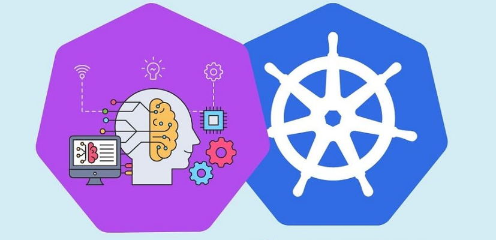
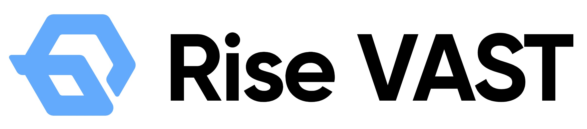

[简体中文](./README.md) · [All articles](../../README.en.md) · [Read on the website](https://www.theriseunion.com/en/blog/why-kubernetes-can-not-meet-ai-scheduling.html)

# Why K8s Cannot Meet AI Computing and Large Model Scheduling Needs

RiseUnion · January 01, 2025 at 08:00 (UTC+08:00)

In-depth analysis of Kubernetes limitations in GPU sharing, cross-node allocation, topology awareness, task prioritization, and parallel computing. Explores how Rise VAST addresses these challenges through innovative scheduling and resource management.

Summary: As a container orchestration platform, Kubernetes faces numerous challenges in AI scheduling. This article analyzes K8s limitations in six aspects: GPU resource sharing, cross-node GPU allocation, GPU topology awareness, task priority scheduling, large-scale parallel computing, and task dependency management. HAMi by RiseUnion successfully addresses these issues through innovative scheduling strategies and resource management mechanisms, providing enterprises with more efficient AI computing management solutions.

## Background

Kubernetes has become the preferred platform for General AI (GenAI) because it provides scalable, self-healing infrastructure that supports the entire lifecycle from model pre-training to deployment. Known for its container orchestration and management capabilities, it can automatically scale resources based on demand while providing self-healing capabilities to ensure high availability. Kubernetes has a rich ecosystem that seamlessly integrates with popular machine learning frameworks like PyTorch and TensorFlow, simplifying the model training process.

Additionally, it provides robust network security features to protect data and intellectual property. Through Kubernetes, enterprises can efficiently build, train, and deploy AI models, driving the development of artificial intelligence technology.

However, while Kubernetes excels in containerized applications and general computing tasks, it faces many unique challenges when handling AI computing tasks and large-scale model scheduling.

### Limitation 1: GPU Resource Sharing and Virtualization

**AI Requirements:** For scenarios where multiple tasks in AI workloads share a single GPU (such as training and inference tasks), the scheduler needs to support GPU virtualization and multi-task sharing.

**K8s Limitations:** Kubernetes' default scheduler does not directly support GPU resource virtualization (e.g., vGPU resource management). For GPU resource sharing requirements, Kubernetes can only manage through resource requests and limits but cannot effectively share GPU resources among multiple tasks.

### Limitation 2: Cross-Node GPU Resource Allocation

**AI Requirements:** For large-scale AI tasks, especially those requiring multiple GPUs, the scheduler needs to be able to coordinate GPU resource allocation across multiple nodes and optimize GPU utilization between different tasks to avoid resource idling.

**K8s Limitations:** Kubernetes' default scheduler can only consider node-level resources (such as CPU, memory, GPU, etc.) and cannot effectively manage GPU resource allocation across nodes.

### Limitation 3: GPU Topology-Aware Scheduling

**AI Requirements:** AI tasks may need to optimize GPU usage, for example, multiple GPUs need to work collaboratively within the same node, or cross-node GPU resources need to be tightly paired to reduce latency and increase bandwidth.

**K8s Limitations:** Kubernetes' default scheduler lacks explicit GPU topology awareness mechanisms and cannot intelligently identify topological relationships between GPUs (e.g., multiple GPUs on the same node or GPUs across different nodes).

### Limitation 4: Task Priority and Preemptive Scheduling

**AI Requirements:** For large-scale AI model training, some tasks may need higher priority GPU resources, while lower priority tasks may need to wait for resource release. This dynamic adjustment and preemption capability is crucial for optimizing resource usage.

**K8s Limitations:** Kubernetes' priority and preemption features are limited to CPU and memory resources, with poor support for GPU resource preemption in AI tasks.

### Limitation 5: Large-Scale Parallel Computing Scheduling

**AI Requirements:** For parallel computing tasks such as deep learning training, the scheduler needs to intelligently allocate and synchronize computing tasks, ensuring smooth task dependencies and data transfer.

**K8s Limitations:** Kubernetes itself does not directly support large-scale parallel computing scheduling, such as distributed training common in large model training, requiring special handling when performing parallel computing across multiple nodes.

### Limitation 6: Task Dependency and State-Aware Scheduling

**AI Requirements:** When training AI models, there may be complex dependencies between tasks, requiring tasks to be executed in a specific order. The scheduler should be able to sense task states and adjust scheduling based on dependencies.

**K8s Limitations:** Kubernetes does not support complex task dependency scheduling by default, and while it can be implemented through Pod and Job configurations, longer dependency chains in large AI jobs may require more control and flexibility.

## Solution: Rise VAST AI Computing Management Platform

Rise VAST is an enterprise-grade heterogeneous GPU pooling management platform developed by Beijing Rise Intelligence Technology Co., Ltd. (Rise Intelligence), aimed at helping enterprises build data center-level AI computing resource pools, improve resource utilization, and reduce AI application costs.

HAMi (Heterogeneous AI Computing Virtualization Middleware), launched in 2021, is an efficient heterogeneous AI computing management middleware. As a CNCF (Cloud Native Computing Foundation) sandbox project, HAMi demonstrates its development potential in the cloud-native ecosystem.

Recently, Rise Intelligence, as one of the core contributors to the HAMi community, partnered with 4Paradigm to launch Rise VAST, jointly expanding the AI computing market.

### Rise VAST Main Features:

- **Heterogeneous Computing Resource Pooling:** Rise VAST supports various domestic and international mainstream AI chips, including NVIDIA, AMD, Hygon DCU, Cambricon, Huawei Ascend, Moore Threads, and more, integrating these heterogeneous computing resources into a unified resource pool for management and scheduling.
- **GPU Virtualization and Computing Power Division:** Rise VAST supports virtualizing physical GPUs into multiple virtual GPUs (vGPUs), with fine-grained division of computing power and memory, down to 1% computing power and MiB-level memory.
- **Computing Power Super-Resolution and Overselling:** Rise VAST supports computing power super-resolution and overselling, breaking through physical memory limitations to support larger-scale models running on limited memory resources.
- **Intelligent Scheduling Strategies:** Rise VAST supports multiple scheduling strategies, including BestEffort, fixed ratio, minimum guarantee, and priority preemption.
- **Cloud-Native Architecture:** Rise VAST is based on cloud-native architecture, seamlessly integrating into the Kubernetes ecosystem and supporting containerized deployment.
- **Rich Monitoring and Management Tools:** Rise VAST provides visual management interfaces and rich monitoring and management tools.

## How Rise VAST Enhances Kubernetes' AI Task Scheduling Capabilities

- **GPU Resource Sharing and Virtualization:** Rise VAST supports GPU virtualization and computing power division, allowing physical GPUs to be divided into multiple vGPUs with arbitrary ratios of computing power and memory allocation. It supports various isolation policies, such as fixed quotas, dynamic quotas, and strong resource isolation.
- **Cross-Node GPU Resource Allocation:** Rise VAST can build a unified computing resource pool, integrating discrete computing servers, including training clusters, training-inference integrated clusters, and edge computing nodes. The platform supports unified management and scheduling of GPUs of different brands and models.
- **GPU Topology Awareness:** Rise VAST can sense topological relationships between GPUs and schedule based on these relationships, such as allocating multiple GPUs that need to work together to the same node or allocating GPUs to nodes with similar network topology structures for high-bandwidth connections.
- **Task Priority and Preemptive Scheduling:** Rise VAST supports task priority management, scheduling based on task priorities to ensure high-priority tasks get resources first. The platform also supports computing power preemption, allowing high-priority tasks to preempt computing power from low-priority tasks.
- **Large-Scale Parallel Computing Scheduling:** Rise VAST supports thousand-card level distributed scheduling and management capabilities, meeting the needs of large-scale parallel computing tasks such as deep learning training. The platform also supports distributed training, allocating computing tasks across multiple nodes for parallel computation.
- **Task Dependency and State-Aware Scheduling:** Rise VAST provides computing power scheduling/queue management functions, sensing task states and adjusting scheduling order based on task dependencies. The platform also supports task queue scheduling, adding tasks to queues and executing them sequentially according to dependencies.

Furthermore, leveraging the open-source HAMi community, Rise VAST continues to address compatibility issues between AI tools and frameworks in the Kubernetes ecosystem across different hardware platforms, expanding AI application deployment scope and improving AI framework compatibility and extensibility. Meanwhile, Rise VAST also contributes more enterprise-grade features back to the open-source community, continuously enhancing the influence of the HAMi community. 

> Republished from: Run:ai ["Understanding the Essential Role of RAG, Fine-Tuning, and LoRA in GenAI"](https://www.run.ai/blog/understanding-the-essential-role-of-rag-fine-tuning-and-lora-in-genai) , with some modifications.

---

[Read this article on the RiseUnion website](https://www.theriseunion.com/en/blog/why-kubernetes-can-not-meet-ai-scheduling.html) · [Explore more articles](https://www.theriseunion.com/en/blog.html)
