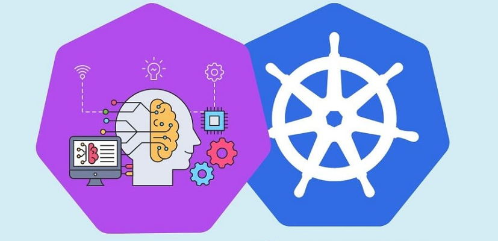
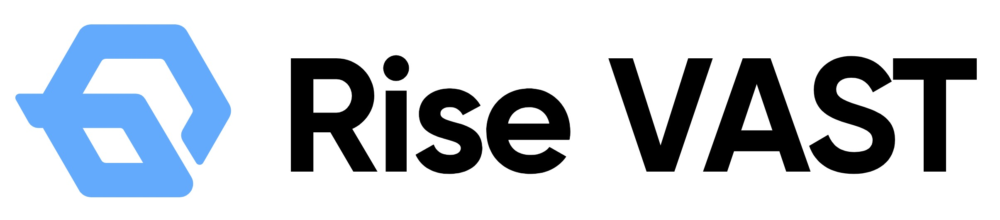

[English](./README.en.md) · [文章目录](../../README.md) · [官网阅读](https://www.theriseunion.com/zh/blog/why-kubernetes-can-not-meet-ai-scheduling.html)

# 为什么 Kubernetes 无法满足 AI 算力任务和大模型的调度需求

睿思智联 · 2024/11/14 08:00（北京时间）

深入分析Kubernetes在GPU资源共享、跨节点分配、拓扑感知、任务优先级、并行计算等方面的局限性，探讨Rise VAST如何通过创新的调度策略和资源管理机制解决这些挑战，实现高效的AI算力管理。

摘要：Kubernetes 作为容器编排平台在 AI 调度中面临诸多挑战。本文深入分析了 K8s 在 GPU 资源共享、跨节点 GPU 分配、GPU 拓扑感知、任务优先级调度、大规模并行计算以及任务依赖管理等六个方面的局限性。睿思智联 HAMi 通过创新的调度策略和资源管理机制，成功解决了这些问题，为企业提供更高效的 AI 算力管理方案。

## 背景

Kubernetes 成为通用人工智能（GenAI）平台的首选，因为它提供了可扩展的自愈基础设施，支持从模型预训练到部署的整个生命周期。它以容器编排和管理能力著称，能够自动根据需求扩展资源，同时具备自我修复能力，确保系统的高可用性。Kubernetes 拥有丰富的生态系统，与流行的机器学习框架如 PyTorch 和 TensorFlow 无缝集成，简化了模型训练过程。

此外，它还提供了强大的网络安全特性，保护数据和知识产权。通过 Kubernetes，企业能够高效地构建、训练和部署 AI 模型，推动人工智能技术的发展。

然而，尽管 Kubernetes 在容器化应用和一般计算任务中表现出色，它在处理 AI 算力任务和大规模模型调度时却面临很多独特的挑战。

### 限制 1：GPU 资源共享与虚拟化

**AI 需求:** 对于 AI 工作负载中多个任务共享单个 GPU 的情况（如训练与推理任务），调度器需要支持 GPU 的虚拟化和多任务共享。

**K8s 限制:** Kubernetes 的默认调度器并不直接支持 GPU 资源的虚拟化（例如，vGPU 资源管理）。对于共享 GPU 资源的需求，Kubernetes 只能通过资源请求和限制来管理，但无法在多个任务间有效共享 GPU 资源。

### 限制 2：跨节点的 GPU 资源分配

**AI 需求:** 对于大规模 AI 任务，尤其是需要多个 GPU 的任务，调度器需要能够跨多个节点协同分配 GPU 资源，并优化不同任务间的 GPU 利用率，避免资源闲置。

**K8s 限制:** Kubernetes 的默认调度器只能考虑节点级别的资源（如 CPU、内存、GPU 等），并不能很好地跨节点管理 GPU 资源的分配。

### 限制 3：GPU 拓扑感知调度

**AI 需求:** AI 任务可能需要优化 GPU 使用，例如，多个 GPU 需要在同一节点内协同工作，或者跨节点的 GPU 资源需要紧密配对以减少延迟和提高带宽。

**K8s 限制:** Kubernetes 默认的调度器没有明确的 GPU 拓扑感知机制，无法智能地识别 GPU 之间的拓扑关系（例如，同一节点上的多个 GPU 或不同节点之间的 GPU）。

### 限制 4：任务优先级和抢占调度

**AI 需求:** 对于大规模的 AI 模型训练，某些任务可能需要更高优先级的 GPU 资源，而低优先级任务可能需要等待资源释放。这种动态调整和抢占能力对于优化资源使用至关重要。

**K8s 限制:** Kubernetes 的优先级和抢占功能仅限于 CPU 和内存资源，对于 AI 任务中的 GPU 资源抢占支持较差。

### 限制 5：大规模并行计算的调度

**AI 需求:** 对于如深度学习训练这样的并行计算任务，调度器需要智能地分配和同步计算任务，确保任务之间的依赖关系和数据传输顺畅。

**K8s 限制:** Kubernetes 本身并不直接支持大规模的并行计算调度，如大模型训练时常见的分布式训练，跨多个节点进行并行计算时需要特殊处理。

### 限制 6：任务依赖和状态感知调度

**AI 需求:** 在训练 AI 模型时，任务间可能存在复杂的依赖关系，需要保证任务按照特定的顺序执行。调度器应该能够感知任务的状态并根据依赖关系调整调度。

**K8s 限制:** Kubernetes 默认不支持复杂的任务依赖调度，虽然可以通过 Pod 和 Job 的配置来实现，但对于依赖链较长的大型 AI 作业，可能需要更多的控制和灵活性。

## 解决之道：Rise VAST AI算力管理平台

Rise VAST 是由北京睿思智联科技有限公司（睿思智联）开发的一款企业级异构 GPU 池化管理平台，旨在帮助企业构建数据中心级 AI 算力资源池，提升资源利用率，降低 AI 应用成本。

HAMi (Heterogeneous AI Computing Virtualization Middleware 异构算力虚拟化中间件)，发起于2021年，是一款高效的异构 AI 算力管理中间件。作为 CNCF（云原生计算基金会）的沙箱项目，HAMi 展现了其在云原生生态中的发展潜力。

近日，睿思智联作为 HAMi 社区的核心贡献者之一，携手第四范式宣布推出 Rise VAST，共同拓展 AI 算力市场。

### Rise VAST 主要功能：
- **异构算力资源池化：** Rise VAST 支持多种国内外主流 AI 芯片，包括 NVIDIA、AMD、海光 DCU、寒武纪、华为昇腾、沐曦、摩尔线程、天数智芯等，可以将这些异构算力资源整合到统一的资源池中进行管理和调度。
- **GPU 虚拟化和算力切分：** Rise VAST 支持将物理 GPU 虚拟化成多个虚拟 GPU（vGPU），并可对 vGPU 进行算力和显存的细粒度切分，最小可达 1% 算力和 MiB 级显存。
- **算力超分与超卖：** Rise VAST 支持算力超分和超卖，可以突破物理显存的限制，支持更大规模的模型在有限的显存资源上运行。
- **智能调度策略：** Rise VAST 支持多种调度策略，包括 BestEffort、固定比例、最低保障和优先级抢占等。
- **云原生架构：** Rise VAST 基于云原生架构，可以无缝集成到 Kubernetes 生态系统中，支持容器化部署。
- **丰富的监控和管理工具：** Rise VAST 提供可视化的管理界面及丰富的监控和管理工具。

## Rise VAST 如何增强 Kubernetes 对 AI 任务的调度能力
- **GPU 资源共享与虚拟化：** Rise VAST 支持GPU 虚拟化和算力切分，可将物理 GPU 切分成多个 vGPU，可以任意比例分配算力和显存。支持多种隔离策略，例如固定配额、动态配额、资源强隔离等，从而实现多个任务共享单个 GPU，提高资源利用率。
- **跨节点 GPU 资源分配：** Rise VAST 能够构建统一的算力资源池，将离散的算力服务器整合到一起，包括训练集群、训推一体集群以及边缘算力节点。平台支持对不同品牌和型号的 GPU 进行统一管理和调度。
- **GPU 拓扑感知：** Rise VAST 可以感知 GPU 之间的拓扑关系，并根据拓扑关系进行调度，例如将需要协同工作的多个 GPU 分配到同一节点，或将需要高带宽连接的 GPU 分配到网络拓扑结构相近的节点。
- **任务优先级和抢占调度：** Rise VAST 支持任务优先级管理，可以根据任务的优先级进行调度，保证高优先级任务优先获得资源。平台还支持算力抢占，允许高优先级任务抢占低优先级任务的算力。
- **大规模并行计算的调度：** Rise VAST 支持千卡级别的分布式调度与管理能力，可以满足深度学习训练等大规模并行计算任务的需求。平台还可以支持分布式训练，将计算任务分配到多个节点上进行并行计算。
- **任务依赖和状态感知调度：** Rise VAST 提供算力调度/队列管理功能，可以感知任务的状态，并根据任务之间的依赖关系调整调度顺序。平台还支持任务队列调度，可以将任务添加到队列中，并按照依赖关系依次执行。

除此之外，依托开源 HAMi 社区，Rise VAST 在持续解决 Kubernetes 生态系统中的 AI 工具和框架对不同硬件平台的兼容性问题，扩大 AI 应用的部署范围，提升 AI 公交和框架的兼容性和扩展性。同时，Rise VAST 也会将更多的企业级特性回馈给开源社区，持续提升 HAMi 社区的影响力。

---

[在睿思智联官网阅读本文](https://www.theriseunion.com/zh/blog/why-kubernetes-can-not-meet-ai-scheduling.html) · [浏览更多文章](https://www.theriseunion.com/zh/blog.html)
