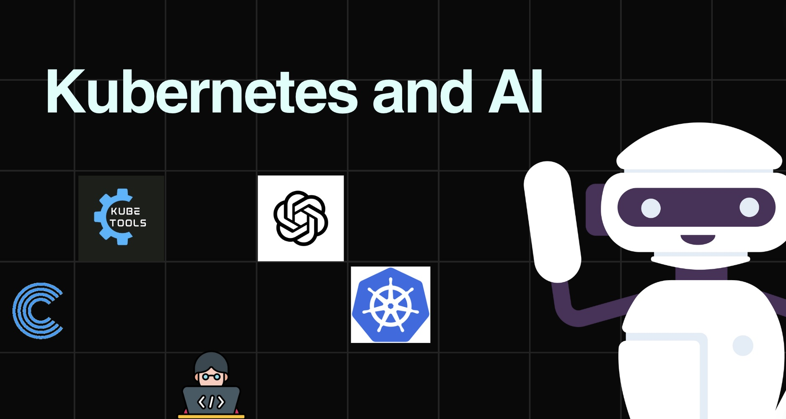
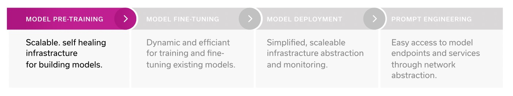
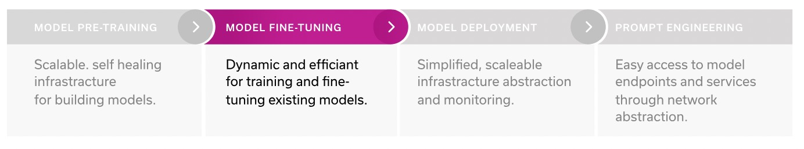
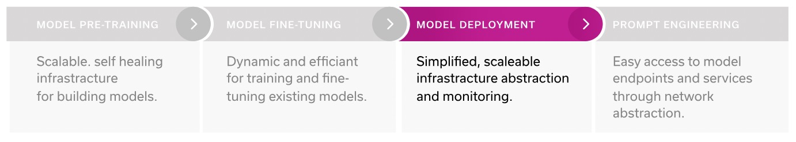
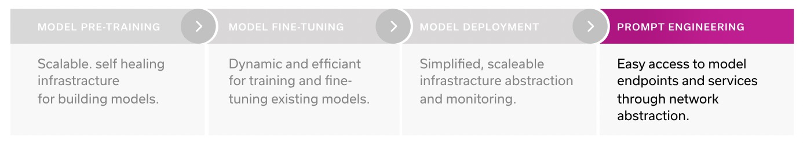

[简体中文](./README.md) · [All articles](../../README.en.md) · [Read on the website](https://www.theriseunion.com/en/blog/why-kubernetes-is-the-platform-for-genai.html)

# Why Top AI Companies Choose Kubernetes

RiseUnion · January 01, 2025 at 08:00 (UTC+08:00)

In-depth analysis of how Kubernetes supports the complete AI lifecycle, from model pre-training to deployment. Explores key features like auto-scaling and self-healing, and its seamless integration with AI frameworks, showing why it's the platform of choice for leading AI companies like OpenAI.

Summary: Kubernetes has become the preferred platform for General AI (GenAI) as it provides scalable, self-healing infrastructure supporting the entire lifecycle from model pre-training to deployment. Known for its container orchestration and management capabilities, it automatically scales resources based on demand while maintaining self-healing abilities to ensure high availability. Kubernetes features a rich ecosystem that seamlessly integrates with popular machine learning frameworks like PyTorch and TensorFlow, simplifying the model training process. Additionally, it offers robust network security features to protect data and intellectual property. Through Kubernetes, enterprises can efficiently build, train, and deploy AI models, driving the advancement of artificial intelligence technology.

## Introduction

Kubernetes is no longer just a tool for running workloads like web applications and microservices; it has become the ideal platform for supporting the end-to-end lifecycle of large AI and machine learning (ML) workloads, such as Large Language Models (LLMs).

In 2021, a Run:ai report found that 42% of respondents were using Kubernetes to handle AI/ML workflows. Last year, Red Hat found this number had increased to 65%, and this year's numbers are expected to be even higher.

This widespread adoption spans across industries: from innovative frontier companies like OpenAI to AI cloud service providers like CoreWeave, to large established brands like Shell and Spotify - all these organizations rely on Kubernetes to support their distributed AI/ML workloads. In this article, we'll explore why Kubernetes provides unique support at every stage of the AI/ML research and engineering lifecycle.

Kubernetes is best known as an efficient platform for container orchestration and management in distributed computing environments. Initially developed by Google as an open-source project to manage their internal applications, it has since become the de facto standard for deploying, scaling, and managing containerized applications across various environments.

Recently, however, Kubernetes has proven its extreme utility in new use cases: it's being adopted by organizations looking to efficiently develop, train, and deploy large language models (LLMs). Its comprehensive support throughout the LLM lifecycle brings numerous advantages, eliminating the need for complex framework integration across different tech stacks and can be used at every stage of the LLM lifecycle, from pre-training to deployment to experimentation and application building.

## Advantages at Each Stage

### Model Pre-training

During the model pre-training phase, Kubernetes lays a strong foundation by providing unmatched scalability and elasticity. Its ability to automatically scale up and down based on resource demands is one of its greatest strengths, particularly suitable for AI/ML workloads that require substantial computing power. K8s achieves this through automatic pod lifecycle management; if a pod encounters an error, it's automatically terminated and restarted - in other words, it has self-healing capabilities.

Kubernetes also supports dynamic scaling, allowing pods and nodes to be easily added or removed to meet changing workload demands. Its declarative infrastructure approach allows users to explicitly express requirements, simplifying the management process. These powerful development features are not available in other tools like Slurm, meaning you can achieve higher throughput and train models more efficiently without manually handling infrastructure limitations.

When working with LLMs and doing prompt engineering, tools like Jupyter notebooks and VS Code are essential, and Kubernetes' network abstraction capabilities make it very easy for data scientists to create development environments and connect these tools. Additionally, port forwarding and configuration management are automated, simplifying the process of providing workspaces to end users and cluster administrators' management of environments and networks.

### Model Fine-tuning

While Kubernetes has all the tools needed for developing large language models (LLMs), many enterprises today don't build models from scratch but instead customize and fine-tune existing models to suit specific business scenarios. In such cases, when you want to fine-tune existing models, Kubernetes remains the ideal choice due to its flexibility. Unlike Slurm, Kubernetes can handle multiple workloads simultaneously, making the training process more efficient.

Another advantage is Kubernetes' rich ecosystem of tools that can seamlessly integrate into the model training process. For example, tools like Kubeflow (supporting operators for Pytorch, Tensorflow, and MPI), KubeRay Operator, and MLflow can all be used in conjunction with Kubernetes to further enhance the efficiency of model fine-tuning and training.

### Model Deployment

When deploying large language models (LLMs) or inference model services, Kubernetes provides a simplified process: you only need to provide data scientists with an access endpoint. Kubernetes' network stack simplifies the process of publishing models externally, making them more accessible to the outside world. Through its rich toolset and ecosystem including load balancers, Ingress controllers, and network policies, K8s enables seamless deployment of model endpoints and easy integration into services and applications.

Infrastructure abstraction further simplifies the deployment process, ensuring scalability and auto-scaling capabilities. Kubernetes abstracts the underlying infrastructure, providing a unified API for managing containers, allowing the same tools and processes to be used regardless of where workloads run. This greatly simplifies production environment management and monitoring.

### Prompt Engineering

The advantages don't stop there. Once you've deployed your LLM model, Kubernetes provides enhanced user experience when building applications or allowing users to experiment with the model. For example, hosting applications on platforms like Gradio or Streamlit is almost effortless because there's a complete toolset specifically designed for this purpose. This simplifies the deployment process, while service endpoints and auto-scaling capabilities ensure smooth and scalable experimentation.

## Security

Throughout each stage, Kubernetes provides robust security to ensure your data and intellectual property are protected. For example, Role-Based Access Control (RBAC) implements fine-grained access control, granting appropriate permissions to users or service accounts; Pod Security Contexts allow you to set security attributes at the pod level, reducing the attack surface within clusters. These features ensure a secure environment for containers, models, and datasets throughout the AI/ML lifecycle.

## Case Studies

This isn't just theoretical - the most innovative, cutting-edge companies are running Kubernetes throughout their entire LLM lifecycle, including leading tech companies operating at massive scale (like OpenAI) and new AI cloud providers (CoreWeave, Lambda Cloud).

For example, OpenAI's cluster consists of over 7,500 nodes supporting their large language models and distributed machine learning workloads. Despite alternatives like Slurm, K8s provides them with a more favorable developer experience and cloud-native integration. It also offers flexibility and simplicity in deploying containers, managing heterogeneous nodes, and handling dynamic infrastructure elements.

> Research teams can now leverage our foundational platform built on Kubernetes to easily launch AI research projects, scale them 10x or 50x on demand, and require almost no additional effort to manage. - Christopher Berner, Head of Infrastructure at OpenAI

OpenAI runs Kubernetes across different Azure data centers, benefiting from cluster-wide MPI communicators that enable parallel jobs and batch operations between nodes. Kubernetes acts as a batch scheduling system, with its auto-scaler ensuring dynamic scaling, reducing idle node costs while maintaining low latency. Moreover, it's fast. Researchers working on distributed training systems can launch and scale experiments in days rather than months.

By adopting Kubernetes, OpenAI enjoys enhanced portability, able to easily move research experiments between clusters. The consistent API provided by Kubernetes simplifies this process. Additionally, OpenAI can leverage their own data centers in combination with Azure, saving costs and improving availability.

But you don't have to be a company of OpenAI's scale to benefit: Kubernetes has become the dominant platform for building, training, and deploying language models, revolutionizing the AI landscape. Hosting AI/ML workloads in Kubernetes offers several advantages: scalability, flexibility, network abstraction, and better user experience in experimentation. With Kubernetes, you can easily build, train, and deploy your AI/ML workloads, using the best tools and technologies that suit your needs.

> Republished from: Run:ai ["Why Kubernetes is THE platform for GenAI"](https://pages.run.ai/hubfs/PDFs/White%20Papers/Why%20Kubernetes%20is%20THE%20platform%20for%20GenAI.pdf)

---

[Read this article on the RiseUnion website](https://www.theriseunion.com/en/blog/why-kubernetes-is-the-platform-for-genai.html) · [Explore more articles](https://www.theriseunion.com/en/blog.html)
