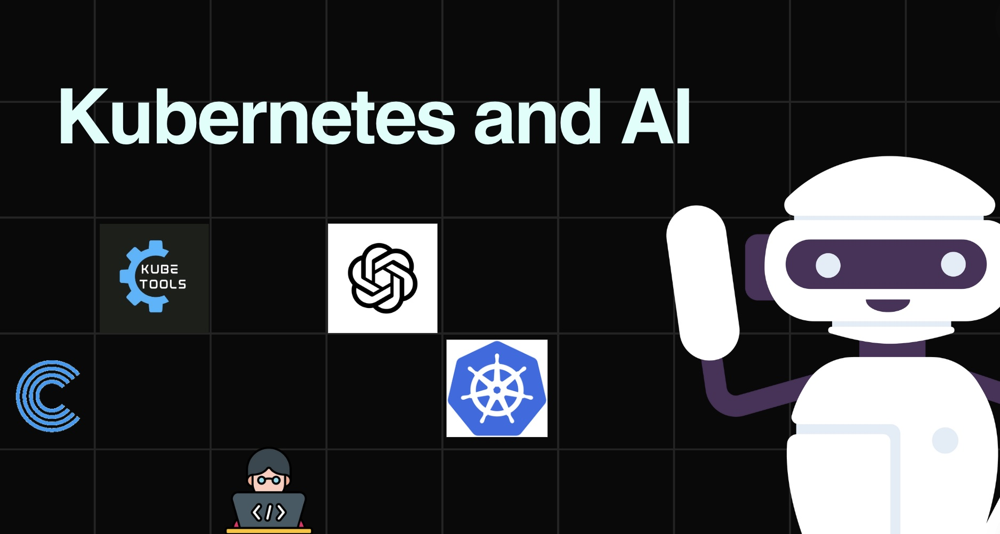
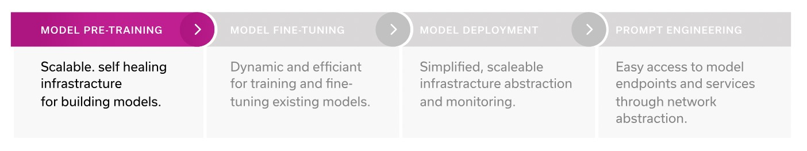
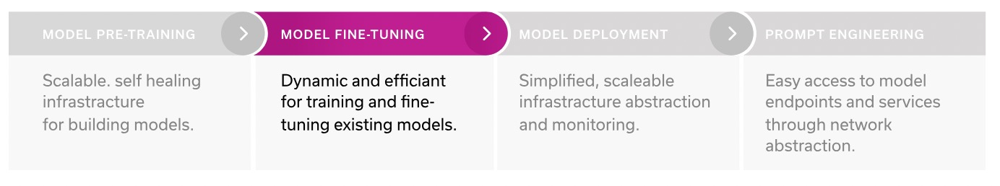
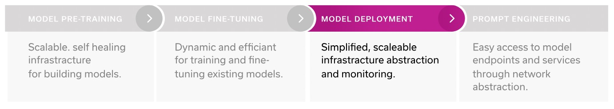
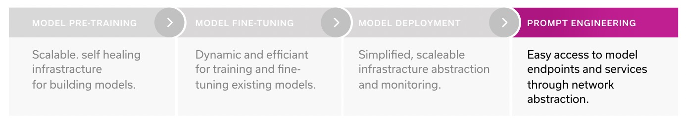

[English](./README.en.md) · [文章目录](../../README.md) · [官网阅读](https://www.theriseunion.com/zh/blog/why-kubernetes-is-the-platform-for-genai.html)

# 为什么顶级 AI 公司都在用 Kubernetes？

睿思智联 · 2024/10/22 08:00（北京时间）

深入分析Kubernetes如何支持AI全生命周期，从模型预训练到部署的优势。探讨其自动扩展、自我修复等关键特性，以及与主流AI框架的无缝集成，展示为何成为OpenAI等顶级AI公司的首选平台。

摘要：Kubernetes 成为通用人工智能（GenAI）平台的首选，因为它提供了可扩展的自愈基础设施，支持从模型预训练到部署的整个生命周期。它以容器编排和管理能力著称，能够自动根据需求扩展资源，同时具备自我修复能力，确保系统的高可用性。Kubernetes 拥有丰富的生态系统，与流行的机器学习框架如 PyTorch 和 TensorFlow 无缝集成，简化了模型训练过程。此外，它还提供了强大的网络安全特性，保护数据和知识产权。通过 Kubernetes，企业能够高效地构建、训练和部署 AI 模型，推动人工智能技术的发展。

## 介绍

Kubernetes 不再仅仅是运行工作负载的工具，例如网络应用和微服务；它是支持大型人工智能（AI）和机器学习（ML）工作负载（如大型语言模型，LLM）端到端生命周期的理想平台。

2021 年，Run:ai的一份报告发现，有 42% 的受访者表示他们使用 Kubernetes 来处理 AI/ML 工作流。去年，Red Hat 公司发现这一比例上升到了 65%，预计今年的数字还会更高。

这种广泛的采用涵盖了各行各业：从像 OpenAI 这样的创新型前沿公司，到 AI 云服务提供商 CoreWeave，再到 壳牌 和 Spotify 等大型知名品牌，所有这些组织都依赖 Kubernetes 来支持其 AI/ML 分布式工作负载。在本文中，我们将探讨为什么 Kubernetes 能够在 AI/ML 研究和工程生命周期的每个阶段提供独特的支持。

Kubernetes 最为人所知的是其作为一个在分布式计算环境中进行容器编排和管理的高效平台。它最初由 Google 开发，作为一个开源项目来管理他们的内部应用。自那时起，它已经成为在各种环境中部署、扩展和管理容器化应用的事实标准。

但最近，Kubernetes 在新的使用场景中证明了其极高的实用性：它被那些希望高效开发、训练和部署大型语言模型（LLM）的组织所采用。它在 LLM 整个生命周期中提供的全面支持，带来了诸多优势，消除了跨不同技术栈进行复杂框架集成的需求，并可用于 LLM 生命周期的每个阶段，从预训练到部署，再到实验和应用构建。

## 每个阶段的优势

### 模型预训练

在模型预训练阶段，Kubernetes 通过提供无与伦比的可扩展性和弹性，奠定了强大的基础。它根据资源需求自动扩展和缩减的能力是其最大的优势之一，尤其适用于需要大量计算能力的 AI/ML 工作负载。K8s 通过自动管理 pod 的生命周期来实现这一点；如果某个 pod 出现错误，它会被自动终止并重新启动，换句话说，它具有自我修复的能力。

Kubernetes 还支持动态扩展，可以根据需求轻松地添加或减少 pod 和节点，满足不断变化的工作负载需求。它的声明式基础设施方法允许用户明确表达需求，从而简化管理过程。这些强大的开发特性是其他工具（如 Slurm）无法提供的，这意味着你可以实现更高的吞吐量，更高效地训练模型，而不需要手动处理基础设施的限制。

在使用 LLM 和进行提示工程时，像 Jupyter notebooks 和 VS Code 这样的工具是必不可少的，而 Kubernetes 的网络抽象功能使数据科学家能够非常轻松地创建开发环境，并连接这些工具。此外，端口转发和配置管理都是自动化的，这简化了为最终用户提供工作空间的过程，以及集群管理员对环境和网络的管理。

### 模型微调

虽然 Kubernetes 具备开发大型语言模型（LLM）所需的所有工具，但如今许多企业并不从零开始构建模型，而是基于现有模型进行定制和微调以适应特定的业务场景。在这种情况下，当你希望对现有模型进行微调时，Kubernetes 仍然是理想的选择，因为它非常灵活。与 Slurm 不同，Kubernetes 能够同时处理多个工作负载，这使得训练过程更加高效。

另一个优势是 Kubernetes 丰富的工具生态系统，可以无缝集成到模型训练过程中。例如，Kubeflow（支持 Pytorch、Tensorflow 和 MPI 的操作符）、KubeRay Operator 和 MLflow 等工具，都能够与 Kubernetes 结合使用，进一步提升模型微调和训练的效率。

### 模型部署

在部署大型语言模型（LLM）或推理模型服务时，Kubernetes 提供了简化的流程：你只需为数据科学家提供一个访问的端点即可。Kubernetes 的网络栈简化了模型对外发布的过程，使其更易被外界使用。通过负载均衡器、Ingress 控制器和网络策略等丰富的工具集和生态系统，K8s 能够实现模型端点的无缝部署，并轻松集成到服务和应用中。

基础设施抽象进一步简化了部署过程，确保了可扩展性和自动扩展功能。Kubernetes 对底层基础设施进行抽象，统一提供管理容器的 API，无论工作负载运行在哪个环境中，都可以使用相同的工具和流程。这大大简化了生产环境的管理和监控。

### 提示词工程

优势还不止于此。一旦你部署了你的 LLM 模型，Kubernetes 在构建应用程序或让用户与模型进行实验时提供了增强的用户体验。例如，在 Gradio 或 Streamlit 等平台上托管应用程序几乎不费吹灰之力，因为有一个完整的工具集专门用于此目的。这简化了部署过程，同时服务端点和自动扩展能力确保了平稳且可扩展的实验。

## 安全性

在整个每个阶段，Kubernetes 都具有强大的安全性，以确保你的数据和知识产权安全。例如，基于角色的访问控制（RBAC）实现了细粒度的访问控制，授予用户或服务帐户适当的权限；Pod 安全上下文允许你在 pod 级别设置安全属性，减少集群内的攻击面。这些功能确保了 AI/ML 生命周期中容器、模型和数据集的安全环境。

## 案例

这不仅仅是理论上的——最创新的、最先进的公司正在它们的整个 LLM 生命周期上运行 Kubernetes，包括在巨大规模上运营的领先技术公司（例如 OpenAI），以及新的 AI 云提供商（Core Weave、Lambda 云）。

例如，OpenAI 的集群由超过 7,500 个节点组成，支持他们的大型语言模型和分布式机器学习工作负载。尽管有像 Slurm 这样的替代品，K8s 为他们提供了更有利的开发者体验和云原生集成。它还提供了部署容器、管理异构节点和处理动态基础设施元素的灵活性和简便性。

> 研发团队现在可以利用我们在 Kubernetes 之上构建的基础平台，轻松启动 AI 研发项目，按需将其扩展至 10 倍或 50 倍规模，并且几乎不需要额外的精力去管理。 - OpenAI 的基础设施负责人 Christopher Berner

OpenAI 在 Azure 的不同数据中心运行 Kubernetes，从集群范围的 MPI 通信器中受益，这些通信器使节点之间的并行作业和批量操作成为可能。Kubernetes 充当批量调度系统，其自动缩放器确保动态扩展，降低空闲节点成本，同时保持低延迟。此外，它非常快。从事分布式训练系统的研究人员能够在几天而不是几个月内启动和扩展实验。

通过采用 Kubernetes，OpenAI 享有增强的可移植性，可以轻松地在集群之间移动研究实验。Kubernetes 提供的一致 API 简化了这一过程。此外，OpenAI 可以利用自己的数据中心与 Azure 结合，从而节省成本并提高可用性。

但你不必像 OpenAI 那样规模的公司才能受益：Kubernetes 已成为构建、训练和部署语言模型的主导平台，彻底改变了 AI 格局。在 Kubernetes 中托管 AI/ML 工作负载提供了几个优势：可扩展性、灵活性、网络抽象以及在实验方面的更好用户体验。有了 Kubernetes，你可以轻松地构建、训练和部署你的 AI/ML 工作负载，使用最适合你需求的最佳工具和技术。

> 本文转载自: Run:ai ["Why Kubernetes is THE platform for GenAI"](https://pages.run.ai/hubfs/PDFs/White%20Papers/Why%20Kubernetes%20is%20THE%20platform%20for%20GenAI.pdf) ，有适当的修改。

---

[在睿思智联官网阅读本文](https://www.theriseunion.com/zh/blog/why-kubernetes-is-the-platform-for-genai.html) · [浏览更多文章](https://www.theriseunion.com/zh/blog.html)
